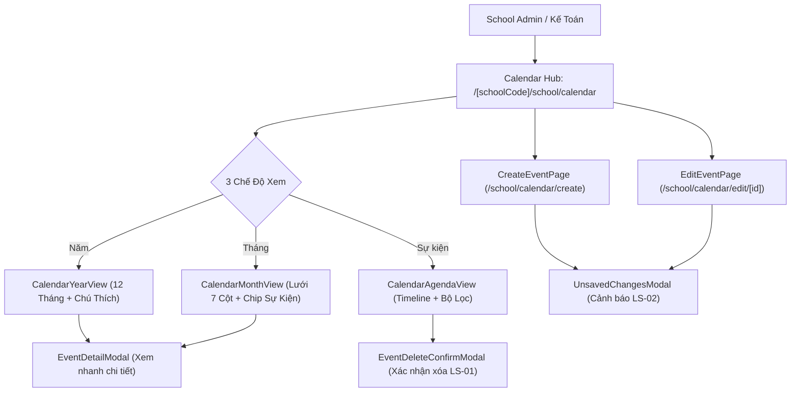

# Feature: School Event Calendar (Nhà Trường — Lịch Sự Kiện)

## Jira Story

- Story: As a School Administrator, I want to manage school events with 3 view projections (Year, Month, Agenda), 3 semantic categories, specific time toggles, inspection dialogs, and automated holiday meal refund cross-linking so that school scheduling is comprehensive and transparent.
- Jira issue type: Feature
- Acceptance owner: `benny-frontend-engineer`

## Priority

- Priority: P1
- Severity if missed: High — Essential for academic milestone planning, faculty coordination, parent engagement, and statutory meal refund calculations.

## User Value

School administrators, teachers, and accountants gain a single authoritative operational calendar supporting bird's-eye annual oversight, daily monthly inspection, and chronological agenda tracking. Holiday events tagged as Ngày nghỉ automatically inform tuition invoicing meal refund deductions without manual attendance overhead.

## PM Notes

- 3 View Modes (Năm, Tháng, Sự kiện) project from a single normalized Redux store (`calendarSlice.ts`).
- Semantic categories enforce approved ECO Design System tokens: Ngày nghỉ (`#E11D48`), Sự kiện nội bộ (`#0D9488`), Sự kiện có mời phụ huynh (`#EA580C`).
- Checkbox toggle 'Thêm thời gian' supports granular start/end time configuration (`HH:mm`).
- Event inspection modal provides quick details with a one-click pencil button to enter edit mode.
- Deletion prompts modal confirmation `LS-01` and unsaved changes trigger warning `LS-02`.

## Requirements Trace

- **FR-SCH-037:** Centralized calendar hub at `/[schoolCode]/school/calendar` with segmented 3-view switcher (BR01).
- **FR-SCH-038:** 3 fixed semantic event categories with approved design system tokens (BR02).
- **FR-SCH-039:** Wide-range calendar year selector (2021-2030+) with next/previous controls and month navigator (BR02, K014).
- **FR-SCH-040:** Year view rendering 12 miniature monthly calendars with continuous colored date highlights and bottom color legend (BR04).
- **FR-SCH-040a:** Month view providing 7-column day cell grid with multi-day continuous event chips, time badges, and cell overflow controls (BR04).
- **FR-SCH-040b:** Agenda view displaying chronological timeline with tear-off calendar date blocks, scope filter (Sắp tới vs Tất cả), and direct inline edit/delete controls (BR05, BR06).
- **FR-SCH-041:** Dedicated authoring routes `create.tsx` and `edit/[eventId].tsx` with validation engine (BR07, BR08).
- **FR-SCH-042:** Checkbox toggle 'Thêm thời gian' for specific start and end time pickers (BR08).
- **FR-SCH-043:** Deletion prompt modal `LS-01` and unsaved exit modal `LS-02` (BR09, BR10).
- **BR-SCH-CAL-04:** Cross-module interoperability linking `ngay_nghi` events with 100% meal fee refunds in Tuition Invoicing (`TASK-FIN-034`).

## Code Scope

- Contracts: `src/types/calendar.ts` (`SchoolEvent`, `SchoolEventType`, `CalendarViewMode`, `EventFormData`).
- Validation Engine: `src/utils/calendarValidation.ts` (`validateEventForm`, `filterEventsByYear`, `filterEventsByMonth`, `filterAgendaEvents`, `generateMonthGridCells`).
- Mock Seed Data: `src/services/mockCalendarData.ts` (11 comprehensive 2026 academic events).
- State Machine: `src/store/slices/calendarSlice.ts` (View mode, year/month selectors, scope filter, modal triggers, CRUD mutations).
- UI Components:
  - `src/modules/school/calendar/CalendarToolbar.tsx`
  - `src/modules/school/calendar/CalendarYearView.tsx`
  - `src/modules/school/calendar/CalendarMonthView.tsx`
  - `src/modules/school/calendar/CalendarAgendaView.tsx`
  - `src/modules/school/calendar/EventDetailModal.tsx`
  - `src/modules/school/calendar/EventDeleteConfirmModal.tsx`
  - `src/modules/school/calendar/UnsavedChangesModal.tsx`
  - `src/modules/school/calendar/EventForm.tsx`
- Page Routes:
  - `src/pages/[schoolCode]/school/calendar/index.tsx`
  - `src/pages/[schoolCode]/school/calendar/create.tsx`
  - `src/pages/[schoolCode]/school/calendar/edit/[eventId].tsx`
- Navigation: `src/components/layout/PortalLayout.tsx`.

## Relationship Map

| Relation | Target | Label | Rationale |
|---|---|---|---|
| IMPLEMENTS | `E-020-school-calendar` | `IMPLEMENTS` | Implements the School Event Calendar epic. |
| USES | `M-020-001-school-calendar` | `USES` | Consumes the calendar module architecture. |
| ENABLES | `P-020-001-school-calendar` | `ENABLES` | Enables the calendar hub and authoring pages. |
| RELATES_TO | `F-009-001-finance-invoices` | `RELATES_TO` | Holiday events inform meal refund deductions. |

## Mermaid Diagram

## Verification

- Automated Tests: `node --test tests/unit/calendar.test.mjs` verifying 15 test assertions.
- Production Build: `npm run build` static compilation of all 54 Next.js routes.
- Full Suite: All 339 tests passing with zero regressions across the codebase.

## Work Log

- Date: 2026-10-06
  - Action: Delivered complete functional implementation of the School Event Calendar.
  - Agent/skill: `benny-frontend-engineer`
  - Evidence: Verified via 15 passing tests in `tests/unit/calendar.test.mjs`.
  - Docs updated before code: `docs/prd.md`, `docs/tasks.md`.

## Change Log

- Date: 2026-10-06
  - Code change: Implemented data contracts, pure utils, Redux slice, 8 UI components, and 3 page routes.
  - Documentation update: Updated feature document, doc sync note, and manifest.
  - Evidence: `tests/unit/calendar.test.mjs`.

