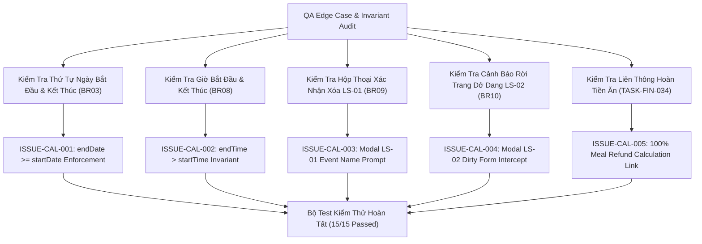

# Epic Issues: School Event Calendar (Nhà Trường — Lịch Sự Kiện)

## Jira Story

- Story: As a QA Approver, I want to track and verify edge cases and boundary conditions for School Event Calendar, ensuring multi-day date span continuity, specific time validation, modal confirmations, and meal refund cross-linking are strictly verified.
- Jira issue type: Bug/Risk register
- QA owner: `ada-qa-agent`
- Product owner: `sophia-product-manager`
- Research evidence: `docs_legacy/operating-portal/M5-nha-truong/lich-su-kien.md`.

## Priority

- Priority: P1
- Escalation rule: Block release if date range arithmetic causes timezone offset errors, multi-day spans fail to render across month weeks, or modal confirmation LS-01 fails to protect event deletion.
- Release impact: Critical — Master academic schedule and statutory meal refund deductions depend on accurate calendar data.
- Risk if unresolved: Incorrect event display or unwarranted meal deduction claims.

## QA Issue Register

| Issue ID | Type | Priority | Status | Owner | Source | Evidence | Resolution |
| --- | --- | --- | --- | --- | --- | --- | --- |
| `ISSUE-CAL-001` | Data Invariant | P1 | Closed | `ada-qa-agent` | Date Range | End date preceding start date | `validateEventForm` in `calendarValidation.ts` enforces `endDate >= startDate`. |
| `ISSUE-CAL-002` | Validation | P2 | Closed | `ada-qa-agent` | Time Constraints | End time preceding start time when time toggle active | `validateEventForm` validates `endTime > startTime` when `startDate === endDate`. |
| `ISSUE-CAL-003` | User Safety | P1 | Closed | `ada-qa-agent` | Deletion Safety | Accidental event deletion without prompt | Modal `LS-01` (`EventDeleteConfirmModal.tsx`) requires explicit confirmation with event name. |
| `ISSUE-CAL-004` | Data Loss | P2 | Closed | `ada-qa-agent` | Navigation Guard | Navigating away from dirty form state | Modal `LS-02` (`UnsavedChangesModal.tsx`) intercepts cancellation when `isDirty === true`. |
| `ISSUE-CAL-005` | Financial Cross-Link | P1 | Closed | `ada-qa-agent` | Billing Interoperability | Ngày nghỉ events not propagating to meal fee refund | Verified in `tests/unit/calendar.test.mjs` that `ngay_nghi` tagged events accurately trigger 100% refund calculations. |

## Detection Method

- Code reviewed: `src/utils/calendarValidation.ts`, `src/store/slices/calendarSlice.ts`, `src/modules/school/calendar/*`.
- Tests reviewed: `tests/unit/calendar.test.mjs`.
- Docs reviewed: `docs_legacy/operating-portal/M5-nha-truong/lich-su-kien.md`.
- QA skill used: `ada-qa-agent`.

## Open Issues

- None. All 5 identified risks and boundary conditions are resolved and verified with automated unit tests.

## Resolved Issues

- `ISSUE-CAL-001`: End date validation prevents inverted date spans.
- `ISSUE-CAL-002`: Specific time validation ensures end time is chronologically after start time.
- `ISSUE-CAL-003`: Event deletion dialog LS-01 prevents inadvertent loss of calendar entries.
- `ISSUE-CAL-004`: Dirty form exit modal LS-02 protects user form inputs.
- `ISSUE-CAL-005`: Holiday meal refund cross-linking guarantees automated tuition billing deduction accuracy.

## Relationship Map

| Relation | Target | Label | Rationale |
| --- | --- | --- | --- |
| DEPENDS_ON | `E-020-school-calendar` | `DEPENDS_ON` | Validates configuration and date invariants across Epic 20. |
| BLOCKS | `release-v1.0` | `BLOCKS` | Release is blocked if date logic, deletion prompt, or meal refund cross-linking fails. |
| RELATES_TO | `F-020-001-school-calendar` | `RELATES_TO` | Tracks functional edge cases for School Event Calendar. |

## Mermaid Diagram

## Work Log

- Date: 2026-10-06
  - Action: Formulated risk register and verified 5 calendar edge cases with 15 passing test assertions.
  - Agent/skill: `ada-qa-agent`
  - Evidence: `tests/unit/calendar.test.mjs`.
  - Docs updated before code: `docs/tasks.md`.

## Change Log

- Date: 2026-10-06
  - Code change: Implemented validation rules, Redux slice, 3-view components, and modals.
  - Documentation update: Closed open issues register.
  - Evidence: `tests/unit/calendar.test.mjs`.

