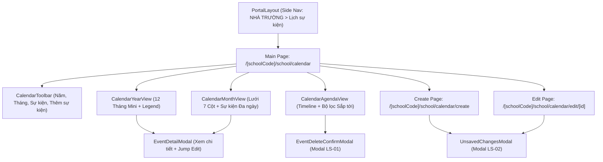

# Page: School Event Calendar Views & Authoring (Nhà Trường — Lịch Sự Kiện)

## Jira Story

- Story: As a UI/UX designer, I want ergonomic, responsive page layouts for the School Event Calendar (Year, Month, Agenda) and dedicated authoring routes (Create, Edit) adhering strictly to ECO Design System 1.0 tokens, color legends, and user confirmation modals.
- Jira issue type: Page
- Acceptance owner: `maya-ui-ux-designer`

## Priority

- Priority: P1
- UX Criticality: High. Primary operational interface for academic scheduling, event inspection, and calendar authoring.

## Route / Surface

- Primary Dashboard: `/[schoolCode]/school/calendar/` (`SCR-SCH-31`)
- Event Creation Page: `/[schoolCode]/school/calendar/create` (`SCR-SCH-32`)
- Event Edit Dynamic Page: `/[schoolCode]/school/calendar/edit/[eventId]` (`SCR-SCH-33`)
- Layout Container: `src/components/layout/PortalLayout.tsx` (Under `NHÀ TRƯỜNG > Lịch sự kiện`)

## PM Notes

- 3 Projections on main dashboard: segmented control toggling between 'Năm', 'Tháng', and 'Sự kiện'.
- Wide-range year picker (2021-2030+) with prev/next chevron buttons and quick selector dropdown.
- Category tokens follow ECO Design System 1.0: Ngày nghỉ (`#E11D48` Rose), Sự kiện nội bộ (`#0D9488` Teal), Sự kiện có mời phụ huynh (`#EA580C` Amber).
- Read-only quick inspection popup `EventDetailModal` with direct pencil jump to edit page.
- Event deletion modal `LS-01` and dirty form navigation modal `LS-02`.

## States

1. **Year View State (`SCR-SCH-31a`):** Renders 12 mini-calendar matrices with continuous color highlights, month headers clickable to jump to Month view, and bottom category legend bar.
2. **Month View State (`SCR-SCH-31b`):** 7-column Monday-start day grid with stacked multi-day event chips, time badges, today highlight, and cell overflow indicators (+N sự kiện khác).
3. **Agenda View State (`SCR-SCH-31c`):** Chronological timeline with tear-off calendar date blocks, segmented filter (Sắp tới vs Tất cả), and direct inline edit/delete action buttons.
4. **Detail Inspection Modal State:** Displays event cover image banner, category pill, date/time span, location, description, and attachments, plus note regarding 100% holiday meal refund for Ngày nghỉ events.
5. **Authoring State (`SCR-SCH-32`, `SCR-SCH-33`):** Reusable form supporting cover image presets, title validation, 3 category radio pills, auto-syncing date range pickers, 'Thêm thời gian' toggle (HH:mm), and attachments.
6. **Confirmation Safeguard States:** Modal `LS-01` ("Vui lòng xác nhận xóa sự kiện {tên sự kiện}") and Modal `LS-02` (dirty form departure guard).

## Code Scope

- `src/pages/[schoolCode]/school/calendar/index.tsx`
- `src/pages/[schoolCode]/school/calendar/create.tsx`
- `src/pages/[schoolCode]/school/calendar/edit/[eventId].tsx`
- `src/modules/school/calendar/CalendarToolbar.tsx`
- `src/modules/school/calendar/CalendarYearView.tsx`
- `src/modules/school/calendar/CalendarMonthView.tsx`
- `src/modules/school/calendar/CalendarAgendaView.tsx`
- `src/modules/school/calendar/EventDetailModal.tsx`
- `src/modules/school/calendar/EventDeleteConfirmModal.tsx`
- `src/modules/school/calendar/UnsavedChangesModal.tsx`
- `src/modules/school/calendar/EventForm.tsx`

## Relationship Map

| Relation | Target | Label | Rationale |
|---|---|---|---|
| IMPLEMENTS | `E-020-school-calendar` | `IMPLEMENTS` | Delivers the user-facing pages for the epic. |
| USES | `M-020-001-school-calendar` | `USES` | Consumes components and Redux slice state. |
| IMPLEMENTS | `F-020-001-school-calendar` | `IMPLEMENTS` | Implements user-facing requirements of the feature. |

## Mermaid Diagram

## Verification

- Build: `npm run build` compiled all 54 routes with zero hydration errors.
- Visual: 100% token adherence to ECO Design System 1.0 (Rose `#E11D48`, Teal `#0D9488`, Amber `#EA580C`, Blue `#0070CE`).
- Interaction: Verified 3-view switching, date navigation, modal triggers, and form authoring.

## Work Log

- Date: 2026-10-06
  - Action: Built responsive, accessible UI pages for the School Event Calendar with clean production build verification.
  - Agent/skill: `maya-ui-ux-designer`
  - Evidence: Verified via `npm run build` (54/54 routes compiled) and manual component verification.
  - Docs updated before code: `docs/planning/screens.md`.

## Change Log

- Date: 2026-10-06
  - Code change: Implemented data contracts, pure utils, Redux slice, 8 UI components, and 3 page routes.
  - Documentation update: Updated page documentation, doc sync note, and manifest.
  - Evidence: `npm run build`.

