# Task: Implement School Event Calendar (Nhà Trường — Lịch Sự Kiện)

## Jira Story

- Story: As a frontend engineer, I want to implement all TypeScript contracts, pure validation logic, Redux state machine, 3-view calendar components, authoring pages, and automated unit tests for School Event Calendar with full test coverage.
- Jira issue type: Task
- Acceptance owner: `benny-frontend-engineer`

## Priority

- Priority: P1
- Execution status: Completed.

## Objective

Deliver the complete frontend implementation of Sub-module Lịch Sự Kiện under Module M5: Nhà Trường in Next.js (Pages Router) and Redux Toolkit, providing 3 viewing perspectives (Year, Month, Agenda), 3 semantic event categories, date span calculations, specific time toggles, modal dialogs, and automated holiday meal refund cross-linking.

## Implementation Commentary

1. **Contracts & Validation:** Implemented `src/types/calendar.ts` and pure date helper functions in `src/utils/calendarValidation.ts` covering form validation, day span calculation, Monday-start month grid generation, and category aggregation.
2. **Redux State Machine:** Authored `src/store/slices/calendarSlice.ts` managing normalized events, view modes (`nam`, `thang`, `su_kien`), year and month pagination, scope filtering, modal inspection, and CRUD actions. Registered in `src/store/index.ts`.
3. **Component Hierarchy:** Built eight components in `src/modules/school/calendar/`:
   - `CalendarToolbar.tsx`: Top bar with Year selector (2021-2030+), Month nav, 3-view segmented switcher, and '+ Thêm sự kiện' CTA.
   - `CalendarYearView.tsx`: 12-month miniature matrix with continuous color highlight spans, month click jumps, and bottom color legend bar.
   - `CalendarMonthView.tsx`: 7-column day cell grid with multi-day continuous event chips, time badges, and cell overflow controls.
   - `CalendarAgendaView.tsx`: Chronological timeline with tear-off calendar date blocks, scope filter (Sắp tới vs Tất cả), and direct inline edit/delete controls.
   - `EventDetailModal.tsx`: Read-only inspection popup with pencil jump to edit page.
   - `EventDeleteConfirmModal.tsx`: Confirmation dialog `LS-01` before permanent event deletion.
   - `UnsavedChangesModal.tsx`: Navigation departure safeguard `LS-02`.
   - `EventForm.tsx`: Reusable authoring form with cover image presets, title validation, 3 category radio pills, auto-syncing date pickers, 'Thêm thời gian' toggle (HH:mm), and attachments.
4. **Page Surfaces & Routing:** Built `src/pages/[schoolCode]/school/calendar/index.tsx`, `src/pages/[schoolCode]/school/calendar/create.tsx`, and `src/pages/[schoolCode]/school/calendar/edit/[eventId].tsx`. Integrated navigation item in `src/components/layout/PortalLayout.tsx`.
5. **Testing & Build Verification:** Authored 15 automated test assertions in `tests/unit/calendar.test.mjs` (15/15 passing in 103ms) and verified full repository suite (339/339 passing). Verified clean Next.js static build `npm run build` compiling all 54/54 static and dynamic routes.

## Write Scope

- Data contracts: `src/types/calendar.ts`
- Business logic: `src/utils/calendarValidation.ts`
- Mock store: `src/services/mockCalendarData.ts`
- State machine: `src/store/slices/calendarSlice.ts`
- Store registration: `src/store/index.ts`
- Components:
  - `src/modules/school/calendar/CalendarToolbar.tsx`
  - `src/modules/school/calendar/CalendarYearView.tsx`
  - `src/modules/school/calendar/CalendarMonthView.tsx`
  - `src/modules/school/calendar/CalendarAgendaView.tsx`
  - `src/modules/school/calendar/EventDetailModal.tsx`
  - `src/modules/school/calendar/EventDeleteConfirmModal.tsx`
  - `src/modules/school/calendar/UnsavedChangesModal.tsx`
  - `src/modules/school/calendar/EventForm.tsx`
- Pages:
  - `src/pages/[schoolCode]/school/calendar/index.tsx`
  - `src/pages/[schoolCode]/school/calendar/create.tsx`
  - `src/pages/[schoolCode]/school/calendar/edit/[eventId].tsx`
- Layout: `src/components/layout/PortalLayout.tsx`
- Tests: `tests/unit/calendar.test.mjs`

## Relationship Map

| Relation | Target | Label | Rationale |
|---|---|---|---|
| IMPLEMENTS | `E-020-school-calendar` | `IMPLEMENTS` | Implements the core engineering scope of Epic 20. |
| IMPLEMENTS | `F-020-001-school-calendar` | `IMPLEMENTS` | Realizes functional requirements for calendar management. |
| USES | `M-020-001-school-calendar` | `USES` | Uses module contracts, slice, and validation helpers. |

## Mermaid Diagram

```mermaid
flowchart LR
    Task["T-020-001-001 Engineering Task"] --> Contracts["Data Contracts (types/calendar.ts)"]
    Contracts --> Validation["Validation Engine (calendarValidation.ts)"]
    Validation --> Redux["Redux Slice (calendarSlice.ts)"]
    Redux --> Components["Calendar UI Components (8 Files)"]
    Components --> Pages["Next.js Pages (index, create, edit)"]
    Pages --> Tests["Unit Test Suite (15/15 Passed)"]
    Tests --> Build["Production Build (54/54 Compiled)"]
```

## Verification Evidence

- Command: `node --test tests/unit/calendar.test.mjs`
  - Output: 15/15 tests passing in 103ms.
- Command: `node --test tests/unit/*.test.mjs`
  - Output: 339/339 tests passing across all 20 modules with zero regressions.
- Command: `npm run build`
  - Output: Clean compilation of all 54/54 routes including calendar index, create, and edit pages.

## Handoff

- Handoff Target: Production release and QA sign-off.
- Target Release: Phase 1 — Enterprise Operational Readiness.
- Known Limitations: None.
- Maintenance Notes: Event categories are fixed to 3 semantic types; any future categories require updating `EVENT_CATEGORY_MAP` and tuition fee holiday refund integrations.

## Work Log

- Date: 2026-10-06
  - Action: Built and verified complete School Event Calendar sub-module with 15 passing tests and clean build.
  - Agent/skill: `benny-frontend-engineer`
  - Evidence: `tests/unit/calendar.test.mjs`.
  - Docs updated before code: `docs/tasks.md`.

## Change Log

- Date: 2026-10-06
  - Code change: Implemented data contracts, pure utils, Redux slice, 8 UI components, and 3 page routes.
  - Documentation update: Updated task documentation, doc sync note, and manifest.
  - Evidence: `tests/unit/calendar.test.mjs`.

