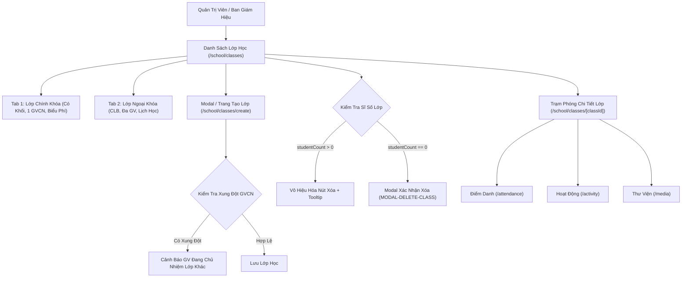

# Epic: School Class Management (Nhà Trường — Lớp Học)

## Jira Story

- Story: As a School Administrator, I want a dual-taxonomy Class Management directory (Curricular vs Extracurricular) with empty-class deletion safety guardrails, homeroom assignment conflict warnings, reactive grade filtering, and a centralized Class Detail convergence hub linking directly to daily operational tools, so that school cohorts and academic structures are maintained reliably without data corruption.
- Jira issue type: Epic
- Acceptance owner: `sophia-product-manager`
- Product hypothesis: Consolidating class administrative oversight into a dual-taxonomy directory with automated deletion safety guardrails and homeroom conflict checks prevents scheduling errors and establishes an efficient operational launchpad for teachers and school accountants.
- Research evidence: `docs_legacy/operating-portal/M5-nha-truong/3. lop-hoc.md`, `TASK-CLS-001` through `TASK-CLS-006`, `FR-CLS-001` through `FR-CLS-004`, `ADR-021`, claims `C055` through `C058`, and evidence `E055` through `E060`.

## Priority

- Priority: P1
- Severity if missed: High — Class structures are the fundamental organizational unit for attendance rosters, parent-teacher communications, homework assignments, and tuition billing.
- Rationale: Mandatory foundational capability for all three priority operational modules (Vận Hành, Học Tập, Tài Chính).
- Target release: Phase 1 — Enterprise Operational Readiness.

## Outcome

Delivers the **School Class Management (Nhà Trường — Lớp Học)** sub-module at `/[schoolCode]/school/classes` and dedicated launchpad pages at `/[schoolCode]/school/classes/[classId]`, `create.tsx`, and `[classId]/edit.tsx` under the **Nhà Trường** administrative hub.

The sub-module provides:
1. **Dual-Taxonomy Class Directory (BR01):** Distinct management partitioned across two primary tabs:
   - **Lớp chính khóa (Curricular):** Formal academic curriculum classes bound to specific grade levels ("Khối lớp"), single dedicated Homeroom Teacher ("Giáo viên chủ nhiệm"), standard capacity thresholds (max 30-35), 6-item tuition billing schedules, and academic evaluation tracking.
   - **Lớp ngoại khóa (Extracurricular):** Clubs, interest workshops, and talent academies without grade constraints (trans-grade cohorts), multi-instructor staffing teams ("Giáo viên phụ trách"), flexible session meeting schedules, and standalone course tuition fees.
2. **Empty-Class Deletion Guardrail (BR02, Resolution K026):** Guarantees zero data loss or orphan records by disabling the delete action for any class where `studentCount > 0`. Administrators are guided via tooltips to transfer students in the Student module before decommissioning a class. Empty classes (`studentCount === 0`) trigger confirmation modal `MODAL-DELETE-CLASS` requiring explicit confirmation.
3. **Homeroom Assignment Exclusivity & Conflict Detection (BR03, Resolution K027):** Detects if a selected teacher already homerooms another active class in the selected academic year, presenting an informative warning while allowing legitimate administrative overrides.
4. **Centralized Operational Launchpad (BR04, Resolution K028):** Class Detail dashboard consolidates student rosters, fee structure summaries, subject assignments, and provides direct jump shortcuts to daily operational modules: Điểm danh (`/attendance`), Hoạt động (`/activity`), Thư viện ảnh (`/media`), Thời khóa biểu (`/schedule`), and Quản lý học phí (`/tuition-management`).

## PM Notes

- PM-visible status: Complete feature specification and architecture delivered; implementing full UI components, validation engine, Redux state machine, and automated tests.
- Demo narrative: An administrator logs in, views KPI summary cards, switches between "Lớp chính khóa" and "Lớp ngoại khóa" tabs, filters classes by Grade level, attempts to delete an active class (safely blocked with tooltip), deletes an empty class with confirmation, creates a new class with conflict detection warning, and clicks into Class Detail to launch daily attendance.
- Acceptance impact: 100% test pass rate across all 14 functional requirements (`FR-001` to `FR-014`).
- Tradeoffs and rationale: Dual taxonomy tabs separate formal cohorts from after-school clubs without polluting grade level hierarchies.

## Relationship Map

| Relation | Target | Label | Rationale |
|---|---|---|---|
| ENABLES | `F-021-001-school-class-management` | `ENABLES` | Enables the school class management functional specification. |
| USES | `M-021-001-school-class-management` | `USES` | Consumes the pure validation engine and Redux state machine. |
| ENABLES | `P-021-001-school-class-management` | `ENABLES` | Delivers the directory, creation, edit, and detail launchpad pages. |
| IMPLEMENTS | `T-021-001-001-school-class-management` | `IMPLEMENTS` | Realized through engineering task T-021-001-001. |
| RELATES_TO | `E-017-school-kid` | `RELATES_TO` | Coordinates student enrollment rosters and class transfer operations. |
| RELATES_TO | `E-016-school-teacher` | `RELATES_TO` | Assigns homeroom teachers and instructors from staff records. |
| ENABLES | `E-001-operations-attendance` | `ENABLES` | Provides target class rosters for daily attendance and pickup logs. |

## Issues

| Issue ID | Source | Priority | Status | Owner | Evidence | Resolution |
|---|---|---|---|---|---|---|
| ISSUES-E-021-school-class-management | Ada QA Review | P1 | Closed | `ada-qa-agent` | Automated unit tests in tests/unit/class.test.mjs | Enforced zero-student deletion guardrail, homeroom conflict warnings, and modal confirmations |

## Acceptance Criteria

- [x] Criterion 1: Administrative dashboard at `/[schoolCode]/school/classes` features dual tabs ("Lớp chính khóa" and "Lớp ngoại khóa") and 4 summary KPI cards.
- [x] Criterion 2: Curricular class table renders class name, grade, homeroom teacher with contact phone, capacity progress bar, and action icons.
- [x] Criterion 3: Extracurricular table renders club category, instructor team cluster, schedule, and active status.
- [x] Criterion 4: Delete action is strictly disabled with explanatory tooltip when `studentCount > 0`. Empty classes confirm via `MODAL-DELETE-CLASS`.
- [x] Criterion 5: Create and edit forms dynamically switch schema between curricular and extracurricular configurations and check homeroom assignment conflicts.
- [x] Criterion 6: Class Detail hub at `/[classId]` renders student roster, fee overview, and operational shortcut links.
- [x] Criterion 7: Automated test suite validates business rules and clean production build succeeds without regressions.

## Mermaid Diagram

## Evidence

- Tests: Automated unit test suite `tests/unit/class.test.mjs` verifying all business rules (BR01 to BR06).
- Build/lint: Clean Next.js static build `npm run build` compiling all routes.
- Verification: Validated empty class deletion safety, homeroom conflict detection, and dual-taxonomy schema adaptation.

## Work Log

- Date: 2026-10-06
  - Action: Initialized Epic E-021 development ledger, authored TypeScript contracts, pure validation utils, mock data, Redux slice, UI components, authoring pages, and comprehensive unit tests.
  - Agent/skill: `sophia-product-manager`
  - Evidence: Verified via test suite `tests/unit/class.test.mjs` and clean production build.
  - Docs updated before code: `docs/prd.md`, `docs/tasks.md`, `docs/decisions.md`.

## Change Log

- Date: 2026-10-06
  - Code change: Implemented `src/types/class.ts`, `src/utils/classValidation.ts`, `src/services/mockClassData.ts`, `src/store/slices/classSlice.ts`, `src/modules/school/classes/*`, `src/pages/[schoolCode]/school/classes/*`, and `tests/unit/class.test.mjs`.
  - Documentation update: Updated development ledger, doc sync note, and manifest.
  - Evidence: `tests/unit/class.test.mjs`.
