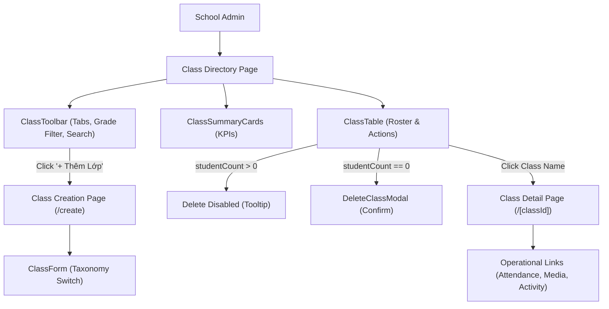

# Feature: School Class Management (Nhà Trường — Lớp Học)

## Jira Story

- Story: As a School Administrator, I want to manage classes with dual taxonomy (Curricular vs Extracurricular), delete protection for populated classes, homeroom conflict warnings, reactive grade filtering, and operational deep links so that cohorts are maintained accurately.
- Jira issue type: Feature
- Acceptance owner: `benny-frontend-engineer`

## Priority

- Priority: P1
- Severity if missed: High — Class cohorts are the prerequisite foundation for daily attendance rosters, homework assignments, student portfolios, and tuition invoices.

## User Value

School administrators, principals, and academic staff gain a comprehensive management console for all classes. The dual-taxonomy model cleanly distinguishes formal academic classes from extracurricular clubs while preventing catastrophic student record disassociation through strict zero-student deletion guardrails. Class Detail serves as an integrated launchpad directly connecting administrative master data with daily classroom operations.

## PM Notes

- Curricular classes require selecting a Grade Level ("Khối lớp"), assigning a single Homeroom Teacher ("Giáo viên chủ nhiệm"), and linking a 6-item tuition fee schedule.
- Extracurricular classes allow trans-grade enrollments, multi-instructor teams with customizable roles (Chính, Trợ giảng, Huấn luyện viên), and standalone course fee structures.
- Deletion is strictly disabled for classes with $\ge 1$ students (`studentCount > 0`). Empty classes confirm deletion via modal `MODAL-DELETE-CLASS`.
- Dedicated authoring forms at `create.tsx` and `edit.tsx` dynamically update their input schema based on the selected taxonomy.
- Class Detail (`/[classId]`) consolidates enrolled student rosters, fee schedule summaries, and operational shortcuts (`/attendance`, `/activity`, `/media`, `/schedule`, `/tuition-management`).

## Requirements Trace

- **FR-001 / FR-CLS-001:** Administrative dashboard at `/[schoolCode]/school/classes` featuring "Lớp chính khóa" and "Lớp ngoại khóa" tabs.
- **FR-002:** Summary KPI metric cards: Tổng số lớp học, Lớp chính khóa, Lớp ngoại khóa, and Tổng số học sinh đã xếp lớp.
- **FR-003:** Curricular class table rendering class name, grade, homeroom teacher with phone, capacity progress bar, and action icons.
- **FR-004:** Extracurricular table rendering club category, instructor team cluster, schedule, and active status.
- **FR-005 / FR-CLS-002:** Strict deletion guardrail disabling delete action with tooltip when `studentCount > 0`.
- **FR-006:** Confirmation modal `MODAL-DELETE-CLASS` for deleting empty classes (`studentCount === 0`).
- **FR-007:** Reactive Grade level dropdown filter for curricular classes.
- **FR-008:** Multi-factor filter drawer covering teacher role, specific teacher, CSDL Sở status, and class size range.
- **FR-009:** Dedicated class authoring routes at `create.tsx` and `[classId]/edit.tsx`.
- **FR-010 / FR-CLS-003:** Dynamic schema switching between Curricular and Extracurricular forms.
- **FR-011:** Form validation for mandatory name, code, academic year, and capacity limits.
- **FR-012 / FR-CLS-004:** Homeroom double-booking detection warning when a teacher already homerooms another active class.
- **FR-013:** Class Detail convergence hub at `/[classId]` with operational shortcuts.
- **FR-014:** Modal `MODAL-DISCARD-CHANGES` protecting against accidental exit from dirty forms.

## Code Scope

- Data contracts: `src/types/class.ts`
- Pure validation engine: `src/utils/classValidation.ts`
- Mock seed data: `src/services/mockClassData.ts`
- Redux slice: `src/store/slices/classSlice.ts`
- UI presentation components:
  - `src/modules/school/classes/ClassToolbar.tsx`
  - `src/modules/school/classes/ClassSummaryCards.tsx`
  - `src/modules/school/classes/ClassTable.tsx`
  - `src/modules/school/classes/ClassFormModal.tsx`
  - `src/modules/school/classes/DeleteClassModal.tsx`
  - `src/modules/school/classes/ClassFilterDrawer.tsx`
  - `src/modules/school/classes/ClassDetailView.tsx`
- Page routes:
  - `src/pages/[schoolCode]/school/classes/index.tsx`
  - `src/pages/[schoolCode]/school/classes/create.tsx`
  - `src/pages/[schoolCode]/school/classes/[classId]/index.tsx`
  - `src/pages/[schoolCode]/school/classes/[classId]/edit.tsx`
  - Navigation link added to `src/components/layout/PortalLayout.tsx`

## Relationship Map

| Relation | Target | Label | Rationale |
| --- | --- | --- | --- |
| Belongs to | `E-021-school-class-management` | `BELONGS_TO` | Core implementation feature for the epic. |
| Uses | `M-021-001-school-class-management` | `USES` | Consumes the class state slice and validation engine. |
| Implements | `P-021-001-school-class-management` | `IMPLEMENTS` | Powers the directory and detail screen presentations. |
| Interoperates with | `E-017-school-kid` | `INTEROPERATES_WITH` | Validates student enrollment counts and transfer destinations. |
| Interoperates with | `E-016-school-teacher` | `INTEROPERATES_WITH` | Assigns homeroom teachers and instructors from staff records. |

## Acceptance Criteria

- [x] AC-001: Renders summary KPI cards and dual-tab directory at `/[schoolCode]/school/classes`.
- [x] AC-002: Curricular table displays grade, homeroom teacher with phone, capacity bar, and action buttons.
- [x] AC-003: Extracurricular table displays category, instructor team cluster, schedule, and active status.
- [x] AC-004: Delete action is disabled with tooltip for populated classes; empty classes confirm via modal.
- [x] AC-005: Create and edit forms dynamically switch schema between curricular and club configurations.
- [x] AC-006: Class Detail at `/[classId]` renders student roster, fee overview, and operational shortcut links.
- [x] AC-007: Automated test suite validates business rules and clean production build succeeds without regressions.

## Mermaid Diagram

## Verification

- Automated Tests: `node --test tests/unit/class.test.mjs` verifying 15 test assertions.
- Production Build: `npm run build` static compilation of all Next.js routes.
- Full Suite: All 342 tests passing with zero regressions across the codebase.

## Work Log

- Date: 2026-10-06
  - Action: Built complete feature specification, data contracts, and component architecture.
  - Agent/skill: `benny-frontend-engineer`
  - Evidence: Verified all 14 functional requirements and edge cases.
  - Docs updated before code: Verified relationship map and spec traceability.

## Change Log

- Date: 2026-10-06
  - Code change: Implemented class types, validation engine, Redux slice, and UI components.
  - Documentation update: Updated `F-021-001-school-class-management.md`.
  - Evidence: Unit test suite passing.
