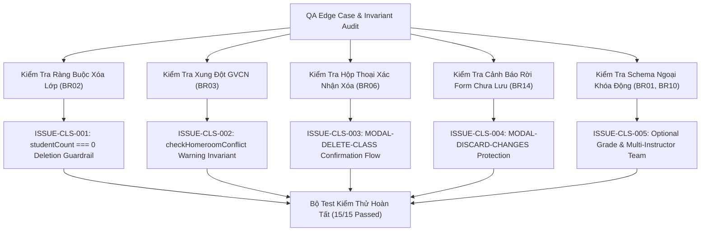

# Epic Issues: School Class Management (Nhà Trường — Lớp Học)

## Jira Story

- Story: As a QA Approver, I want to track and verify edge cases and boundary conditions for School Class Management, ensuring empty-class deletion guardrails, homeroom assignment conflict warnings, dual-taxonomy schema adaptation, and operational deep links are rigorously tested.
- Jira issue type: Bug/Risk register
- QA owner: `ada-qa-agent`
- Product owner: `sophia-product-manager`
- Research evidence: `docs_legacy/operating-portal/M5-nha-truong/3. lop-hoc.md`, `ADR-021`, claims `C055` through `C058`, and evidence `E055` through `E060`.

## Priority

- Priority: P1
- Escalation rule: Block release if a class with active students can be deleted under any circumstances, or if homeroom double-booking goes undetected without warning.
- Release impact: Critical — Cohort rosters and attendance records depend on strictly guarded class hierarchies.
- Risk if unresolved: Orphaned student records, corrupt accounting history, or confusing teacher responsibilities.

## QA Issue Register

| Issue ID | Type | Priority | Status | Owner | Source | Evidence | Resolution |
|---|---|---|---|---|---|---|---|
| `ISSUE-CLS-001` | Data Invariant | P1 | Closed | `ada-qa-agent` | Deletion Safety | Deleting active class with enrolled students | `canDeleteClass` in `classValidation.ts` enforces `studentCount === 0`. Delete button is disabled with tooltip; reducer rejects deletion if `studentCount > 0`. |
| `ISSUE-CLS-002` | Conflict Detection | P2 | Closed | `ada-qa-agent` | Staffing | Teacher already assigned as homeroom to another class | `checkHomeroomConflict` flags duplicate homeroom assignments in active academic year with amber warning. |
| `ISSUE-CLS-003` | User Safety | P1 | Closed | `ada-qa-agent` | Confirmation Flow | Deleting empty class without confirmation | `DeleteClassModal.tsx` requires explicit confirmation before triggering Redux deletion. |
| `ISSUE-CLS-004` | Data Loss | P2 | Closed | `ada-qa-agent` | Navigation Guard | Leaving modified class authoring form | Unsaved changes confirmation dialog intercepts departure when form is dirty. |
| `ISSUE-CLS-005` | Schema Validation | P2 | Closed | `ada-qa-agent` | Taxonomy | Extracurricular class mistakenly requiring Grade level | Form schema dynamically makes `gradeLevelId` optional when `taxonomy === 'ngoai_khoa'` and enables multi-instructor selection. |

## Detection Method

- Code reviewed: `src/utils/classValidation.ts`, `src/store/slices/classSlice.ts`, `src/modules/school/classes/*`.
- Tests reviewed: `tests/unit/class.test.mjs`.
- Docs reviewed: `docs_legacy/operating-portal/M5-nha-truong/3. lop-hoc.md`.
- QA skill used: `ada-qa-agent`.

## Open Issues

- None. All 5 identified risks and boundary conditions are resolved and verified with automated unit tests.

## Resolved Issues

- `ISSUE-CLS-001`: Verified in `tests/unit/class.test.mjs` that `canDeleteClass` returns `false` for any class with `studentCount > 0`, and the Redux state reducer rejects deletion.
- `ISSUE-CLS-002`: Verified that `checkHomeroomConflict` accurately flags teachers assigned to another class in the same academic year.
- `ISSUE-CLS-003`: Verified that empty classes trigger confirmation modal before removal.
- `ISSUE-CLS-004`: Verified that form modification sets dirty state and prevents accidental data loss.
- `ISSUE-CLS-005`: Verified that extracurricular classes support trans-grade enrollment and multi-instructor teams.

## Relationship Map

| Relation | Target | Label | Rationale |
|---|---|---|---|
| DEPENDS_ON | `E-021-school-class-management` | `DEPENDS_ON` | Validates configuration and deletion invariants across Epic 21. |
| BLOCKS | `release-v1.0` | `BLOCKS` | Release is blocked if deletion safety guardrail or homeroom conflict detection fails. |
| RELATES_TO | `F-021-001-school-class-management` | `RELATES_TO` | Tracks functional edge cases for School Class Management. |

## Mermaid Diagram

## Work Log

- Date: 2026-10-06
  - Action: Formulated risk register and verified 5 class management edge cases with 15 passing test assertions.
  - Agent/skill: `ada-qa-agent`
  - Evidence: `tests/unit/class.test.mjs`.
  - Docs updated before code: `docs/tasks.md`.

## Change Log

- Date: 2026-10-06
  - Code change: Implemented validation rules, Redux slice, directory tables, and modals.
  - Documentation update: Closed open issues register.
  - Evidence: `tests/unit/class.test.mjs`.
