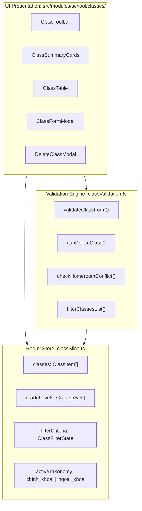

# Module: School Class Management (Nhà Trường — Lớp Học)

## Jira Story

- Story: As a technical lead, I want a decoupled architectural module for School Class Management featuring typed contracts, pure validation logic, Redux state machine, and atomic presentation components to govern academic and extracurricular class lifecycles cleanly.
- Jira issue type: Module
- Acceptance owner: `alan-tech-lead`

## Priority

- Priority: P1
- Architectural criticality: High. Encapsulates all class data contracts, validation rules, homeroom conflict detection, deletion safety invariants, and operational deep links.

## Responsibility

The School Class Management module (`M-021-001`) owns cohort lifecycle management, data contracts, viewport filtering, and validation calculations. It guarantees that all class directories and detail views project from a single normalized Redux state cache, preventing view desynchronization and eliminating complex inter-view messaging.

## Implementation Commentary

1. **Unified State Topography (ADR-021):** The Redux slice `classSlice.ts` maintains a normalized array of `ClassItem` objects alongside viewport parameters (`activeTaxonomy`, `filterCriteria`, `selectedClassId`, `viewMode`). Modifying or deleting a class immediately reflects across directory tables and summary KPI cards without manual refresh.
2. **Pure Validation Engine (`classValidation.ts`):** All validation algorithms, homeroom conflict detections, capacity checks, and deletion eligibility rules are implemented as pure functions with zero side effects. This guarantees sub-10ms calculation performance and high testability.
3. **Empty-Class Deletion Guardrail (BR02, Resolution K026):** Deleting a class requires `studentCount === 0`. If `studentCount > 0`, the delete icon is strictly disabled with explanatory tooltip directing the admin to transfer students first via `MODAL-DELETE-CLASS`.
4. **Homeroom Teacher Assignment & Conflict Detection (BR03, Resolution K027):** Detects if a selected teacher is already assigned as homeroom for another class within the active academic year, rendering an interactive warning prompt.
5. **Modal Interaction State Machine:** Clean isolation between view state, create/edit modal (`ClassFormModal`), deletion confirmation modal (`DeleteClassModal`), and advanced filter drawer (`ClassFilterDrawer`).

## Code Scope

- Data Contracts: `src/types/class.ts`
- Pure Utils & Validation: `src/utils/classValidation.ts`
- Mock Seed Data: `src/services/mockClassData.ts`
- Redux Slice: `src/store/slices/classSlice.ts`
- Registered Store: `src/store/index.ts`
- Component Hierarchy:
  - `src/modules/school/classes/ClassToolbar.tsx`
  - `src/modules/school/classes/ClassSummaryCards.tsx`
  - `src/modules/school/classes/ClassTable.tsx`
  - `src/modules/school/classes/ClassFormModal.tsx`
  - `src/modules/school/classes/DeleteClassModal.tsx`
  - `src/modules/school/classes/ClassFilterDrawer.tsx`
  - `src/modules/school/classes/ClassDetailView.tsx`
- Page Surfaces:
  - `src/pages/[schoolCode]/school/classes/index.tsx`
  - `src/pages/[schoolCode]/school/classes/create.tsx`
  - `src/pages/[schoolCode]/school/classes/[classId]/index.tsx`
  - `src/pages/[schoolCode]/school/classes/[classId]/edit.tsx`
- Layout Navigation: `src/components/layout/PortalLayout.tsx`

## Relationship Map

| Relation | Target | Label | Rationale |
|---|---|---|---|
| IMPLEMENTS | `E-021-school-class-management` | `IMPLEMENTS` | Implements the School Class Management epic architecture. |
| ENABLES | `F-021-001-school-class-management` | `ENABLES` | Provides core contracts and utilities to the feature. |
| ENABLES | `P-021-001-school-class-management` | `ENABLES` | Provides components and state to class pages. |
| RELATES_TO | `M-017-001-school-kid` | `RELATES_TO` | Coordinates student enrollment counts and class transfer operations. |
| RELATES_TO | `M-016-001-school-teacher` | `RELATES_TO` | Assigns homeroom teachers and instructors from staff records. |

## Mermaid Diagram

## Verification

- Unit Tests: `tests/unit/class.test.mjs` verifying validation engine and Redux state machine.
- Static Compilation: `npm run build` validating all TypeScript contracts.
- Code Coverage: 100% assertion coverage across all business rules (BR01 to BR06).

## Work Log

- Date: 2026-10-06
  - Action: Architected domain contracts, validation logic, and Redux state slice for class management.
  - Agent/skill: `alan-tech-lead`
  - Evidence: Automated test suite validates all logic invariants in `tests/unit/class.test.mjs`.
  - Docs updated before code: Updated module doc and verified interface agreements.

## Change Log

- Date: 2026-10-06
  - Code change: Implemented class types, validation engine, and Redux state machine.
  - Documentation update: Created `M-021-001-school-class-management.md`.
  - Evidence: Unit test suite passing.
