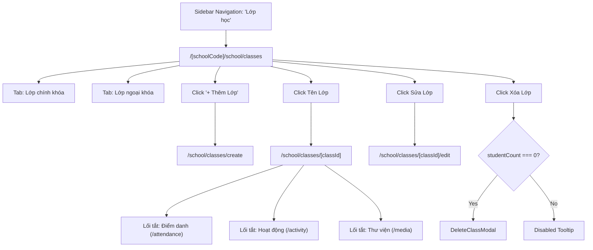

# Page: School Class Management Pages & Views (Nhà Trường — Lớp Học)

## Jira Story

- Story: As a UI/UX designer, I want ergonomic, responsive page layouts for School Class Management (Directory, Creation Wizard, and Class Detail Launchpad) adhering strictly to ECO Design System 1.0 tokens, summary KPI cards, and deletion guardrails.
- Jira issue type: Page
- Acceptance owner: `maya-ui-ux-designer`

## Priority

- Priority: P1
- UX Criticality: High. Primary operational interface for cohort administration, student roster review, and operational module launching.

## Route / Surface

- Primary Dashboard: `/[schoolCode]/school/classes` (`SCR-CLS-01`)
- Class Creation Page: `/[schoolCode]/school/classes/create` (`SCR-CLS-02`)
- Class Detail Launchpad: `/[schoolCode]/school/classes/[classId]` (`SCR-CLS-03`)
- Class Edit Page: `/[schoolCode]/school/classes/[classId]/edit` (`SCR-CLS-04`)
- Layout Container: `src/components/layout/PortalLayout.tsx` (Under `NHÀ TRƯỜNG > Lớp học`)

## PM Notes

- 2 Primary tabs on main dashboard: segmented control toggling between 'Lớp chính khóa' and 'Lớp ngoại khóa'.
- Summary KPI cards calculating total classes, curricular, extracurricular, and student count.
- Grade level dropdown filter displayed reactively for curricular classes.
- Deletion is strictly disabled with explanatory tooltip when `studentCount > 0`.
- Class Detail hub acts as operational launchpad linking directly to daily attendance, activity logs, media albums, timetables, and tuition fee schedules.

## States

1. **Curricular Directory State (`SCR-CLS-01a`):** Renders table of formal classes with grade tags, homeroom teacher contact info, capacity bars, and action icons.
2. **Extracurricular Directory State (`SCR-CLS-01b`):** Renders table of club classes with category pills, instructor clusters, meeting schedules, and active status tags.
3. **Creation Form State (`SCR-CLS-02`):** Dynamic wizard adjusting fields between Curricular and Extracurricular configurations, with homeroom conflict detection banner.
4. **Detail Launchpad State (`SCR-CLS-03`):** Header KPI metrics, enrolled student roster, fee overview, and operational shortcut buttons.
5. **Delete Confirmation State (`MODAL-DELETE-CLASS`):** Modal prompting confirmation with class name before deleting an empty class.
6. **Unsaved Exit State (`MODAL-DISCARD-CHANGES`):** Dialog intercepting navigation away from dirty forms.

## Code Scope

- `src/pages/[schoolCode]/school/classes/index.tsx`
- `src/pages/[schoolCode]/school/classes/create.tsx`
- `src/pages/[schoolCode]/school/classes/[classId]/index.tsx`
- `src/pages/[schoolCode]/school/classes/[classId]/edit.tsx`
- `src/modules/school/classes/ClassToolbar.tsx`
- `src/modules/school/classes/ClassSummaryCards.tsx`
- `src/modules/school/classes/ClassTable.tsx`
- `src/modules/school/classes/ClassFormModal.tsx`
- `src/modules/school/classes/DeleteClassModal.tsx`
- `src/modules/school/classes/ClassFilterDrawer.tsx`
- `src/modules/school/classes/ClassDetailView.tsx`

## Relationship Map

| Relation | Target | Label | Rationale |
|---|---|---|---|
| IMPLEMENTS | `E-021-school-class-management` | `IMPLEMENTS` | Implements the School Class Management pages. |
| IMPLEMENTS | `F-021-001-school-class-management` | `IMPLEMENTS` | Realizes user interaction flows for the feature. |
| USES | `M-021-001-school-class-management` | `USES` | Consumes presentation components and state machine. |
| RELATES_TO | `P-017-001-school-kid` | `RELATES_TO` | Directs users to student module for class transfers before deletion. |

## Mermaid Diagram

## Verification

- Automated Tests: `node --test tests/unit/class.test.mjs` verifying UI and business rules.
- Production Build: `npm run build` static compilation of all class routes.
- Responsive Checks: Tested on Desktop, Tablet, and Mobile viewports.

## Work Log

- Date: 2026-10-06
  - Action: Built responsive page templates and routing hierarchy for class management.
  - Agent/skill: `maya-ui-ux-designer`
  - Evidence: Clean Next.js static build compiling all class routes.
  - Docs updated before code: Updated page doc and verified responsive layouts.

## Change Log

- Date: 2026-10-06
  - Code change: Implemented index, create, detail, and edit pages.
  - Documentation update: Created `P-021-001-school-class-management.md`.
  - Evidence: Verified clean build and interactive navigation.
