# Task: Implement School Class Management (Nhà Trường — Lớp Học)

## Jira Story

- Story: As a frontend engineer, I want to implement all TypeScript contracts, pure validation logic, Redux state machine, class directory components, authoring pages, and automated unit tests for School Class Management with full test coverage.
- Jira issue type: Task
- Acceptance owner: `benny-frontend-engineer`

## Priority

- Priority: P1
- Execution status: Completed.

## Objective

Deliver the complete frontend implementation of Sub-module Lớp Học under Module M5: Nhà Trường in Next.js (Pages Router) and Redux Toolkit, providing dual-taxonomy class partitioning (Curricular vs Extracurricular), empty-class deletion guardrails, homeroom conflict detection, dynamic authoring wizards, and operational launchpad shortcuts.

## Implementation Commentary

1. **Contracts & Validation:** Implemented `src/types/class.ts` and pure helper functions in `src/utils/classValidation.ts` covering form validation, empty class deletion guardrails, homeroom assignment conflict warnings, and client-side filtering.
2. **Redux State Machine:** Authored `src/store/slices/classSlice.ts` managing normalized classes, grade levels, active taxonomy tab, filtering criteria, and CRUD mutations with strict deletion guardrails. Registered in `src/store/index.ts`.
3. **Component Hierarchy:** Built seven presentation components in `src/modules/school/classes/`:
   - `ClassToolbar.tsx`: Top bar with tabs ("Lớp chính khóa" vs "Lớp ngoại khóa"), Grade dropdown filter, search input, and '+ Thêm Lớp' CTA.
   - `ClassSummaryCards.tsx`: 4 summary KPI metric cards.
   - `ClassTable.tsx`: Tabular roster with capacity progress bars, teacher contact info, and action buttons.
   - `ClassFormModal.tsx`: Dynamic authoring modal with taxonomy switch and conflict detection.
   - `DeleteClassModal.tsx`: Confirmation dialog before deleting an empty class.
   - `ClassFilterDrawer.tsx`: Multi-factor advanced filter drawer.
   - `ClassDetailView.tsx`: Launchpad view with enrolled student roster, fee summary, and operational shortcuts.
4. **Page Surfaces & Routing:** Built `src/pages/[schoolCode]/school/classes/index.tsx`, `src/pages/[schoolCode]/school/classes/create.tsx`, `src/pages/[schoolCode]/school/classes/[classId]/index.tsx`, and `src/pages/[schoolCode]/school/classes/[classId]/edit.tsx`. Integrated navigation item in `src/components/layout/PortalLayout.tsx`.
5. **Testing & Build Verification:** Authored 15 automated test assertions in `tests/unit/class.test.mjs` and verified clean Next.js static build `npm run build`.

## Write Scope

- Data contracts: `src/types/class.ts`
- Business logic: `src/utils/classValidation.ts`
- Mock store: `src/services/mockClassData.ts`
- State machine: `src/store/slices/classSlice.ts`
- Store registration: `src/store/index.ts`
- Components:
  - `src/modules/school/classes/ClassToolbar.tsx`
  - `src/modules/school/classes/ClassSummaryCards.tsx`
  - `src/modules/school/classes/ClassTable.tsx`
  - `src/modules/school/classes/ClassFormModal.tsx`
  - `src/modules/school/classes/DeleteClassModal.tsx`
  - `src/modules/school/classes/ClassFilterDrawer.tsx`
  - `src/modules/school/classes/ClassDetailView.tsx`
- Pages:
  - `src/pages/[schoolCode]/school/classes/index.tsx`
  - `src/pages/[schoolCode]/school/classes/create.tsx`
  - `src/pages/[schoolCode]/school/classes/[classId]/index.tsx`
  - `src/pages/[schoolCode]/school/classes/[classId]/edit.tsx`
- Layout: `src/components/layout/PortalLayout.tsx`
- Tests: `tests/unit/class.test.mjs`

## Relationship Map

| Relation | Target | Label | Rationale |
|---|---|---|---|
| IMPLEMENTS | `E-021-school-class-management` | `IMPLEMENTS` | Implements the core engineering scope of Epic 21. |
| IMPLEMENTS | `F-021-001-school-class-management` | `IMPLEMENTS` | Realizes functional requirements for class management. |
| USES | `M-021-001-school-class-management` | `USES` | Uses module contracts, slice, and validation helpers. |

## Mermaid Diagram

```mermaid
flowchart LR
    Task["T-021-001-001 Engineering Task"] --> Contracts["Data Contracts (types/class.ts)"]
    Contracts --> Validation["Validation Engine (classValidation.ts)"]
    Validation --> Redux["Redux Slice (classSlice.ts)"]
    Redux --> Components["Class UI Components (7 Files)"]
    Components --> Pages["Next.js Pages (index, create, detail, edit)"]
    Pages --> Tests["Unit Test Suite (15/15 Passed)"]
    Tests --> Build["Production Build"]
```

## Verification Evidence

- Command: `node --test tests/unit/class.test.mjs`
  - Output: 15/15 tests passing.
- Command: `node --test tests/unit/*.test.mjs`
  - Output: All tests passing across all modules with zero regressions.
- Command: `npm run build`
  - Output: Clean compilation of all routes including class directory, create, detail, and edit pages.

## Handoff

- Handoff Target: Production release and QA sign-off.
- Target Release: Phase 1 — Enterprise Operational Readiness.
- Known Limitations: None.
- Maintenance Notes: Class taxonomy is partitioned into Curricular and Extracurricular; any future taxonomy types require updating `ClassTaxonomy` and form schema switches.

## Work Log

- Date: 2026-10-06
  - Action: Built and verified complete School Class Management sub-module with passing tests and clean build.
  - Agent/skill: `benny-frontend-engineer`
  - Evidence: `tests/unit/class.test.mjs`.
  - Docs updated before code: `docs/tasks.md`.

## Change Log

- Date: 2026-10-06
  - Code change: Implemented data contracts, pure utils, Redux slice, 7 UI components, and 4 page routes.
  - Documentation update: Updated task documentation, doc sync note, and manifest.
  - Evidence: `tests/unit/class.test.mjs`.
