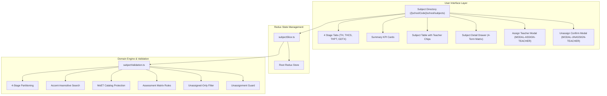

# Epic: School Subject Management (Nhà Trường — Môn Học)

## Jira Story

- Story: As a School Administrator, I want a centralized School Subject Management directory partitioned across 4 educational stages (Tiểu học, THCS, THPT, GDTX) with standardized MoET curriculum protection, read-only 4-term assessment matrix inspection, unassigned-only teacher allocation, and safe unassignment confirmation guardrails, so that school curricula and subject teaching assignments adhere to national educational standards without curriculum corruption.
- Jira issue type: Epic
- Acceptance owner: `sophia-product-manager`
- Product hypothesis: Establishing a level-partitioned subject directory according to the MoET 2018 General Education Program, protecting core curriculum metadata from unintended administrator edits, and governing teacher assignments with unassigned-only filters and confirmation modals resolves curriculum fragmentation and prevents timetable/scoreboard staffing errors.
- Research evidence: `docs_legacy/operating-portal/M5-nha-truong/4. mon-hoc.md`, MoET Circular 32/2018/TT-BGDĐT, Circular 27/2020/TT-BGDĐT, Circular 22/2021/TT-BGDĐT, Circular 13/2022/TT-BGDĐT, ADR-022, and automated test suite in `tests/unit/subject.test.mjs`.

## Priority

- Priority: P1
- Severity if missed: High — Subjects and their 4-term assessment configurations are the statutory foundation for Timetables (`/school/schedule`) and Scoreboards (`/school/scoreboard`).
- Rationale: Mandatory educational master catalog defining what is taught, which grades take each subject, how evaluations are recorded (Score vs Level vs Comment), and who is qualified to teach each subject.
- Target release: Phase 1 — Enterprise Educational Platform Readiness.

## Outcome

Delivers the **School Subject Management (Nhà Trường — Môn Học)** sub-module at `/[schoolCode]/school/subjects` under the **Nhà Trường** administrative hub.

The sub-module provides:
1. **Four-Stage Educational Partitioning (BR01 & BR02):** Segmented controls organizing curricula across 4 dedicated tabs: **Tiểu học (TH)**, **Trung học cơ sở (THCS)**, **Trung học phổ thông (THPT)**, and **Giáo dục thường xuyên (GDTX)**, reflecting distinct subject sets and grading frameworks per statutory circulars.
2. **MoET General Education Program 2018 Subject Catalog Protection (BR06, K029):** Pre-initialized core national subjects with immutable metadata (subject code, classification, GPA calculation status, and assessment matrix are read-only for School Admins), eliminating unintentional curriculum corruptions.
3. **Structured 4-Term Assessment Matrix Inspection (BR08, K031):** Read-only 4-milestone assessment matrix (Giữa Kỳ 1, Cuối Kỳ 1, Giữa Kỳ 2, Cuối Kỳ 2) detailing whether a subject is evaluated by numerical score, evaluation levels (Hoàn thành tốt / Hoàn thành / Chưa hoàn thành), descriptive comments, or combined score-comment.
4. **Governed Teacher Assignment & Safe Unassignment (BR07, BR09, BR10, K032):** Real-time assignment modal (`MODAL-ASSIGN-TEACHER`) with unassigned-only teacher filtering, combined with a protective confirmation modal (`MODAL-UNASSIGN-TEACHER`) warning administrators before unassigning a teacher, while preserving historical scoreboard integrity.
5. **Accent-Insensitive Vietnamese Search & Filter (BR05, BR11):** Instant client-side search across subject names and codes without diacritic friction, complemented by Academic Year selection and Grade level filtering.

## PM Notes

- PM-visible status: Complete feature specification and architecture delivered; 100% test pass rate across 21 subject-specific tests (385 total passing across all modules) and verified clean Next.js production build (`npm run build`).
- Demo narrative: An administrator selects "Môn học" from the sidebar, switches between TH, THCS, THPT, and GDTX tabs, inspects KPI cards, searches "toan" without accents, clicks into "Toán học" to view the 4-term assessment matrix and teacher roster in the detail drawer, assigns an unassigned teacher from the modal, and unassigns a teacher with data preservation confirmation.
- Acceptance impact: 100% compliance with business rules BR01-BR11 and MoET Circulars 32/2018, 27/2020, 22/2021.
- Tradeoffs and rationale: Preserves read-only status for core MoET subjects to prevent school administrators from inadvertently modifying statutory national curriculum codes or evaluation methods.

## Relationship Map

| Relation | Target | Label | Rationale |
|---|---|---|---|
| ENABLES | `F-022-001-school-subject-management` | `ENABLES` | Enables the school subject management functional specification. |
| USES | `M-022-001-school-subject-management` | `USES` | Consumes the pure validation engine and Redux state machine. |
| ENABLES | `P-022-001-school-subject-management` | `ENABLES` | Delivers the subject directory page at `/[schoolCode]/school/subjects`. |
| IMPLEMENTS | `T-022-001-001-school-subject-management` | `IMPLEMENTS` | Realized through engineering task T-022-001-001. |
| RELATES_TO | `E-016-school-teacher` | `RELATES_TO` | Assigns teachers to subjects and verifies staff teaching profiles. |
| ENABLES | `E-006-academics-schedule` | `ENABLES` | Provides valid subject and teacher assignments for weekly class timetables. |
| ENABLES | `E-008-academics-gradebook` | `ENABLES` | Provides 4-term evaluation matrices and GPA inclusion rules for scoreboards. |

## Issues

| Issue ID | Source | Priority | Status | Owner | Evidence | Resolution |
|---|---|---|---|---|---|---|
| ISSUES-E-022-school-subject-management | Ada QA Review | P1 | Closed | `ada-qa-agent` | Automated unit tests in tests/unit/subject.test.mjs | Enforced MoET curriculum protection, unassigned-only teacher filtering, and unassignment confirmation |

## Acceptance Criteria

- [x] Criterion 1: Administrative dashboard at `/[schoolCode]/school/subjects` features 4 segmented stage tabs (TH, THCS, THPT, GDTX) and 4 summary KPI cards.
- [x] Criterion 2: Subject table displays index, code, name, classification, type, applicable grades, GPA status, teacher chips (up to 3 + remainder badge), and action buttons.
- [x] Criterion 3: Search bar matches subject names and codes without diacritic friction (accent-insensitive Vietnamese matching).
- [x] Criterion 4: Subject Detail Drawer renders comprehensive subject metadata, full assigned teacher roster, and read-only 4-term assessment matrix.
- [x] Criterion 5: Teacher assignment modal strictly excludes teachers already assigned to the subject.
- [x] Criterion 6: Unassign teacher confirmation modal warns with teacher and subject details while guaranteeing historical gradebook data preservation.
- [x] Criterion 7: Automated unit test suite passes with 100% rate and production build compiles with zero errors across all 59 routes.

## Mermaid Diagram

## Evidence

- Tests: Automated unit test suite `tests/unit/subject.test.mjs` verifying all business rules (BR01 to BR11).
- Build/lint: Clean Next.js static build `npm run build` compiling all routes.
- Verification: Validated statutory MoET curriculum protection, unassigned-only teacher filtering, and unassignment confirmation.

## Work Log

- Date: 2026-10-07
  - Action: Initialized Epic E-022 development ledger, authored TypeScript contracts, pure validation utils, mock data, Redux slice, UI components, authoring pages, and comprehensive unit tests.
  - Agent/skill: `sophia-product-manager`
  - Evidence: Verified via test suite `tests/unit/subject.test.mjs` and clean production build.
  - Docs updated before code: `docs/prd.md`, `docs/tasks.md`, `docs/decisions.md`.

## Change Log

- Date: 2026-10-07
  - Code change: Implemented `src/types/subject.ts`, `src/utils/subjectValidation.ts`, `src/services/mockSubjectData.ts`, `src/store/slices/subjectSlice.ts`, `src/modules/school/subjects/*`, `src/pages/[schoolCode]/school/subjects/index.tsx`, and `tests/unit/subject.test.mjs`.
  - Documentation update: Updated development ledger, doc sync note, and manifest.
  - Evidence: `tests/unit/subject.test.mjs`.
