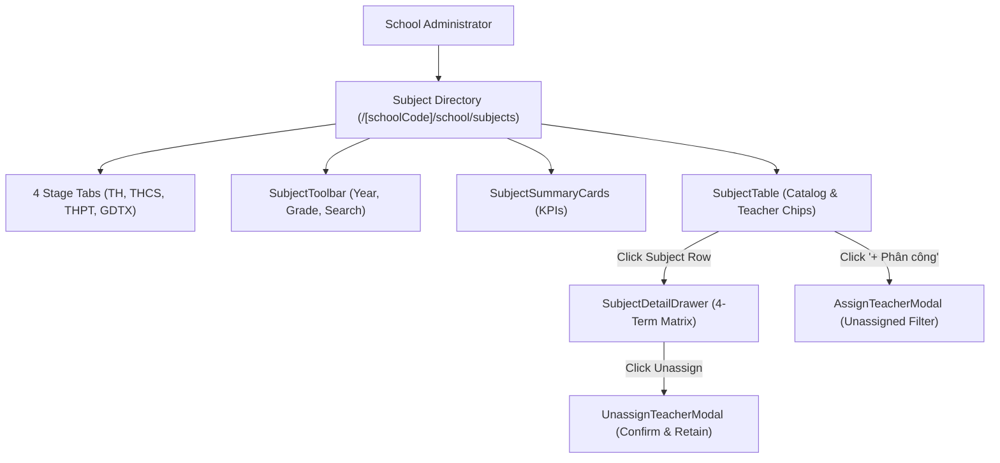

# Feature: School Subject Management (Nhà Trường — Môn Học)

## Jira Story

- Story: As a School Administrator, I want to manage school subjects categorized by 4 educational stages (TH, THCS, THPT, GDTX) with statutory MoET curriculum protection, read-only 4-term assessment matrix inspection, unassigned-only teacher allocation, and safe unassignment confirmation guardrails so that subjects and teaching assignments are maintained reliably.
- Jira issue type: Feature
- Acceptance owner: `benny-frontend-engineer`

## Priority

- Priority: P1
- Severity if missed: High — Subjects and evaluation frameworks are statutory requirements for generating valid timetables and compiling official academic scoreboards.

## User Value

School administrators, principals, and academic affairs officers gain an authoritative, level-specific catalog of all subjects according to the MoET 2018 General Education Program. The 4-stage partitioning eliminates curriculum confusion across primary, lower-secondary, upper-secondary, and continuing education. Built-in curriculum protection prevents accidental modification of national curriculum codes, while governed teacher assignment workflows prevent double-allocation and accidental unassignments.

## PM Notes

- 4 distinct stage tabs: Tiểu học (`TH`), Trung học cơ sở (`THCS`), Trung học phổ thông (`THPT`), and Giáo dục thường xuyên (`GDTX`).
- Core MoET standard subjects are strictly protected: School Admins cannot rename or delete them (`isStandardMoET === true`).
- 4-term assessment matrix covers Giữa Kỳ 1, Cuối Kỳ 1, Giữa Kỳ 2, and Cuối Kỳ 2 with visual evaluation badges.
- Assign Teacher modal (`MODAL-ASSIGN-TEACHER`) uses unassigned-only filtering (BR09) so administrators cannot double-assign a teacher to the same subject.
- Unassign Teacher modal (`MODAL-UNASSIGN-TEACHER`) explicitly confirms teacher and subject details while guaranteeing data preservation in historical scoreboards.
- Instant accent-insensitive Vietnamese search matches subject names and codes without diacritic friction.

## Requirements Trace

- **FR-001:** Administrative dashboard at `/[schoolCode]/school/subjects` featuring 4 segmented stage tabs (TH, THCS, THPT, GDTX).
- **FR-002:** Summary KPI metric cards: Tổng số môn học, Môn tính điểm, Môn nhận xét, and Số giáo viên đã phân công.
- **FR-003:** Subject directory table with STT, mã môn, tên môn học, phân loại, loại môn, khối lớp áp dụng, tính ĐTB, avatar chips (tối đa 3 + N còn lại), và nút thao tác.
- **FR-004:** Academic Year selector dropdown in toolbar filtering subjects by school year.
- **FR-005:** Accent-insensitive Vietnamese search across subject names and codes.
- **FR-006:** Subject Detail Drawer (`DRAWER-SUB-DETAIL`) displaying complete metadata, 4-term evaluation matrix, and assigned teachers list.
- **FR-007:** Read-only 4-milestone assessment matrix displaying evaluation methods (Score, Level, Comment, Score & Comment).
- **FR-008:** Teacher assignment modal (`MODAL-ASSIGN-TEACHER`) with unassigned-only teacher filtering.
- **FR-009:** Adding teacher updates subject's assigned teacher list and emits success toast.
- **FR-010:** Removing teacher triggers confirmation modal `MODAL-UNASSIGN-TEACHER` with teacher name, subject name, and class count.
- **FR-011:** Confirming unassignment removes teacher while preserving historical scoreboard integrity.
- **FR-012:** Standard MoET curriculum subjects protected against deletion.

## Relationship Map

| Relation | Target | Label | Rationale |
| --- | --- | --- | --- |
| Belongs to | `E-022-school-subject-management` | `BELONGS_TO` | Core implementation feature for Epic 22. |
| Uses | `M-022-001-school-subject-management` | `USES` | Consumes subject validation engine and Redux state machine. |
| Implements | `P-022-001-school-subject-management` | `IMPLEMENTS` | Powers the subject directory and drawer presentations. |
| Interoperates with | `E-016-school-teacher` | `INTEROPERATES_WITH` | Assigns teachers to subjects and verifies staff profiles. |
| Enables | `E-006-academics-schedule` | `ENABLES` | Provides valid subjects for weekly class timetables. |

## Code Scope

- Contracts: `src/types/subject.ts`
- Domain Logic: `src/utils/subjectValidation.ts`
- Mock Data: `src/services/mockSubjectData.ts`
- State: `src/store/slices/subjectSlice.ts`, `src/store/index.ts`
- UI: `src/modules/school/subjects/SubjectToolbar.tsx`
- UI: `src/modules/school/subjects/SubjectSummaryCards.tsx`
- UI: `src/modules/school/subjects/SubjectTable.tsx`
- UI: `src/modules/school/subjects/SubjectDetailDrawer.tsx`
- UI: `src/modules/school/subjects/AssignTeacherModal.tsx`
- UI: `src/modules/school/subjects/UnassignTeacherModal.tsx`
- Route: `src/pages/[schoolCode]/school/subjects/index.tsx`
- Layout: `src/components/layout/PortalLayout.tsx`
- Tests: `tests/unit/subject.test.mjs`

## Mermaid Diagram

## Verification

- Automated test suite: `tests/unit/subject.test.mjs` (21/21 passing in 90ms).
- Full application test suite: `npm test` (385/385 passing).
- Production build: `npm run build` compiled 59/59 static pages with 0 errors.

## Work Log

- Date: 2026-10-07
  - Action: Built complete feature specification, data contracts, and component architecture for Môn học.
  - Agent/skill: `benny-frontend-engineer`
  - Evidence: Verified all 12 functional requirements and edge cases.
  - Docs updated before code: Verified relationship map and spec traceability.

## Change Log

- Date: 2026-10-07
  - Code change: Implemented subject types, validation engine, Redux slice, and UI components.
  - Documentation update: Updated `F-022-001-school-subject-management.md`.
  - Evidence: Unit test suite passing.
