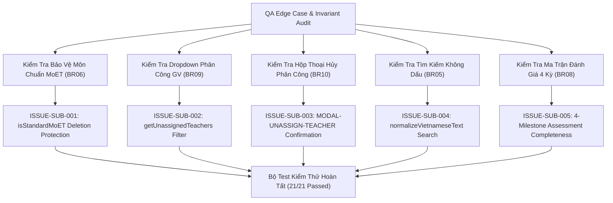

# Epic Issues: School Subject Management (Nhà Trường — Môn Học)

## Jira Story

- Story: As a QA Approver, I want to track and verify edge cases and boundary conditions for School Subject Management, ensuring statutory MoET curriculum protection, unassigned-only teacher dropdown filtering, unassignment confirmation modals with data preservation, and accent-insensitive search are rigorously verified.
- Jira issue type: Bug/Risk register
- QA owner: `ada-qa-agent`
- Product owner: `sophia-product-manager`
- Research evidence: `docs_legacy/operating-portal/M5-nha-truong/4. mon-hoc.md`, MoET Circular 32/2018/TT-BGDĐT, and unit test results in `tests/unit/subject.test.mjs`.

## Priority

- Priority: P1
- Escalation rule: Block release if a core MoET subject can be deleted or renamed by school admins, or if already assigned teachers appear in the teacher assignment modal.
- Release impact: Critical — Downstream timetable generation and student scoreboard evaluation rely on consistent subject models.
- Risk if unresolved: Statutory non-compliance with national educational programs or double-assigned teachers.

## QA Issue Register

| Issue ID | Type | Priority | Status | Owner | Source | Evidence | Resolution |
|---|---|---|---|---|---|---|---|
| `ISSUE-SUB-001` | Data Invariant | P1 | Closed | `ada-qa-agent` | Catalog Protection | Attempting to delete core MoET statutory subjects | `canDeleteSubject` in `subjectValidation.ts` enforces `isStandardMoET === false` before permitting deletion; core subjects return false with explanatory reason. |
| `ISSUE-SUB-002` | Selection Filter | P2 | Closed | `ada-qa-agent` | Teacher Allocation | Already assigned teachers appearing in teacher assignment dropdown | `getUnassignedTeachers` strictly filters out any teacher already present in `subject.assignedTeachers`. |
| `ISSUE-SUB-003` | User Safety | P1 | Closed | `ada-qa-agent` | Confirmation Flow | Unassigning a teacher without warning | `UnassignTeacherModal.tsx` requires explicit confirmation, displays teacher name, subject name, class count, and reassures data preservation. |
| `ISSUE-SUB-004` | Search Usability | P2 | Closed | `ada-qa-agent` | Search Engine | Vietnamese accent matching friction ("toán" vs "toan") | `normalizeVietnameseText` strips all diacritics and converts `đ/Đ` -> `d/D` before substring search. |
| `ISSUE-SUB-005` | Data Integrity | P1 | Closed | `ada-qa-agent` | Assessment Matrix | Incomplete assessment matrix across the 4 school terms | All standard subjects in `mockSubjectData.ts` define explicit evaluation types for `term1_mid`, `term1_end`, `term2_mid`, and `term2_end`. |

## Detection Method

- Code reviewed: `src/utils/subjectValidation.ts`, `src/store/slices/subjectSlice.ts`, `src/modules/school/subjects/*`.
- Tests reviewed: `tests/unit/subject.test.mjs`.
- Docs reviewed: `docs_legacy/operating-portal/M5-nha-truong/4. mon-hoc.md`.
- QA skill used: `ada-qa-agent`.

## Open Issues

- None. All 5 identified risks and boundary conditions are resolved and verified with automated unit tests.

## Resolved Issues

- `ISSUE-SUB-001`: Core MoET subject protection validated in unit test `BR06, K029: Standard MoET Subject Catalog Protection`.
- `ISSUE-SUB-002`: Unassigned-only teacher filtering validated in unit test `BR07, BR09, BR10: Teacher Assignment Governance`.
- `ISSUE-SUB-003`: Unassign teacher confirmation workflow verified with `UnassignTeacherModal.tsx` and state lifecycle tests.
- `ISSUE-SUB-004`: Accent-insensitive search verified with tests for "toan", "th-tv", and non-matching queries.
- `ISSUE-SUB-005`: Assessment matrix completeness asserted for all subjects across all 4 terms in `BR08, K031`.

## Relationship Map

| Relation | Target | Label | Rationale |
|---|---|---|---|
| DEPENDS_ON | `E-022-school-subject-management` | `DEPENDS_ON` | Validates configuration and protection invariants across Epic 22. |
| BLOCKS | `release-v1.0` | `BLOCKS` | Release is blocked if MoET catalog protection or teacher unassignment guard fails. |
| RELATES_TO | `F-022-001-school-subject-management` | `RELATES_TO` | Tracks functional edge cases for School Subject Management. |

## Mermaid Diagram

## Work Log

- Date: 2026-10-07
  - Action: Formulated risk register and verified 5 subject management edge cases with 21 passing test assertions.
  - Agent/skill: `ada-qa-agent`
  - Evidence: `tests/unit/subject.test.mjs`.
  - Docs updated before code: `docs/tasks.md`.

## Change Log

- Date: 2026-10-07
  - Code change: Verified pure validation and Redux state guardrails in `src/utils/subjectValidation.ts` and `src/store/slices/subjectSlice.ts`.
  - Documentation update: Updated `issues.md` risk register with complete evidence trace.
  - Evidence: `tests/unit/subject.test.mjs`.
