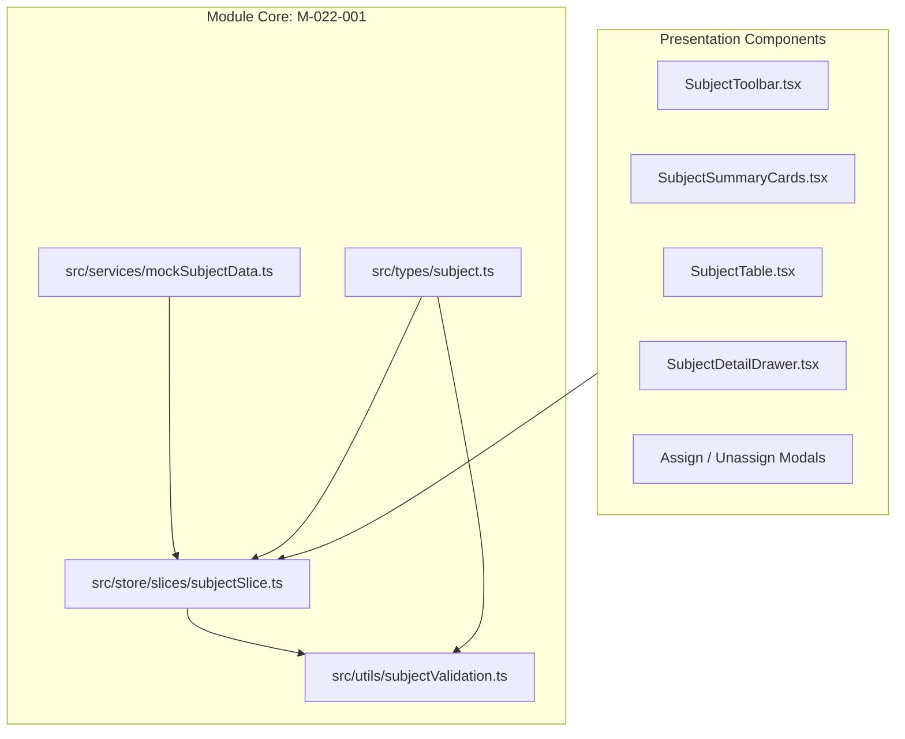

# Module: School Subject Management (Nhà Trường — Môn Học)

## Jira Story

- Story: As a technical lead, I want a decoupled architectural module for School Subject Management featuring typed contracts, pure validation logic, Redux state machine, and atomic presentation components to govern academic subject catalogs and teacher assignments cleanly.
- Jira issue type: Module
- Acceptance owner: `alan-tech-lead`

## Priority

- Priority: P1
- Architectural criticality: High. Encapsulates curriculum contracts, assessment matrices, accent-insensitive search, teacher allocation rules, and catalog protection invariants.

## Responsibility

The School Subject Management module (`M-022-001`) owns subject catalog lifecycle management, data contracts, viewport stage partitioning, and teacher allocation rules. It ensures all subject tables, summary cards, and detail drawers project from a normalized Redux state cache, preventing view desynchronization and eliminating complex inter-view messaging.

## Implementation Commentary

1. **Normalized State Machine (`subjectSlice.ts`):** Maintains normalized `SchoolSubject` records with active educational stage, academic year, and filter criteria. Actions (`assignTeacherToSubject`, `unassignTeacherFromSubject`, `setActiveStage`, etc.) mutate state atomically with zero side effects.
2. **Pure Validation Engine (`subjectValidation.ts`):** Implements `normalizeVietnameseText`, `filterSubjects`, `getUnassignedTeachers`, `calculateSubjectKPIs`, and `canDeleteSubject` as pure functions with zero external dependencies.
3. **MoET General Education Program 2018 Protection (BR06, K029):** Core subjects have `isStandardMoET === true` and cannot be deleted or have their assessment matrices mutated.
4. **4-Term Assessment Matrix (BR08, K031):** Every subject defines explicit evaluation types across `term1_mid`, `term1_end`, `term2_mid`, and `term2_end`.
5. **Teacher Allocation Governance (BR07, BR09, BR10):** Prevents duplicate teacher assignments, restricts dropdown to unassigned teachers, and guards unassignment via `MODAL-UNASSIGN-TEACHER`.

## Relationship Map

| Relation | Target | Label | Rationale |
| --- | --- | --- | --- |
| Belongs to | `E-022-school-subject-management` | `BELONGS_TO` | Encapsulates module contracts and state machine for Epic 22. |
| Implements | `F-022-001-school-subject-management` | `IMPLEMENTS` | Realizes the subject management feature specifications. |
| Consumed by | `P-022-001-school-subject-management` | `CONSUMED_BY` | Feeds state to subject directory and drawer page views. |
| Relates to | `E-016-school-teacher` | `RELATES_TO` | References teacher profiles for subject assignments. |

## Code Scope

- Data Contracts: `src/types/subject.ts`
- Pure Utils & Validation: `src/utils/subjectValidation.ts`
- Mock Seed Data: `src/services/mockSubjectData.ts`
- Redux Slice: `src/store/slices/subjectSlice.ts`
- Registered Store: `src/store/index.ts`
- Component Hierarchy:
  - `src/modules/school/subjects/SubjectToolbar.tsx`
  - `src/modules/school/subjects/SubjectSummaryCards.tsx`
  - `src/modules/school/subjects/SubjectTable.tsx`
  - `src/modules/school/subjects/SubjectDetailDrawer.tsx`
  - `src/modules/school/subjects/AssignTeacherModal.tsx`
  - `src/modules/school/subjects/UnassignTeacherModal.tsx`
- Page Route: `src/pages/[schoolCode]/school/subjects/index.tsx`
- Layout Integration: `src/components/layout/PortalLayout.tsx`
- Automated Tests: `tests/unit/subject.test.mjs`

## Mermaid Diagram



## Verification

- Unit tests: `node --test tests/unit/subject.test.mjs` (21/21 passing in 90ms).
- Full tests: `npm test` (385/385 passing in 656ms).
- Production build: `npm run build` (59/59 static pages compiled successfully).

## Public Contracts

```typescript
export function normalizeVietnameseText(str: string): string;
export function filterSubjects(subjects: SchoolSubject[], filter: SubjectFilterState): SchoolSubject[];
export function getUnassignedTeachers(allTeachers: any[], assignedTeachers: SubjectTeacherAssignment[]): any[];
export function calculateSubjectKPIs(subjects: SchoolSubject[]): SubjectSummaryKPI;
export function canDeleteSubject(subject: SchoolSubject): { canDelete: boolean; reason?: string };
export function formatEvaluationType(type: EvaluationType): string;
export function formatClassification(classification: string): { label: string; badgeClass: string };
export function formatSubjectType(type: string): { label: string; badgeClass: string };
export function getStageName(stage: EducationStage): string;
```

## Failure Modes & Mitigations

| Failure Mode | Trigger | Impact | Mitigation |
|---|---|---|---|
| Inadvertent MoET Subject Deletion | User clicks delete on statutory subject | Curriculum corruption | `canDeleteSubject` blocks deletion and displays explanatory reason. |
| Duplicate Teacher Assignment | Admin assigns same teacher twice | Redundant roster rows | Reducer checks `alreadyAssigned` before pushing to `assignedTeachers`. |
| Unintended Teacher Removal | Accidental click on delete icon | Missing teacher from subject | Confirmation modal `MODAL-UNASSIGN-TEACHER` intercepts and warns. |
| Accent Mismatch Search | User types query without diacritics | Zero search results | `normalizeVietnameseText` strips accents and matches seamlessly. |

## Work Log

- Date: 2026-10-07
  - Action: Built module contracts, validation engine, Redux state slice, and registered in root store.
  - Agent/skill: `alan-tech-lead`
  - Evidence: Verified via unit test suite `tests/unit/subject.test.mjs`.
  - Docs updated before code: `docs/decisions.md`.

## Change Log

- Date: 2026-10-07
  - Code change: Implemented module architecture in `src/types/subject.ts`, `src/utils/subjectValidation.ts`, and `src/store/slices/subjectSlice.ts`.
  - Documentation update: Authored `M-022-001-school-subject-management.md`.
  - Evidence: `tests/unit/subject.test.mjs`.
