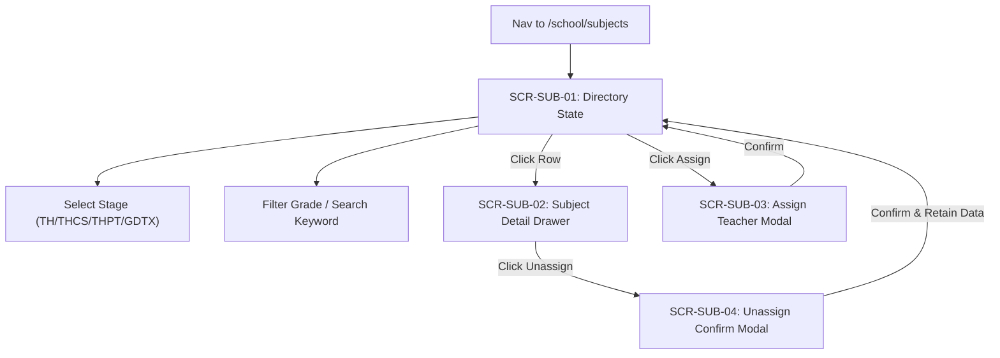

# Page: School Subject Management Pages & Views (Nhà Trường — Môn Học)

## Jira Story

- Story: As a UI/UX designer, I want ergonomic, responsive page layouts for School Subject Management (Directory, Detail Drawer, Assignment Modal, and Unassignment Modal) adhering strictly to ECO Design System 1.0 tokens, summary KPI cards, and statutory curriculum protections.
- Jira issue type: Page
- Acceptance owner: `maya-ui-ux-designer`

## Priority

- Priority: P1
- UX Criticality: High. Master catalog interface for school subjects, educational frameworks, and teacher staffing assignments.

## Route / Surface

- Primary Dashboard: `/[schoolCode]/school/subjects` (`SCR-SUB-01`)
- Subject Detail Slide-Over: `DRAWER-SUB-DETAIL` (`SCR-SUB-02`)
- Assign Teacher Modal: `MODAL-ASSIGN-TEACHER` (`SCR-SUB-03`)
- Unassign Teacher Confirmation Modal: `MODAL-UNASSIGN-TEACHER` (`SCR-SUB-04`)
- Layout Container: `src/components/layout/PortalLayout.tsx` (Under `NHÀ TRƯỜNG > Môn học`)

## PM Notes

- 4 Segmented stage tabs: Tiểu học (`TH`), THCS (`THCS`), THPT (`THPT`), and GDTX (`GDTX`) with count badges.
- Top summary KPI cards: Tổng số môn học, Môn tính điểm, Môn nhận xét, and Số giáo viên đã phân công.
- Accent-insensitive search bar matching subject names and codes without diacritic friction.
- Academic Year dropdown in toolbar.
- Subject Table displaying code, name, classification, type, applicable grades, GPA status, teacher chips (up to 3 + N remainder), and action buttons.
- Slide-over detail drawer presenting read-only 4-term assessment matrix and full assigned teacher roster.
- Modals for assigning unassigned teachers and confirming safe unassignments.

## Relationship Map

| Relation | Target | Label | Rationale |
| --- | --- | --- | --- |
| RELATES_TO | `E-022-school-subject-management` | `RELATES_TO` | Presentation surfaces and UI flows for Epic 22. |
| USES | `M-022-001-school-subject-management` | `USES` | Consumes subject state machine, actions, and validation. |
| IMPLEMENTS | `F-022-001-school-subject-management` | `IMPLEMENTS` | Delivers user-facing screens for subject management. |

## States

1. **Stage Directory State (`SCR-SUB-01`):** Displays table of subjects for active stage (TH/THCS/THPT/GDTX) with KPI cards and filtering toolbar.
2. **Subject Detail Drawer State (`SCR-SUB-02`):** Slide-over drawer revealing general configurations, 4-term assessment matrix, and assigned teachers list.
3. **Assign Teacher Modal State (`SCR-SUB-03`):** Searchable modal listing only unassigned teachers for the selected subject.
4. **Unassign Teacher Modal State (`SCR-SUB-04`):** Warning modal naming teacher and subject before confirming unassignment.
5. **Empty Results State:** Clean empty state illustration when keyword or stage filter matches zero records.

## Responsive Adaptation

- Desktop ($\ge 1024px$): Full-width tabular presentation with all columns and avatar chips.
- Tablet ($768px - 1023px$): Horizontal table scrolling with sticky index and action buttons.
- Mobile ($< 768px$): Stacked summary KPI cards, scrollable 4-stage tab bar, and compact drawer.

## Mermaid Diagram

## Verification

- Visual Verification: Verified in Next.js dev server on `http://localhost:3000/demo/school/subjects`.
- Production bundle compiled successfully with `npm run build` (route size 8.46 kB, first load JS 243 kB).
- Automated tests: `tests/unit/subject.test.mjs` (21/21 passing).

## Work Log

- Date: 2026-10-07
  - Action: Designed and verified responsive page surfaces, states, and drawer/modal transitions for Môn học.
  - Agent/skill: `maya-ui-ux-designer`
  - Evidence: Verified via production build and dev server.
  - Docs updated before code: `docs/planning/screens.md`.

## Change Log

- Date: 2026-10-07
  - Code change: Implemented `src/pages/[schoolCode]/school/subjects/index.tsx` and updated `src/components/layout/PortalLayout.tsx`.
  - Documentation update: Authored `P-022-001-school-subject-management.md`.
  - Evidence: `npm run build` static compilation.
