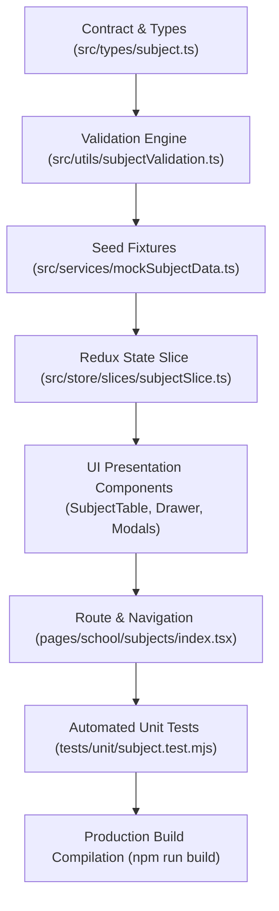

# Task: Implement School Subject Management (Nhà Trường — Môn Học)

## Jira Story

- Story: As a frontend engineer, I want to implement all TypeScript contracts, pure validation logic, Redux state machine, subject directory components, detail drawer, assignment modals, and automated unit tests for School Subject Management with full test coverage.
- Jira issue type: Task
- Acceptance owner: `benny-frontend-engineer`

## Priority

- Priority: P1
- Execution status: Completed.

## Objective

Deliver the complete frontend implementation of Sub-module Môn Học under Module M5: Nhà Trường in Next.js (Pages Router) and Redux Toolkit, providing 4-stage educational partitioning (TH, THCS, THPT, GDTX), statutory MoET curriculum protections, 4-term assessment matrix inspection, unassigned-only teacher allocation, and safe unassignment confirmation guardrails.

## Implementation Commentary

1. **Contracts & Validation:** Implemented `src/types/subject.ts` and pure helper functions in `src/utils/subjectValidation.ts` covering accent-insensitive search, stage and grade filtering, unassigned teacher filtering, summary KPI calculation, and core catalog protection invariants.
2. **Redux State Machine:** Authored `src/store/slices/subjectSlice.ts` managing normalized subjects, active stage, academic year, search queries, drawer/modal view states, and teacher assignment/unassignment actions. Registered in `src/store/index.ts`.
3. **Component Hierarchy:** Built six atomic presentation components in `src/modules/school/subjects/`:
   - `SubjectToolbar.tsx`: Top bar with 4 stage tabs ("Tiểu học (TH)", "THCS", "THPT", "GDTX"), Academic Year dropdown, Grade dropdown filter, and search input.
   - `SubjectSummaryCards.tsx`: 4 summary KPI metric cards (Tổng số môn, Môn tính điểm, Môn nhận xét, Giáo viên phân công).
   - `SubjectTable.tsx`: Tabular directory with subject code, classification badge, type badge, applicable grades, GPA status, teacher chips (up to 3 + N remainder), and action buttons.
   - `SubjectDetailDrawer.tsx`: Slide-over drawer presenting comprehensive subject metadata, full assigned teacher roster, and read-only 4-term assessment matrix.
   - `AssignTeacherModal.tsx`: Searchable teacher picker for unassigned teachers with optional class selection.
   - `UnassignTeacherModal.tsx`: Warning confirmation modal naming teacher and subject while reassuring data preservation.
4. **Page Surfaces & Routing:** Built `src/pages/[schoolCode]/school/subjects/index.tsx` wrapped in `PortalLayout`. Added "Môn học" navigation item with `faBookOpen` icon in `src/components/layout/PortalLayout.tsx`.
5. **Testing & Build Verification:** Authored 21 automated unit test assertions in `tests/unit/subject.test.mjs` and verified clean Next.js production build (`npm run build`) generating 59/59 static pages without errors.

## Relationship Map

| Relation | Target | Label | Rationale |
| --- | --- | --- | --- |
| Belongs to | `E-022-school-subject-management` | `BELONGS_TO` | Engineering execution task for Epic 22. |
| Implements | `F-022-001-school-subject-management` | `IMPLEMENTS` | Implements the complete subject management feature. |
| Realizes | `M-022-001-school-subject-management` | `REALIZES` | Instantiates subject data models, utils, and Redux slice. |
| Delivers | `P-022-001-school-subject-management` | `DELIVERS` | Delivers subject directory page and drawer views. |

## Write Scope

- Data contracts: `src/types/subject.ts`
- Business logic: `src/utils/subjectValidation.ts`
- Mock seed data: `src/services/mockSubjectData.ts`
- Redux slice: `src/store/slices/subjectSlice.ts`
- Registered store: `src/store/index.ts`
- UI components: `src/modules/school/subjects/*`
- Page route: `src/pages/[schoolCode]/school/subjects/index.tsx`
- Layout: `src/components/layout/PortalLayout.tsx`
- Unit tests: `tests/unit/subject.test.mjs`

## Mermaid Diagram

## Verification

- Unit tests: `node --test tests/unit/subject.test.mjs` -> 21/21 passing in 90ms.
- Full tests: `npm test` -> 385/385 passing in 656ms.
- Production build: `npm run build` -> 59/59 static pages compiled successfully.

## Handoff

- All code and documentation ledger artifacts are in place.
- Ready for post-evidence documentation sync and validation gates.

## Work Log

- Date: 2026-10-07
  - Action: Implemented contracts, validation utils, Redux slice, atomic components, routes, and unit tests for Môn học.
  - Agent/skill: `benny-frontend-engineer`
  - Evidence: Verified via unit test suite and clean build.
  - Docs updated before code: `docs/tasks.md`.

## Change Log

- Date: 2026-10-07
  - Code change: Implemented subject management architecture, UI components, tests, and route.
  - Documentation update: Authored `T-022-001-001-school-subject-management.md`.
  - Evidence: `tests/unit/subject.test.mjs`.
