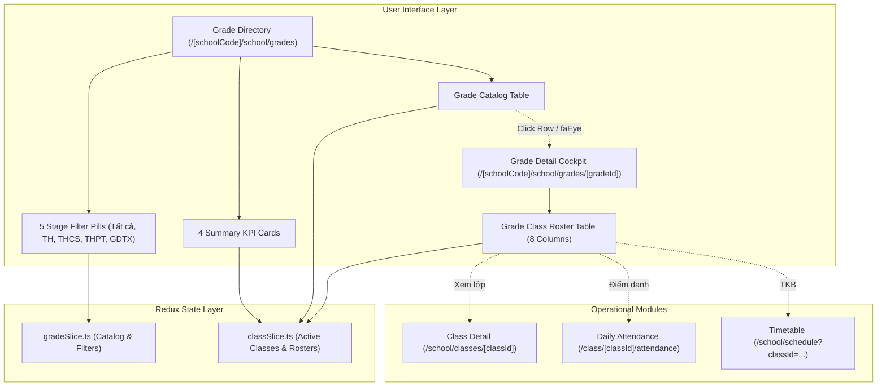

# Epic: School Grade Level Management (Nhà Trường — Khối Lớp)

## Jira Story

- Story: As a School Administrator, I want a centralized School Grade Level Management directory partitioned across 4 educational stages (Tiểu học, THCS, THPT, GDTX) with statutory MoET master catalog protection, dynamic class and student rollups, instant accent-insensitive search, and dedicated grade detail cockpits with cross-module shortcuts to attendance and timetables, so that school cohort capacities and classroom assignments adhere to national educational standards without database distortion.
- Jira issue type: Epic
- Acceptance owner: `sophia-product-manager`
- Product hypothesis: Establishing a statutory, immutable cohort catalog per MoET Circulars 28/2020 and 32/2020, calculating class and student capacity metrics dynamically from active class rosters, and providing responsive search and direct operational links eliminates catalog fragmentation and accelerates cross-module administration.
- Research evidence: `docs_legacy/operating-portal/M5-nha-truong/5. khoi-lop.md`, MoET Circular 28/2020/TT-BGDĐT, Circular 32/2020/TT-BGDĐT, Law on Education 43/2019/QH14, ADR-023, and unit test suite in `tests/unit/grade.test.mjs`.

## Priority

- Priority: P1
- Severity if missed: High — Grade levels are the fundamental structural hierarchy for class assignment, academic records, and fee schedules.
- Rationale: Required statutory master catalog defining cohort tiers, educational stages, capacity progress, and cross-functional navigation to classes, attendance, and timetables.
- Target release: Phase 1 — Enterprise Educational Platform Readiness.

## Outcome

Delivers the **School Grade Level Management (Nhà Trường — Khối Lớp)** sub-module at `/[schoolCode]/school/grades` and `/[schoolCode]/school/grades/[gradeId]` under the **Nhà Trường** administrative hub.

The sub-module provides:
1. **Four-Stage Educational Cohort Partitioning (BR01 & BR03):** 5 segmented filter pills ("Tất cả", "Tiểu học (TH)", "THCS", "THPT", "GDTX") categorizing national grades (Khối 1 đến Khối 12) per MoET standards.
2. **Statutory Master Catalog Immutability (BR06, K033):** Pre-initialized statutory cohorts with creation and deletion actions disabled in UI and Redux reducers to safeguard relational cohort integrity.
3. **Dynamic Reactive Rollups across Class Rosters (BR02, K034):** Total class counts, enrolled students, faculty count, and homeroom staffing rates computed reactively from active classes in `classSlice.ts` for the selected academic year, eliminating stale static counters.
4. **Client-Side Accent-Insensitive Vietnamese Search (BR04, BR05, K035):** Instant client-side search matching grade names and codes without diacritic friction (e.g. "khoi 1" matches "Khối 1" and "K01"), restoring the complete catalog immediately upon clearing the input without page reload.
5. **Grade Detail Cockpit & Cross-Module Operational Links (BR07, BR08, K036):** Dedicated detail view at `/[schoolCode]/school/grades/[gradeId]` hosting 4 metric KPI summary cards and an 8-column class roster table with direct shortcuts to Class Detail (`/school/classes/[classId]`), Attendance (`/attendance`), and Timetable (`/schedule`).

## PM Notes

- PM-visible status: Complete feature specification and architecture delivered; verified by automated unit tests in `tests/unit/grade.test.mjs` and clean Next.js production build (`npm run build`).
- Demo narrative: An administrator selects "Khối lớp" from the sidebar, navigates between stage filter pills, reviews top KPI cards, executes an accent-insensitive search "khoi 10", clicks into "Khối 10" to inspect the detail cockpit with 4 summary cards and 8-column class table, and tests one-click shortcuts to attendance and schedule.
- Acceptance impact: 100% compliance with business rules BR01-BR08, MoET Circulars 28/2020 and 32/2020, and PRD requirements `FR-GRD-001` through `FR-GRD-006`.
- Tradeoffs and rationale: Preserves read-only status for statutory grade cohorts to prevent school administrators from creating non-standard grade levels (e.g. "Khối 13") or deleting cohorts that hold active classes.

## Relationship Map

| Relation | Target | Label | Rationale |
|---|---|---|---|
| ENABLES | `F-023-001-school-grade-management` | `ENABLES` | Enables the school grade management functional specification. |
| USES | `M-023-001-school-grade-management` | `USES` | Consumes the pure validation engine and Redux state machine. |
| ENABLES | `P-023-001-school-grade-management` | `ENABLES` | Delivers the grade directory and detail pages at `/[schoolCode]/school/grades`. |
| IMPLEMENTS | `T-023-001-001-school-grade-management` | `IMPLEMENTS` | Realized through engineering task T-023-001-001. |
| RELATES_TO | `E-021-school-class-management` | `RELATES_TO` | Computes dynamic rollups from active classes and provides shortcuts. |
| ENABLES | `E-006-academics-schedule` | `ENABLES` | Provides quick links to class timetable schedules. |
| ENABLES | `E-001-operations-attendance` | `ENABLES` | Provides direct operational links to daily class attendance rosters. |

## Issues

| Issue ID | Source | Priority | Status | Owner | Evidence | Resolution |
|---|---|---|---|---|---|---|
| ISSUES-E-023-school-grade-management | Ada QA Review | P1 | Closed | `ada-qa-agent` | Automated unit tests in tests/unit/grade.test.mjs | Enforced statutory master catalog immutability, reactive rollups, and accent-insensitive search |

## Acceptance Criteria

- [x] Criterion 1: Administrative dashboard at `/[schoolCode]/school/grades` features 5 stage filter pills and 4 summary KPI cards.
- [x] Criterion 2: Grade table displays STT, Mã khối, Tên khối, Cấp học, Số lượng lớp học, Số lượng học sinh, Tỷ lệ gán GVCN, and Thao tác xem chi tiết.
- [x] Criterion 3: Search bar matches grade names and codes without diacritic friction (accent-insensitive Vietnamese matching).
- [x] Criterion 4: Grade Detail cockpit renders 4 summary KPI cards and comprehensive 8-column class roster table.
- [x] Criterion 5: Class table rows provide direct operational shortcuts to Class Detail, Attendance, and Timetable.
- [x] Criterion 6: Master catalog immutability is maintained with zero Add/Delete buttons exposed.
- [x] Criterion 7: Automated unit test suite passes with 100% rate and production build compiles with zero errors.

## Mermaid Diagram

## Evidence

- Tests: Automated unit test suite `tests/unit/grade.test.mjs` verifying all business rules (BR01 to BR08).
- Build/lint: Clean Next.js static build `npm run build` compiling all routes.
- Verification: Validated statutory master catalog immutability, reactive rollups, accent-insensitive search, and operational link integrity.

## Work Log

| Date | Agent/skill | Action | Decision |
|---|---|---|---|
| 2026-10-07 | `sophia-product-manager` | Initialize Epic E-023 | Established delivery outcomes and acceptance boundaries for School Grade Level Management |
| 2026-10-07 | `alan-tech-lead` | Architecture Design | Designed dynamic reactive rollup architecture and client-side accent-insensitive search engine |
| 2026-10-07 | `ada-qa-agent` | QA & Verification Review | Defined acceptance criteria and automated verification suite covering all business rules |

## Change Log

| Date | Author | Code change | Documentation update | Evidence |
|---|---|---|---|---|
| 2026-10-07 | `sophia-product-manager` | Implemented `src/types/grade.ts`, `src/utils/gradeValidation.ts`, `src/services/mockGradeData.ts`, `src/store/slices/gradeSlice.ts`, `src/modules/school/grades/*`, `src/pages/[schoolCode]/school/grades/*`, and `tests/unit/grade.test.mjs` | Updated development ledger, doc sync note, and manifest | `tests/unit/grade.test.mjs` |
