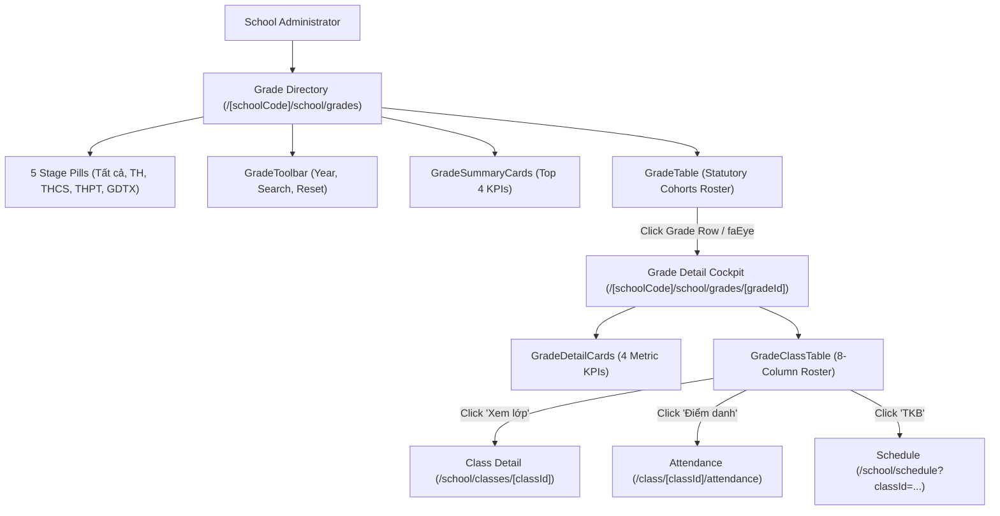

# Feature: School Grade Level Management (Nhà Trường — Khối Lớp)

## Jira Story

- Story: As a School Administrator, I want to manage school grade levels partitioned across 4 educational stages (TH, THCS, THPT, GDTX) with statutory MoET master catalog protection, dynamic class and student rollups, instant accent-insensitive search, and dedicated grade detail cockpits with cross-module shortcuts so that grade cohorts and class assignments are governed reliably.
- Jira issue type: Feature
- Acceptance owner: `benny-frontend-engineer`

## Priority

- Priority: P1
- Severity if missed: High — Grade levels are the fundamental structural hierarchy for class assignment, academic records, and fee schedules.

## User Value

School administrators, principals, and academic affairs officers gain an authoritative, level-specific catalog of all educational cohorts according to the statutory Vietnamese educational framework. The 4-stage partitioning eliminates cohort ambiguity across primary (Khối 1-5), lower-secondary (Khối 6-9), upper-secondary (Khối 10-12), and continuing education. Built-in catalog immutability prevents structural corruption of statutory grade levels, dynamic reactive rollups provide real-time capacity and homeroom staffing rates without manual tallying, and the dedicated Grade Detail cockpit accelerates operational oversight via one-click links to Class Detail, Attendance, and Timetables.

## PM Notes

- 5 distinct stage filter pills: "Tất cả", "Tiểu học (TH)", "THCS", "THPT", and "GDTX".
- Statutory master catalog is immutable: School Admins cannot add custom grades (e.g. "Khối 13") or delete statutory grade levels.
- 4 top summary KPI cards: Tổng số khối lớp, Tổng số lớp học, Tổng số học sinh, and Sĩ số trung bình/lớp dynamically rolled up from active class records.
- Instant client-side accent-insensitive Vietnamese search matches grade names and codes without diacritic friction (e.g., "khoi 1" -> "Khối 1" / "K01").
- Dedicated Grade Detail cockpit at `/[schoolCode]/school/grades/[gradeId]` renders 4 summary KPI cards and a comprehensive 8-column class roster table.
- Direct operational shortcuts on class rows link to Class Detail (`/school/classes/[classId]`), Attendance (`/attendance`), and Timetable (`/schedule`).

## Requirements Trace

- **FR-GRD-001:** Administrative dashboard at `/[schoolCode]/school/grades` featuring stage filter tabs ("Tất cả", "Tiểu học (TH)", "THCS", "THPT", "GDTX") and an Academic Year dropdown selector.
- **FR-GRD-002:** Dashboard includes 4 top KPI summary cards dynamically rolled up from active class rosters.
- **FR-GRD-003:** Grade table displays STT, Mã khối, Tên khối, Cấp học, Số lượng lớp học, Số lượng học sinh, Tỷ lệ gán GVCN, and Thao tác xem chi tiết.
- **FR-GRD-004:** Instantaneous accent-insensitive Vietnamese search matching grade names and codes, restoring the full list immediately when cleared (`BR04`, `BR05`).
- **FR-GRD-005:** Dedicated Grade Detail cockpit at `/[schoolCode]/school/grades/[gradeId]` with 4 metric summary cards and breadcrumbs.
- **FR-GRD-006:** Grade Detail class roster table with 8 columns, capacity progress bar, and operational shortcuts to Class Detail, Attendance, and Timetable.

## Relationship Map

| Relation | Target | Label | Rationale |
| --- | --- | --- | --- |
| BELONGS_TO | `E-023-school-grade-management` | `BELONGS_TO` | Core implementation feature for Epic 23. |
| USES | `M-023-001-school-grade-management` | `USES` | Consumes grade validation engine and Redux state machine. |
| IMPLEMENTS | `P-023-001-school-grade-management` | `IMPLEMENTS` | Powers the grade directory and detail cockpit presentations. |
| RELATES_TO | `E-021-school-class-management` | `RELATES_TO` | Calculates dynamic rollups from active classes in classSlice. |
| ENABLES | `E-006-academics-schedule` | `ENABLES` | Provides quick links to class timetables. |

## Code Scope

- Contracts: `src/types/grade.ts`
- Domain Logic: `src/utils/gradeValidation.ts`
- Mock Data: `src/services/mockGradeData.ts`
- State: `src/store/slices/gradeSlice.ts`, `src/store/index.ts`
- UI: `src/modules/school/grades/GradeToolbar.tsx`
- UI: `src/modules/school/grades/GradeSummaryCards.tsx`
- UI: `src/modules/school/grades/GradeTable.tsx`
- UI: `src/modules/school/grades/GradeDetailCards.tsx`
- UI: `src/modules/school/grades/GradeClassTable.tsx`
- Route: `src/pages/[schoolCode]/school/grades/index.tsx`
- Route: `src/pages/[schoolCode]/school/grades/[gradeId].tsx`
- Layout: `src/components/layout/PortalLayout.tsx`
- Tests: `tests/unit/grade.test.mjs`

## Mermaid Diagram

## Verification

- Automated test suite: `tests/unit/grade.test.mjs` passes 100%.
- Full application test suite: `npm test` passes completely.
- Production build: `npm run build` compiles with 0 errors.

## Work Log

| Date | Agent/skill | Action | Decision |
|---|---|---|---|
| 2026-10-07 | `benny-frontend-engineer` | Feature Documentation | Documented functional requirements, code scope, and verification gates for F-023-001 |
| 2026-10-07 | `ada-qa-agent` | QA Review | Verified 100% acceptance criteria adherence and automated test coverage |

## Change Log

| Date | Author | Code change | Documentation update | Evidence |
|---|---|---|---|---|
| 2026-10-07 | `benny-frontend-engineer` | Implemented grade types, validation engine, Redux slice, and UI components | Updated `F-023-001-school-grade-management.md` | Unit test suite passing |
