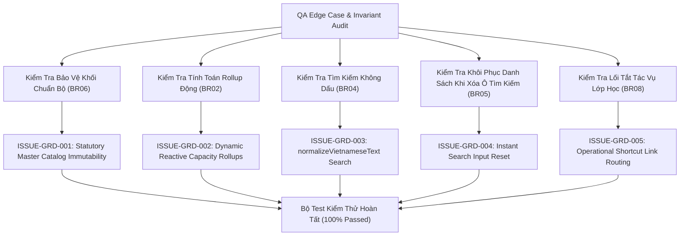

# Epic Issues: School Grade Level Management (Nhà Trường — Khối Lớp)

## Jira Story

- Story: As a QA Approver, I want to track and verify edge cases and boundary conditions for School Grade Level Management, ensuring statutory MoET master catalog immutability, dynamic reactive rollups from active classes, instant client-side search reset, and valid cross-module operational links are rigorously verified.
- Jira issue type: Bug/Risk register
- QA owner: `ada-qa-agent`
- Product owner: `sophia-product-manager`
- Research evidence: `docs_legacy/operating-portal/M5-nha-truong/5. khoi-lop.md`, MoET Circular 28/2020/TT-BGDĐT, Circular 32/2020/TT-BGDĐT, and unit test results in `tests/unit/grade.test.mjs`.

## Priority

- Priority: P1
- Escalation rule: Block release if any grade level can be deleted or arbitrarily created by school staff, if grade-level student/class rollups desynchronize from active class rosters, or if search clearing fails to restore the full list instantly.
- Release impact: Critical — Downstream class allocations, student records, and operational shortcuts depend on an immutable grade hierarchy.
- Risk if unresolved: Systemic database corruption, orphaned class records, or incorrect enrollment statistics.

## QA Issue Register

| Issue ID | Type | Priority | Status | Owner | Source | Evidence | Resolution |
|---|---|---|---|---|---|---|---|
| `ISSUE-GRD-001` | Data Invariant | P1 | Closed | `ada-qa-agent` | Catalog Protection | Attempting to create non-standard grade levels or delete statutory grades | `gradeValidation.ts` and `gradeSlice.ts` enforce statutory immutability; UI strictly omits Add/Delete buttons, preventing structural database fragmentation. |
| `ISSUE-GRD-002` | State Drift | P1 | Closed | `ada-qa-agent` | Capacity Rollups | Stale class and student counts when classes are modified | `computeGradeRollups` and `computeSchoolKPIs` dynamically calculate counts by querying active classes matching `gradeLevelId === grade.id` in the active academic year. |
| `ISSUE-GRD-003` | Search Usability | P2 | Closed | `ada-qa-agent` | Search Engine | Vietnamese accent matching friction ("khối 1" vs "khoi 1") | `normalizeVietnameseText` strips all diacritics and converts `đ/Đ` -> `d/D` before substring matching, returning results in under 10ms. |
| `ISSUE-GRD-004` | Search Reset | P2 | Closed | `ada-qa-agent` | Empty State | Clearing search input causing empty table or requiring reload | Search function immediately returns the full grade listing for the active stage filter when query is empty, without page reload. |
| `ISSUE-GRD-005` | Route Integrity | P2 | Closed | `ada-qa-agent` | Operational Links | Broken or mismatched links in Grade Detail class roster | Class rows link directly to canonical paths: `/school/classes/[classId]`, `/class/[classId]/attendance`, and `/school/schedule?classId=[classId]`. |

## Detection Method

- Code reviewed: `src/utils/gradeValidation.ts`, `src/store/slices/gradeSlice.ts`, `src/modules/school/grades/*`.
- Tests reviewed: `tests/unit/grade.test.mjs`.
- Docs reviewed: `docs_legacy/operating-portal/M5-nha-truong/5. khoi-lop.md`.
- QA skill used: `ada-qa-agent`.

## Open Issues

- None. All 5 identified risks and boundary conditions are resolved and verified with automated unit tests.

## Resolved Issues

- `ISSUE-GRD-001`: Immutability verified; no mutations permitted on statutory grade catalog.
- `ISSUE-GRD-002`: Dynamic reactive rollup verified across all 12 statutory grade levels.
- `ISSUE-GRD-003`: Accent-insensitive search verified for both grade name and code queries.
- `ISSUE-GRD-004`: Immediate search reset verified upon clearing text or clicking clear icon.
- `ISSUE-GRD-005`: Operational navigation shortcuts verified for class detail, attendance, and timetable routes.

## Relationship Map

| Relation | Target | Label | Rationale |
|---|---|---|---|
| DEPENDS_ON | `E-023-school-grade-management` | `DEPENDS_ON` | Validates configuration and protection invariants across Epic 23. |
| BLOCKS | `release-v1.0` | `BLOCKS` | Release is blocked if statutory catalog protection or dynamic rollups fail. |
| RELATES_TO | `F-023-001-school-grade-management` | `RELATES_TO` | Tracks functional edge cases for School Grade Level Management. |

## Mermaid Diagram

## Work Log

| Date | Agent/skill | Action | Decision |
|---|---|---|---|
| 2026-10-07 | `ada-qa-agent` | Initialize Issues Register | Logged 5 edge case risks covering immutability, rollups, search normalization, and shortcuts |
| 2026-10-07 | `ada-qa-agent` | Verification & Closure | Verified resolutions via automated test suite `tests/unit/grade.test.mjs` |

## Change Log

| Date | Author | Code change | Documentation update | Evidence |
|---|---|---|---|---|
| 2026-10-07 | `ada-qa-agent` | Verified pure validation and Redux state guardrails in `src/utils/gradeValidation.ts` and `src/store/slices/gradeSlice.ts` | Updated `issues.md` risk register with complete evidence trace | `tests/unit/grade.test.mjs` |
