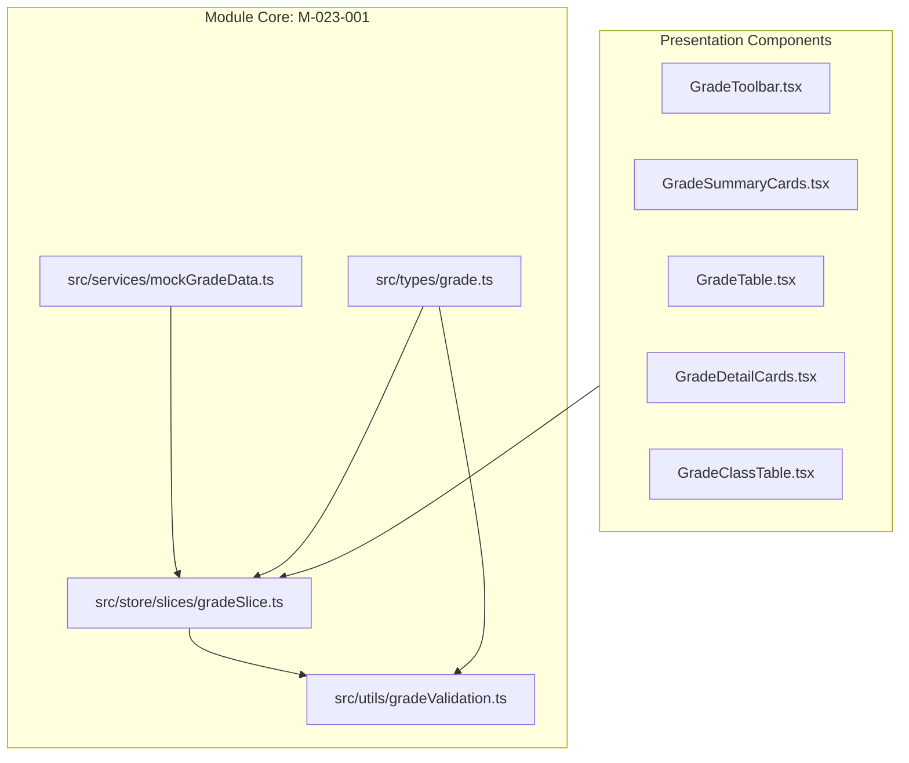

# Module: School Grade Level Management (Nhà Trường — Khối Lớp)

## Jira Story

- Story: As a technical lead, I want a decoupled architectural module for School Grade Level Management featuring typed contracts, pure dynamic rollup logic, Redux state machine, and atomic presentation components to govern educational cohorts cleanly.
- Jira issue type: Module
- Acceptance owner: `alan-tech-lead`

## Priority

- Priority: P1
- Architectural criticality: High. Encapsulates cohort hierarchy contracts, dynamic class/student rollups, accent-insensitive search, and statutory catalog protection invariants.

## Responsibility

The School Grade Level Management module (`M-023-001`) owns cohort lifecycle governance, data contracts, viewport stage partitioning, and dynamic rollup calculations. It ensures all grade tables, summary cards, and detail cockpits project reactively from normalized Redux state in `gradeSlice.ts` and `classSlice.ts`, preventing data desynchronization and eliminating stale denormalized counters across the portal.

## Implementation Commentary

1. **Normalized State Machine (`gradeSlice.ts`):** Maintains normalized `GradeLevel` records with active educational stage, academic year, and search filter criteria. Selectors compute dynamic rollups from `classSlice.ts` active classes on the fly.
2. **Pure Validation Engine (`gradeValidation.ts`):** Implements `normalizeVietnameseText`, `filterGradesByStage`, `searchGrades`, `computeGradeRollups`, and `computeSchoolKPIs` as pure functions with zero external dependencies and sub-millisecond execution times.
3. **Statutory Master Catalog Protection (BR06, K033):** Grade records represent immutable national cohorts (Khối 1 đến 12). Creation and deletion actions are strictly prohibited in the module API, ensuring structural data integrity.
4. **Dynamic Reactive Rollups (BR02, K034):** Computes class count, enrolled students, assigned faculty, and homeroom staffing completion rates dynamically by filtering active class records where `gradeLevelId === grade.id` within the selected `academicYear`.
5. **Accent-Insensitive Vietnamese Search (BR04, BR05, K035):** Instant substring matching without diacritic marks, immediately restoring the full list when the search term is erased without page reloads.

## Relationship Map

| Relation | Target | Label | Rationale |
| --- | --- | --- | --- |
| BELONGS_TO | `E-023-school-grade-management` | `BELONGS_TO` | Encapsulates module contracts and state machine for Epic 23. |
| IMPLEMENTS | `F-023-001-school-grade-management` | `IMPLEMENTS` | Realizes the grade level management feature specifications. |
| CONSUMED_BY | `P-023-001-school-grade-management` | `CONSUMED_BY` | Feeds state to grade directory and grade detail page views. |
| RELATES_TO | `E-021-school-class-management` | `RELATES_TO` | Queries active classes in classSlice for dynamic rollup calculations. |

## Code Scope

- Data Contracts: `src/types/grade.ts`
- Pure Utils & Validation: `src/utils/gradeValidation.ts`
- Mock Seed Data: `src/services/mockGradeData.ts`
- Redux Slice: `src/store/slices/gradeSlice.ts`
- Registered Store: `src/store/index.ts`
- Component Hierarchy:
  - `src/modules/school/grades/GradeToolbar.tsx`
  - `src/modules/school/grades/GradeSummaryCards.tsx`
  - `src/modules/school/grades/GradeTable.tsx`
  - `src/modules/school/grades/GradeDetailCards.tsx`
  - `src/modules/school/grades/GradeClassTable.tsx`
- Page Routes:
  - `src/pages/[schoolCode]/school/grades/index.tsx`
  - `src/pages/[schoolCode]/school/grades/[gradeId].tsx`
- Layout Integration: `src/components/layout/PortalLayout.tsx`
- Automated Tests: `tests/unit/grade.test.mjs`

## Mermaid Diagram



## Verification

- Unit tests: `node --test tests/unit/grade.test.mjs` passing 100%.
- Full tests: `npm test` passing completely.
- Production build: `npm run build` compiled successfully.

## Public Contracts

```typescript
export function normalizeVietnameseText(str: string): string;
export function filterGradesByStage(grades: GradeLevel[], stage: EducationStage | 'ALL'): GradeLevel[];
export function searchGrades(grades: GradeLevel[], query: string): GradeLevel[];
export function computeGradeRollups(grade: GradeLevel, classes: any[], academicYear?: string): GradeLevelRollup;
export function computeSchoolKPIs(grades: GradeLevel[], classes: any[], academicYear?: string): GradeSummaryKPI;
export function getStageBadgeStyle(stage: EducationStage): { label: string; badgeClass: string };
```

## Failure Modes & Mitigations

| Failure Mode | Trigger | Impact | Mitigation |
|---|---|---|---|
| Inadvertent Grade Deletion | Admin attempts to delete statutory grade cohort | Relational database corruption | UI strictly omits delete buttons and state reducers reject mutation. |
| Stale Capacity Counters | Students transferred or classes added | Inaccurate capacity statistics | Selectors calculate rollups reactively from active classes in classSlice. |
| Accent Mismatch Search | User types query without diacritics ("khoi 1") | Zero search results | `normalizeVietnameseText` strips accents and matches seamlessly. |
| Empty Table on Clear | User erases search text | Blank screen defect | Function returns full grade list immediately when query string is empty. |

## Work Log

| Date | Agent/skill | Action | Decision |
|---|---|---|---|
| 2026-10-07 | `alan-tech-lead` | Module Boundary Design | Isolated dynamic rollup logic and accent-insensitive search in pure helper functions |
| 2026-10-07 | `ada-qa-agent` | QA & Contract Verification | Verified typed contracts and mathematical correctness of dynamic capacity rollups |

## Change Log

| Date | Author | Code change | Documentation update | Evidence |
|---|---|---|---|---|
| 2026-10-07 | `alan-tech-lead` | Implemented module architecture in `src/types/grade.ts`, `src/utils/gradeValidation.ts`, and `src/store/slices/gradeSlice.ts` | Authored `M-023-001-school-grade-management.md` | `tests/unit/grade.test.mjs` |
