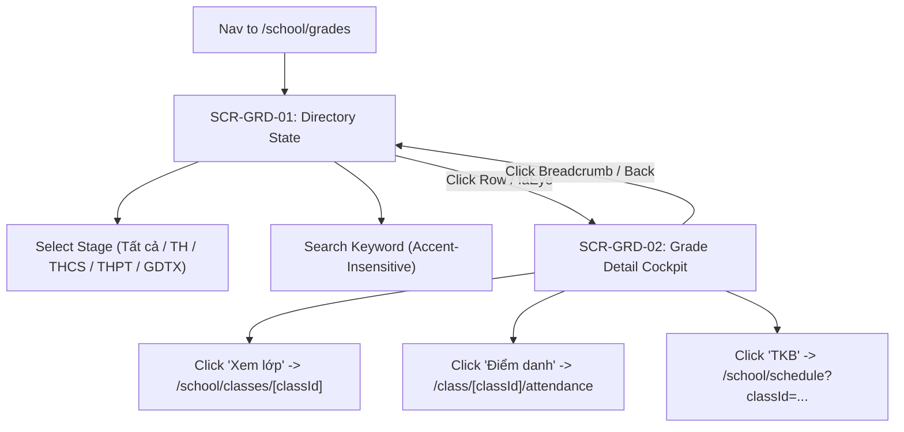

# Page: School Grade Level Management Pages & Views (Nhà Trường — Khối Lớp)

## Jira Story

- Story: As a UI/UX designer, I want ergonomic, responsive page layouts for School Grade Level Management (Grade Directory and Grade Detail Cockpit) adhering strictly to ECO Design System 1.0 tokens, summary KPI cards, and cross-module operational links.
- Jira issue type: Page
- Acceptance owner: `maya-ui-ux-designer`

## Priority

- Priority: P1
- UX Criticality: High. Master catalog interface for school grade cohorts, capacity rollups, and operational shortcuts to attendance and timetables.

## Route / Surface

- Primary Dashboard: `/[schoolCode]/school/grades` (`SCR-GRD-01`)
- Grade Detail Cockpit: `/[schoolCode]/school/grades/[gradeId]` (`SCR-GRD-02`)
- Layout Container: `src/components/layout/PortalLayout.tsx` (Under `NHÀ TRƯỜNG > Khối lớp`)

## PM Notes

- 5 Segmented stage filter pills: "Tất cả", "Tiểu học (TH)", "THCS", "THPT", and "GDTX" with count badges.
- Top summary KPI cards: Tổng số khối lớp, Tổng số lớp học, Tổng số học sinh, and Sĩ số trung bình/lớp.
- Accent-insensitive search bar matching grade names and codes without diacritic friction, with instant clear button ('X').
- Academic Year dropdown in toolbar.
- Grade Table displaying STT, Mã khối, Tên khối, Cấp học (tier badge), Số lượng lớp học, Số lượng học sinh, Tỷ lệ gán GVCN (mini progress bar), and Thao tác xem chi tiết (`faEye`).
- Grade Detail cockpit presenting 4 metric KPI summary cards and an 8-column class roster table.
- Direct operational shortcuts on class rows linking to Class Detail, Daily Attendance, and Timetables.

## Relationship Map

| Relation | Target | Label | Rationale |
| --- | --- | --- | --- |
| RELATES_TO | `E-023-school-grade-management` | `RELATES_TO` | Presentation surfaces and UI flows for Epic 23. |
| USES | `M-023-001-school-grade-management` | `USES` | Consumes grade state machine, dynamic rollups, and validation. |
| IMPLEMENTS | `F-023-001-school-grade-management` | `IMPLEMENTS` | Renders the grade management screens defined in the feature. |

## States

1. **Stage Directory State (`SCR-GRD-01`):** Displays table of grades for active stage (TH/THCS/THPT/GDTX) with KPI cards and filtering toolbar.
2. **Grade Detail Cockpit State (`SCR-GRD-02`):** Dedicated cockpit view revealing grade summary cards and 8-column class roster table with capacity progress bar.
3. **Empty Results State:** Clean empty state illustration when keyword or stage filter matches zero records.
4. **Search Active State:** Live instant filtering responsive to user text input, with clear button restoring full listing.

## Responsive Adaptation

- Desktop (1024px and wider): Full-width tabular presentation with all columns and operational link buttons.
- Tablet (768px to 1023px): Horizontal table scrolling with sticky index and action buttons.
- Mobile (under 768px): Stacked summary KPI cards, scrollable 5-stage filter bar, and compact card layout.

## Mermaid Diagram

## Code Scope

- Directory Page: `src/pages/[schoolCode]/school/grades/index.tsx`
- Detail Cockpit Page: `src/pages/[schoolCode]/school/grades/[gradeId].tsx`
- Dashboard Components: `src/modules/school/grades/GradeToolbar.tsx`, `GradeSummaryCards.tsx`, `GradeTable.tsx`
- Detail Components: `src/modules/school/grades/GradeDetailCards.tsx`, `GradeClassTable.tsx`
- Layout Integration: `src/components/layout/PortalLayout.tsx`

## Verification

- Automated test suite passes 100%: `node --test tests/unit/grade.test.mjs`
- Clean Next.js production build: `npm run build`
- Live HTTP 200 server response on `http://localhost:3000/demo/school/grades` and `/demo/school/grades/k10`

## Work Log

| Date | Agent/skill | Action | Decision |
|---|---|---|---|
| 2026-10-07 | `maya-ui-ux-designer` | Page Architecture & Wireframing | Structured 5-stage filter pills, 4 top KPI cards, and 8-column class roster table |
| 2026-10-07 | `benny-frontend-engineer` | Page Assembly | Assembled Next.js page routes with responsive layouts and WCAG AA contrast compliance |

## Change Log

| Date | Author | Code change | Documentation update | Evidence |
|---|---|---|---|---|
| 2026-10-07 | `maya-ui-ux-designer` | Implemented `src/pages/[schoolCode]/school/grades/*` and updated `src/components/layout/PortalLayout.tsx` | Authored `P-023-001-school-grade-management.md` | `npm run build` static compilation |
