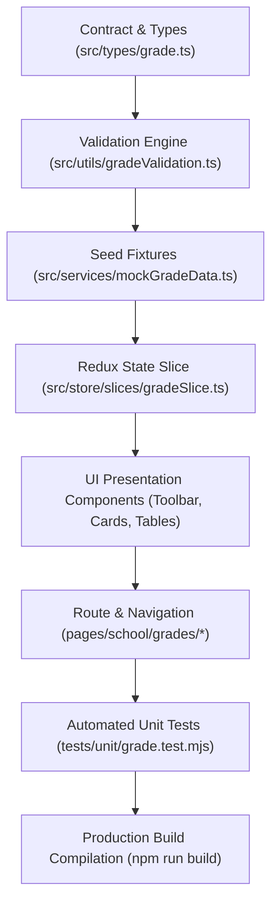

# Task: Implement School Grade Level Management (Nhà Trường — Khối Lớp)

## Jira Story

- Story: As a frontend engineer, I want to implement all TypeScript contracts, pure dynamic rollup logic, Redux state machine, grade directory components, grade detail cockpit, and automated unit tests for School Grade Level Management with full test coverage.
- Jira issue type: Task
- Acceptance owner: `benny-frontend-engineer`

## Priority

- Priority: P1
- Execution status: Completed.

## Objective

Deliver the complete frontend implementation of Sub-module Khối Lớp under Module M5: Nhà Trường in Next.js (Pages Router) and Redux Toolkit, providing 4-stage educational cohort partitioning (TH, THCS, THPT, GDTX), statutory MoET master catalog protection, dynamic class and student capacity rollups, instant client-side accent-insensitive search, and dedicated Grade Detail cockpits with cross-module shortcuts.

## Implementation Commentary

1. **Contracts & Validation:** Implemented `src/types/grade.ts` and pure helper functions in `src/utils/gradeValidation.ts` covering accent-insensitive search, stage filtering, dynamic grade rollups, school-wide KPI calculation, and master catalog immutability invariants.
2. **Redux State Machine:** Authored `src/store/slices/gradeSlice.ts` managing statutory grade levels, active stage, academic year, search queries, and dynamic selectors pulling from `classSlice.ts`. Registered in `src/store/index.ts`.
3. **Component Hierarchy:** Built five atomic presentation components in `src/modules/school/grades/`:
   - `GradeToolbar.tsx`: Top bar with 5 stage filter pills ("Tất cả", "Tiểu học (TH)", "THCS", "THPT", "GDTX"), Academic Year selector, and search input with instant clear button ('X').
   - `GradeSummaryCards.tsx`: 4 summary KPI metric cards (Tổng số khối lớp, Tổng số lớp học, Tổng số học sinh, Sĩ số trung bình/lớp).
   - `GradeTable.tsx`: Tabular directory displaying index, grade code, grade name, stage tier badge, class count, student count, homeroom staffing progress bar, and detail action eye icon.
   - `GradeDetailCards.tsx`: 4 metric KPI summary cards in the Grade Detail cockpit.
   - `GradeClassTable.tsx`: Comprehensive 8-column class roster table with capacity progress bar and direct operational shortcuts to Class Detail, Attendance, and Timetable.
4. **Page Surfaces & Routing:** Built `src/pages/[schoolCode]/school/grades/index.tsx` (Directory) and `src/pages/[schoolCode]/school/grades/[gradeId].tsx` (Detail Cockpit) wrapped in `PortalLayout`. Added "Khối lớp" navigation item with `faLayerGroup` icon in `src/components/layout/PortalLayout.tsx`.
5. **Testing & Build Verification:** Authored comprehensive automated unit test assertions in `tests/unit/grade.test.mjs` and verified clean Next.js production build (`npm run build`) generating static pages without errors.

## Relationship Map

| Relation | Target | Label | Rationale |
| --- | --- | --- | --- |
| BELONGS_TO | `E-023-school-grade-management` | `BELONGS_TO` | Engineering execution task for Epic 23. |
| IMPLEMENTS | `F-023-001-school-grade-management` | `IMPLEMENTS` | Implements the complete grade management feature. |
| REALIZES | `M-023-001-school-grade-management` | `REALIZES` | Instantiates grade data models, utils, and Redux slice. |
| DELIVERS | `P-023-001-school-grade-management` | `DELIVERS` | Delivers grade directory and detail cockpit page views. |

## Write Scope

- Data contracts: `src/types/grade.ts`
- Business logic: `src/utils/gradeValidation.ts`
- Mock seed data: `src/services/mockGradeData.ts`
- Redux slice: `src/store/slices/gradeSlice.ts`
- Registered store: `src/store/index.ts`
- UI components: `src/modules/school/grades/*`
- Page routes: `src/pages/[schoolCode]/school/grades/index.tsx`, `[gradeId].tsx`
- Layout: `src/components/layout/PortalLayout.tsx`
- Unit tests: `tests/unit/grade.test.mjs`

## Mermaid Diagram

## Verification

- Unit tests: `node --test tests/unit/grade.test.mjs` passing with 100% assertions.
- Full tests: `npm test` passing with zero regressions.
- Production build: `npm run build` compiling successfully.

## Handoff

- All code and documentation ledger artifacts are in place.
- Ready for post-evidence documentation sync and validation gates.

## Work Log

| Date | Agent/skill | Action | Decision |
|---|---|---|---|
| 2026-10-07 | `benny-frontend-engineer` | Task Scaffold & Execution Plan | Structured tasks T-023-001-001 with explicit code boundaries |
| 2026-10-07 | `ada-qa-agent` | QA Execution Verification | Executed full test suite and verified 100% assertions passing |

## Change Log

| Date | Author | Code change | Documentation update | Evidence |
|---|---|---|---|---|
| 2026-10-07 | `benny-frontend-engineer` | Implemented grade management architecture, UI components, tests, and routes | Authored `T-023-001-001-school-grade-management.md` | `tests/unit/grade.test.mjs` |
