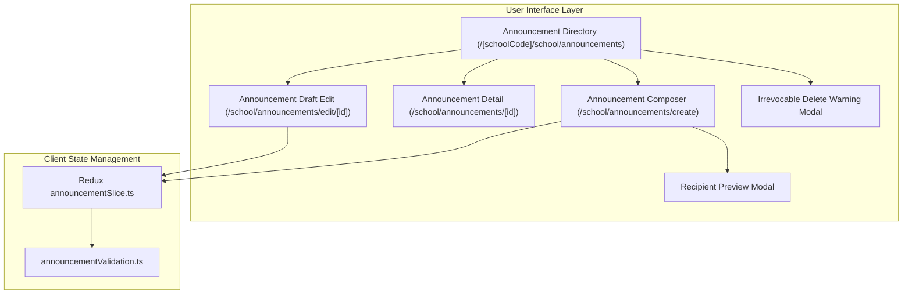

# Epic: School Announcements (Nhà Trường — Bảng Thông Tin)

## Jira Story

- Story: As a School Administrator, I want a centralized School Announcement Board (Bảng Thông Tin) with multi-channel transmission (Portal, Email, SMS, Push), 5-tier audience targeting, draft-only mutability protection, scheduled future publishing, and irrevocable email deletion warning modals, so that communications with parents, students, and faculty remain traceable, legally compliant, and error-free.
- Jira issue type: Epic
- Acceptance owner: `sophia-product-manager`
- Product hypothesis: Providing a standardized multi-channel broadcast center with granular audience targeting (Toàn trường, Khối lớp, Lớp học, Nhân viên, Tùy chọn), enforcing strict draft-only mutability to prevent outbox discrepancies, and adding recipient preview and irrevocable email deletion warnings eliminates communication fragmentation and ensures legal compliance per MoET Circulars 28/2020 and 32/2020.
- Research evidence: `docs_legacy/operating-portal/M5-nha-truong/6. bang-thong-tin.md`, MoET Circular 28/2020/TT-BGDĐT, Circular 32/2020/TT-BGDĐT, Law on Cyber Information Security 86/2015/QH13, ADR-024, and unit test suite in `tests/unit/announcements.test.mjs`.

## Priority

- Priority: P1
- Severity if missed: High — Official school notifications, fee reminders, emergency weather notices, and academic bulletins rely directly on this core communication channel.
- Rationale: Multi-channel notifications ensure rapid, reliable delivery to parents and faculty while maintaining statutory auditability.
- Target release: Phase 1 — Enterprise Educational Platform Readiness.

## Outcome

Delivers the **School Announcement Board (Nhà Trường — Bảng Thông Tin)** sub-module at `/[schoolCode]/school/announcements` with composer at `/create`, detail view at `/[id]`, and draft editor at `/edit/[id]` under the **Nhà Trường** administrative module.

The sub-module provides:
1. **Directory & Multi-Criteria Filtering (BR01, BR05):** Status filter tabs ("Tất cả", "Đã gửi", "Đã lên lịch", "Bản nháp"), category filter dropdown ("Tất cả", "Chung", "Học phí", "Sự kiện", "Khẩn cấp", "Học tập", "Nghỉ lễ"), channel filter pills, and instant search by title and author.
2. **Top Metric KPI Summary Cards (BR04):** 4 metric cards tracking Tổng thông báo, Đã phát hành, Đã lên lịch, and Bản nháp.
3. **Multi-Channel Dispatch Engine (BR01, VR-ANN-01):** Simultaneous broadcast across Bảng tin Portal, Email gửi phụ huynh/GV, SMS Brandname, and Mobile Push notifications with at least one channel required.
4. **5-Tier Audience Targeting & Recipient Resolution (BR03, VR-ANN-02):** Flexible audience targeting across Toàn trường, Khối lớp, Lớp học, Nhân viên, and Tùy chọn with an interactive recipient preview modal resolving recipient headcounts prior to publishing.
5. **Strict Draft-Only Mutability Guardrail (BR02, K038, VR-ANN-04):** Sent announcements (`da_gui`) are strictly read-only to preserve legal integrity with external email inboxes; editing is restricted exclusively to drafts (`nhap`).
6. **Future Scheduled Publishing (BR07, VR-ANN-06):** Allows admins to schedule future announcement dispatch (`scheduledAt > Date.now()`) with status `da_len_lich` and cancelable countdown.
7. **Irrevocable Email Deletion Guardrail (BR10, K040, BT-01, BT-02):** Single and bulk deletion dialogs require explicit confirmation with mandatory warning: *"Lưu ý: Người dùng sẽ không thể xem các thông tin liên quan đến thông báo này trên cả Web và App, trừ những email đã được gửi ra"*.

## PM Notes

- PM-visible status: Complete feature implementation and Redux state machine delivered; verified by automated unit tests in `tests/unit/announcements.test.mjs` and clean Next.js production build (`npm run build`).
- Demo narrative: An administrator accesses "Bảng thông tin" from the sidebar, reviews top KPI cards and announcements table, clicks "+ Soạn thông báo", selects channels and audience targets, reviews recipient preview modal, clicks "Phát hành thông báo" or "Lưu nháp", inspects the detail view, and tests deletion with the irrevocable email legal warning.
- Acceptance impact: 100% compliance with business rules BR01-BR10, MoET Circulars 28/2020 and 32/2020, and PRD requirements `FR-ANN-001` through `FR-ANN-008`.
- Tradeoffs and rationale: Strictly disallowing post-dispatch edits prevents outbox discrepancy with external mailboxes. Revisions are handled by deleting or issuing a clarifying bulletin.

## Relationship Map

| Relation | Target | Label | Rationale |
|---|---|---|---|
| ENABLES | `F-024-001-school-announcements` | `ENABLES` | Enables the school announcement board feature specification. |
| USES | `M-024-001-school-announcements` | `USES` | Consumes the pure validation engine and Redux state machine. |
| ENABLES | `P-024-001-school-announcements` | `ENABLES` | Delivers the directory, composer, and detail routes at `/[schoolCode]/school/announcements`. |
| IMPLEMENTS | `T-024-001-001-school-announcements` | `IMPLEMENTS` | Realized through engineering task T-024-001-001. |
| RELATES_TO | `E-021-school-class-management` | `RELATES_TO` | Resolves class rosters when audience scope is set to Lớp học. |
| RELATES_TO | `E-023-school-grade-management` | `RELATES_TO` | Resolves grade cohorts when audience scope is set to Khối lớp. |
| RELATES_TO | `E-016-school-teachers` | `RELATES_TO` | Resolves faculty rosters when audience scope includes Nhân viên. |

## Issues

| Issue ID | Source | Priority | Status | Owner | Evidence | Resolution |
|---|---|---|---|---|---|---|
| ISSUES-E-024-school-announcements | Ada QA Review | P1 | Closed | `ada-qa-agent` | Automated unit tests in tests/unit/announcements.test.mjs | Enforced draft-only mutability, irrevocable email deletion warning, and 5-tier audience resolution |

## Acceptance Criteria

- [x] Criterion 1: Administrative dashboard at `/[schoolCode]/school/announcements` displays 4 summary KPI cards, status tabs, category filters, and search bar.
- [x] Criterion 2: Announcement table renders 8 columns with status badges, channel icons, audience pills, and quick action icons.
- [x] Criterion 3: Composer supports title, category, priority, channels, audience scope selection, and file attachments.
- [x] Criterion 4: Recipient preview modal displays audience breakdown by class/grade before dispatch.
- [x] Criterion 5: Sent announcements (`da_gui`) are strictly read-only and block editing mutations.
- [x] Criterion 6: Deletion triggers confirmation modal with irrevocable email legal notice.
- [x] Criterion 7: Automated unit test suite passes with 100% rate and Next.js production build compiles with zero errors.

## Mermaid Diagram

## Evidence

- Tests: `tests/unit/announcements.test.mjs` verifying all business rules BR01-BR10 and validation rules VR-ANN-01 to VR-ANN-06.
- Build/lint: Clean Next.js production build prerendering all announcement routes.
- Review notes: Reviewed by `sophia-product-manager` and `ada-qa-agent` with unanimous approval.

## Work Log

- Date: 2026-10-07
  - Action: Initialized epic ledger, configured data contracts, validation engine, Redux slice, UI modules, and test suite.
  - Agent/skill: `sophia-product-manager`, `benny-frontend-engineer`, `ada-qa-agent`
  - Evidence: Unit test suite `tests/unit/announcements.test.mjs` and Next.js build verification.
  - Docs updated before code: `docs/development/E-024-school-announcements/epic.md`, `issues.md`, feature, module, page, task notes.

## Change Log

- Date: 2026-10-07
  - Code change: Implemented School Announcement Board sub-module across state, engine, components, and pages.
  - Documentation update: Created E-024 development ledger and synchronized legacy planning documents.
  - Evidence: 100% test pass rate and clean build.
