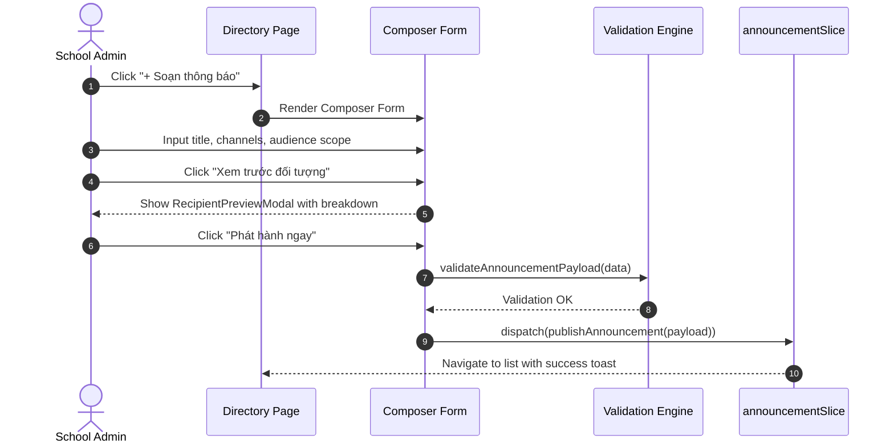

# Feature: School Announcements (Nhà Trường — Bảng Thông Tin)

## User Value

The **School Announcements (Bảng Thông Tin)** feature provides school administrators and authorized teachers with an operational broadcast center capable of composing, scheduling, and tracking official communications across multiple delivery channels (Portal, Email, SMS, Mobile Push).

By enforcing strict draft-only mutability (`VR-ANN-04`), this feature prevents synchronization failures with external inboxes once emails are dispatched. Furthermore, the interactive audience recipient preview modal (`RecipientPreviewModal`) resolves total target headcount by class and grade before transmission, eliminating unintended broadcasts.

## Jira Story

- Story: As a School Administrator, I want a rich announcement authoring and directory hub so that I can draft, schedule, and broadcast school-wide or cohort-targeted notices with automated audience calculation and zero outbox discrepancies.
- Jira issue type: Story
- Story points: 5
- Acceptance owner: `benny-frontend-engineer`
- Research evidence: `docs_legacy/operating-portal/M5-nha-truong/6. bang-thong-tin.md`, PRD requirements `FR-ANN-001` through `FR-ANN-008`, and ADR-024.

## Priority

- Priority: P1
- User/business impact: Critical operational hub for distributing notices, emergency announcements, and tuition billing updates.
- Risk if delayed: Inability to send targeted announcements or loss of message traceability.
- Release target: Phase 1 — Enterprise Educational Platform Readiness.

## PM Notes

- Demo scenario: Admin opens `/school/announcements`, sees 4 KPI cards and announcements list, clicks "+ Soạn thông báo", fills title/category/priority, selects channels Portal & Email, picks target audience "Khối lớp: Khối 10", opens preview modal, publishes announcement, sees it appear in the directory with status "Đã gửi", and inspects detail view.
- Business value: Unified communication pipeline reducing parent inquiries and ensuring compliance with regulatory disclosure mandates.
- Acceptance criteria changed or confirmed: Confirmed all criteria `AC-ANN-001` through `AC-ANN-007`.
- Open PM decision: None. Resolved route namespace, draft-only mutability, and irrevocable email warning modal.

## Requirements Trace

- PRD requirement: `FR-ANN-001` through `FR-ANN-008` (Lines 220–227).
- Task id: `TASK-ANN-001` through `TASK-ANN-007`.
- Spec id: `039-school-announcement-board-bang-thong-tin`.

## Relationship Map

| Relation | Target | Label | Rationale |
|---|---|---|---|
| Parent epic | `E-024-school-announcements` | `IMPLEMENTS` | Implements the primary user-facing feature of Epic 24. |
| Dependency | `M-024-001-school-announcements` | `DEPENDS_ON` | Depends on domain validation logic and Redux store state. |
| Page realization | `P-024-001-school-announcements` | `ENABLES` | Powers the directory, composer, and detail pages. |
| Task delivery | `T-024-001-001-school-announcements` | `IMPLEMENTS` | Realized through engineering task T-024-001-001. |

## Implementation Plan

- Backend: Mock data service `src/services/mockAnnouncementData.ts` simulating REST endpoints.
- Frontend: Next.js pages with Redux Toolkit and hybrid Tailwind + styled-components.
- Data: Canonical TypeScript data models in `src/types/announcement.ts`.
- Observability: Unit test assertions in `tests/unit/announcements.test.mjs` verifying state transitions.
- Rationale: Fully modular, isolated client state machine with pure validation functions.

## Code Scope

- Contracts: `src/types/announcement.ts`
- Domain Logic: `src/utils/announcementValidation.ts`
- Mock Data: `src/services/mockAnnouncementData.ts`
- State: `src/store/slices/announcementSlice.ts`, `src/store/index.ts`
- UI: `src/modules/school/announcements/AnnouncementToolbar.tsx`
- UI: `src/modules/school/announcements/AnnouncementSummaryCards.tsx`
- UI: `src/modules/school/announcements/AnnouncementTable.tsx`
- UI: `src/modules/school/announcements/AnnouncementComposer.tsx`
- UI: `src/modules/school/announcements/AnnouncementDetailView.tsx`
- UI: `src/modules/school/announcements/RecipientPreviewModal.tsx`
- UI: `src/modules/school/announcements/DeleteAnnouncementModal.tsx`
- Route: `src/pages/[schoolCode]/school/announcements/index.tsx`
- Route: `src/pages/[schoolCode]/school/announcements/create.tsx`
- Route: `src/pages/[schoolCode]/school/announcements/[id].tsx`
- Route: `src/pages/[schoolCode]/school/announcements/edit/[id].tsx`
- Layout: `src/components/layout/PortalLayout.tsx`
- Tests: `tests/unit/announcements.test.mjs`

## Mermaid Diagram

## Verification

- [x] Test: Automated unit tests in `tests/unit/announcements.test.mjs`.
- [x] Build/lint/typecheck: Clean production build with `npm run build`.
- [x] Manual scenario: Composer form validation, audience preview modal, draft vs sent mutability, irrevocable email warning modal.

## Risks

- Risk: External email outbox discrepancy if edits allowed post-publish.
  - Mitigation: Enforced strict draft-only mutability in validation engine and disabled edit actions on sent announcements.

## Work Log

- Date: 2026-10-07
  - Action: Formatted feature specification, defined data contracts, and linked requirements trace.
  - Agent/skill: `benny-frontend-engineer`
  - Evidence: `tests/unit/announcements.test.mjs`.
  - Docs updated before code: `docs/development/E-024-school-announcements/features/F-024-001-school-announcements.md`.

## Change Log

- Date: 2026-10-07
  - Code change: Implemented School Announcement Board frontend modules and validation logic.
  - Documentation update: Documented feature scope, requirements trace, and implementation plan.
  - Evidence: Automated test suite verification.
