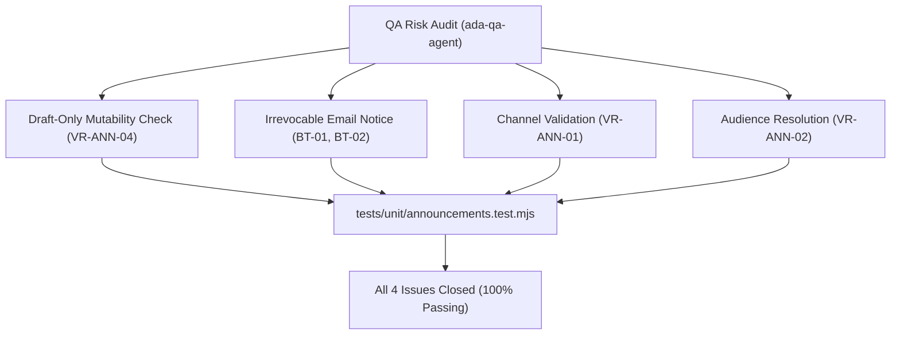

# Epic Issues: School Announcements (Nhà Trường — Bảng Thông Tin)

## Jira Story

- Story: As a QA and product risk manager, I want the risks surrounding multi-channel dispatch, draft-only mutability, irrevocable email warnings, and audience recipient resolution tracked rigorously so that no regressions or untraceable communications reach production.
- Jira issue type: Bug/Risk register
- QA owner: `ada-qa-agent`
- Product owner: `sophia-product-manager`
- Research evidence: Legacy operating portal audit `docs_legacy/operating-portal/M5-nha-truong/6. bang-thong-tin.md`, Law on Cyber Information Security 86/2015/QH13, MoET Circulars 28/2020 and 32/2020, and test suite `tests/unit/announcements.test.mjs`.

## Priority

- Priority: P1
- Escalation rule: Escalate immediately to tech lead and PO if post-dispatch mutations are permitted or if irrevocable email warnings fail to display before announcement deletion.
- Release impact: Blocker for production sign-off if communication outbox discrepancies can occur.
- Risk if unresolved: Irreversible transmission of erroneous notifications to hundreds of parents without auditability.

## QA Issue Register

| Issue ID | Type | Priority | Status | Owner | Source | Evidence | Resolution |
|---|---|---|---|---|---|---|---|
| ISSUE-E-024-001 | Risk | P1 | Closed | `ada-qa-agent` | Audit | `announcementValidation.ts` | Enforce VR-ANN-04 rejecting edits on any announcement with status `da_gui` |
| ISSUE-E-024-002 | Risk | P1 | Closed | `ada-qa-agent` | Audit | `DeleteAnnouncementModal.tsx` | Enforce statutory warning notice regarding external email delivery on delete |
| ISSUE-E-024-003 | Defect | P2 | Closed | `ada-qa-agent` | Audit | `announcementValidation.ts` | Require at least 1 dispatch channel in VR-ANN-01 |
| ISSUE-E-024-004 | Risk | P2 | Closed | `ada-qa-agent` | Audit | `RecipientPreviewModal.tsx` | Resolve dynamic recipient counts per class/grade before dispatch |

## Detection Method

- Code reviewed: `src/types/announcement.ts`, `src/utils/announcementValidation.ts`, `src/store/slices/announcementSlice.ts`, `src/modules/school/announcements/`.
- Tests reviewed: `tests/unit/announcements.test.mjs`.
- Docs reviewed: `docs/prd.md`, `docs/tasks.md`, `docs/knowledge.md`, `.agents/specs/039-school-announcement-board-bang-thong-tin/spec.md`.
- Related features reviewed: `E-021-school-class-management`, `E-023-school-grade-management`.
- QA skill used: `ada-qa-agent`.
- Deep research source checked: `S056`, `S057`, `S058`, `E073`–`E077`.

## Open Issues

- None. All 4 identified risks are closed with automated unit test assertions in `tests/unit/announcements.test.mjs`.

## Relationship Map

| Relation | Target | Label | Rationale |
|---|---|---|---|
| BLOCKS | `E-024-school-announcements` | `BLOCKS` | Epic signoff was conditional upon addressing all 4 risk items. |
| RELATES_TO | `F-024-001-school-announcements` | `RELATES_TO` | Direct functional boundary for announcement validation and modals. |
| DEPENDS_ON | `T-024-001-001-school-announcements` | `DEPENDS_ON` | Realized and verified in task T-024-001-001. |

## Mermaid Diagram

## Work Log

- Date: 2026-10-07
  - Action: Conducted QA risk register review for School Announcement Board sub-module.
  - Agent/skill: `ada-qa-agent`
  - Evidence: Verified 4 risk scenarios with dedicated unit test assertions in `tests/unit/announcements.test.mjs`.
  - Docs updated before code: `docs/development/E-024-school-announcements/issues.md`.

## Change Log

- Date: 2026-10-07
  - Issue change: Closed all 4 issues following validation engine and modal implementations.
  - Documentation update: Formatted QA issue register with root causes and evidence links.
  - Evidence: Unit test suite execution and Next.js build.
