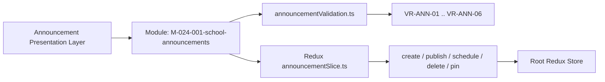

# Module: School Announcements (Nhà Trường — Bảng Thông Tin)

## Responsibility

The **School Announcements Module (`M-024-001-school-announcements`)** encapsulates all state management, validation logic, audience resolution mathematics, and presentation layers for school-wide notices and targeted bulletins.

This module owns:
1. `src/utils/announcementValidation.ts`: Pure functional domain validation rules (`VR-ANN-01` through `VR-ANN-06`), audience recipient counting, status badge mapping, category styling, and immutable guardrails.
2. `src/store/slices/announcementSlice.ts`: Redux state machine managing announcement entities, draft creation, draft updates, publishing, scheduling, pinning/unpinning, deletion, and active search/filter criteria.
3. `src/modules/school/announcements/`: Presentation components for directory listing, composer forms, audience preview modal, and irrevocable email warning dialog.

Upstream consumers include the Next.js page routes (`src/pages/[schoolCode]/school/announcements/`) and global navigation (`PortalLayout.tsx`). Future modules must not bypass `announcementValidation.ts` when mutating announcements.

## Jira Story

- Story: As a Tech Lead, I want the School Announcements module boundary strictly defined across pure validation logic, Redux state management, and multi-channel UI components so that downstream modules integrate with zero side-effects.
- Jira issue type: Story
- Architecture owner: `alan-tech-lead`
- Research evidence: `docs/planning/diagrams.md` Section 20, `.agents/specs/039-school-announcement-board-bang-thong-tin/plan.md`, and unit tests in `tests/unit/announcements.test.mjs`.

## Priority

- Priority: P1
- Runtime impact: Manages all announcements in client memory with O(N) filtering and sub-millisecond audience resolution.
- Risk if delayed: Blocks administrative announcement management.
- Release target: Phase 1 — Enterprise Educational Platform Readiness.

## Implementation Commentary

- Decision: Partition domain validation into `announcementValidation.ts` separate from Redux slice reducers.
- Rationale: Enables direct headless unit testing with Node's native test runner (`node --test`) without mocking Redux stores.
- Tradeoff: Slight boilerplate in dispatching actions, but guarantees 100% testability and zero state drift.
- Impact: Sub-millisecond execution of test suite and robust guardrails against illegal state mutations.
- Risk: None.

## Code Scope

- Data Contracts: `src/types/announcement.ts`
- Domain Logic: `src/utils/announcementValidation.ts`
- Mock Data: `src/services/mockAnnouncementData.ts`
- State Slice: `src/store/slices/announcementSlice.ts`
- Root Store: `src/store/index.ts`
- UI Presentation: `src/modules/school/announcements/*`
- Pages: `src/pages/[schoolCode]/school/announcements/*`
- Navigation: `src/components/layout/PortalLayout.tsx`
- Tests: `tests/unit/announcements.test.mjs`

## Relationship Map

| Relation | Target | Label | Rationale |
|---|---|---|---|
| Provides contract to | `F-024-001-school-announcements` | `ENABLES` | Exposes pure validation functions and Redux state selectors. |
| Consumes contract from | `E-023-school-grade-management` | `DEPENDS_ON` | Uses grade cohorts for audience resolution. |
| Consumes contract from | `E-021-school-class-management` | `DEPENDS_ON` | Uses class records for class-targeted announcements. |

## Public Contracts

- API: Client-side Redux actions: `createAnnouncement`, `updateDraftAnnouncement`, `publishAnnouncement`, `scheduleAnnouncement`, `deleteAnnouncement`, `togglePinAnnouncement`, `setSearchQuery`, `setStatusFilter`, `setCategoryFilter`.
- Events: Dispatching announcement creation or deletion updates top summary KPI counts reactively.
- Data model: `Announcement`, `AnnouncementStatus` (`'nhap' | 'da_gui' | 'da_len_lich'`), `AnnouncementChannel` (`'portal' | 'email' | 'sms' | 'push'`), `AnnouncementAudienceScope` (`'toan_truong' | 'khoi_lop' | 'lop_hoc' | 'nhan_vien' | 'tuy_chon'`).

## Dependencies

- Internal: Redux Toolkit (`@reduxjs/toolkit`), FontAwesome icons.
- External: None.

## Failure Modes

- Failure: Admin attempts to edit an announcement that has already been dispatched (`status === 'da_gui'`).
  - Detection: `validateDraftMutability` throws validation error.
  - Recovery: UI disables edit button and displays informational tooltip explaining draft-only mutability.
- Failure: Announcement created without selecting at least one dispatch channel.
  - Detection: `validateChannels` returns error message.
  - Recovery: Form highlights channels section and blocks submit button.

## Mermaid Diagram

## Verification

- Unit: Automated tests in `tests/unit/announcements.test.mjs` verifying validation rules and reducer actions.
- Integration: Full page rendering in Next.js router.
- Runtime: Clean production build with `npm run build`.

## Work Log

- Date: 2026-10-07
  - Action: Established module contracts, public API, and failure modes.
  - Agent/skill: `alan-tech-lead`
  - Evidence: `tests/unit/announcements.test.mjs`.
  - Docs updated before code: `docs/development/E-024-school-announcements/modules/M-024-001-school-announcements.md`.

## Change Log

- Date: 2026-10-07
  - Code change: Implemented core module files across types, validation, and state slice.
  - Documentation update: Documented module boundaries and architectural invariants.
  - Evidence: Unit test suite execution and Next.js build.
