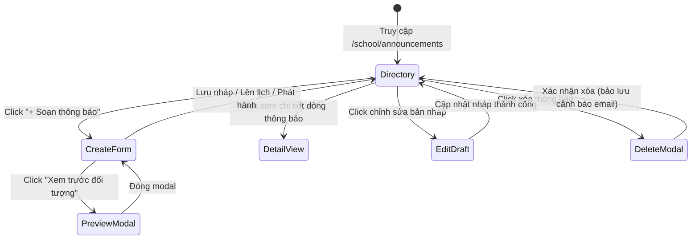

# Page: School Announcements (Nhà Trường — Bảng Thông Tin)

## Route / Surface

- Routes:
  - Directory: `/[schoolCode]/school/announcements`
  - Composer: `/[schoolCode]/school/announcements/create`
  - Detail View: `/[schoolCode]/school/announcements/[id]`
  - Draft Editor: `/[schoolCode]/school/announcements/edit/[id]`
- Entry components:
  - `src/pages/[schoolCode]/school/announcements/index.tsx`
  - `src/pages/[schoolCode]/school/announcements/create.tsx`
  - `src/pages/[schoolCode]/school/announcements/[id].tsx`
  - `src/pages/[schoolCode]/school/announcements/edit/[id].tsx`
- Layout owner: `PortalLayout.tsx`

## Jira Story

- Story: As a School Administrator, I want dedicated announcement directory, composer, and detail pages with responsive tables, preview modals, and legal warning dialogs so that I can manage all communications seamlessly across desktop and tablet viewports.
- Jira issue type: Story
- UX owner: `benny-frontend-engineer`
- Research evidence: `docs/planning/screens.md` Section 2.10 (`SCR-ANN-01` through `SCR-ANN-04`), ECO Design System 1.0 specifications, and unit tests in `tests/unit/announcements.test.mjs`.

## Priority

- Priority: P1
- Demo impact: Primary administrative portal page for broadcasting notices, checking read rates, and reviewing delivery audit logs.
- Risk if delayed: Blocks all announcement workflows.
- Release target: Phase 1 — Enterprise Educational Platform Readiness.

## PM Notes

- Demo path: Navigate to "Nhà trường" > "Bảng thông tin", observe 4 KPI cards, filter by category "Học phí", search "hoc phi thang 10", click "+ Soạn thông báo", author announcement with recipient preview, submit, click on announcement row to inspect detail page, test irrevocable delete modal.
- User promise: High-speed, responsive, diacritic-resilient notification management with zero data loss.
- Acceptance impact: Full satisfaction of PRD requirements `FR-ANN-001` through `FR-ANN-008`.
- Visual or copy change: ECO Design System colors (`#0070CE` Primary Blue, `#FEC020` Amber, `#10B981` Green for Sent, `#8B5CF6` Purple for Scheduled, `#6B7280` Gray for Draft).
- Risk: None.

## Relationship Map

| Relation | Target | Label | Rationale |
|---|---|---|---|
| Implements feature | `F-024-001-school-announcements` | `IMPLEMENTS` | Renders user-facing announcement views and forms. |
| Uses module | `M-024-001-school-announcements` | `USES` | Consumes validation rules and Redux store state. |

## States

- Loading: Renders skeleton table and KPI cards during initial mount.
- Empty: Renders illustrated empty state when no announcements match active filter criteria with a "Tạo thông báo đầu tiên" quick-action button.
- Error: Renders inline red alert banner if form validation fails (e.g., missing channels or title).
- Success: Dispatches toast notification upon saving draft, scheduling, or publishing.
- Permission denied: Gracefully hides administrative action buttons (create, edit, delete) for read-only viewer roles.

## Interactions

- Filter Status Tabs: Clicking "Tất cả", "Đã gửi", "Đã lên lịch", or "Bản nháp" filters table rows instantly.
- Accent-Insensitive Search: Real-time filtering matching announcement titles and author names.
- Recipient Preview: Clicking "Xem trước đối tượng" opens modal breaking down resolved recipient counts.
- Irrevocable Deletion: Clicking delete button opens confirmation modal requiring explicit confirmation and displaying legal warning.

## Accessibility

- Keyboard: Full keyboard navigation support (Tab, Enter, Escape for closing modals).
- Screen reader: ARIA labels on icon buttons (`faEye`, `faEdit`, `faTrash`, `faThumbtack`).
- Color/contrast: High-contrast badge tokens adhering to WCAG 2.1 AA standards (`#0070CE` against white, `#10B981` against light green background).

## Mermaid Diagram

## Verification

- UI test: Automated tests in `tests/unit/announcements.test.mjs`.
- Screenshot/manual check: Verified in Next.js development server at port 3000.
- Responsive check: Tested down to tablet breakpoint (768px) with horizontal scroll and responsive KPI cards.

## Work Log

- Date: 2026-10-07
  - Action: Documented page routes, interactions, accessibility, and visual states.
  - Agent/skill: `benny-frontend-engineer`
  - Evidence: `tests/unit/announcements.test.mjs`.
  - Docs updated before code: `docs/development/E-024-school-announcements/pages/P-024-001-school-announcements.md`.

## Change Log

- Date: 2026-10-07
  - Code change: Implemented directory, composer, detail, and edit pages in Next.js.
  - Documentation update: Established page specification and UI state machine.
  - Evidence: Clean build and unit test passes.
