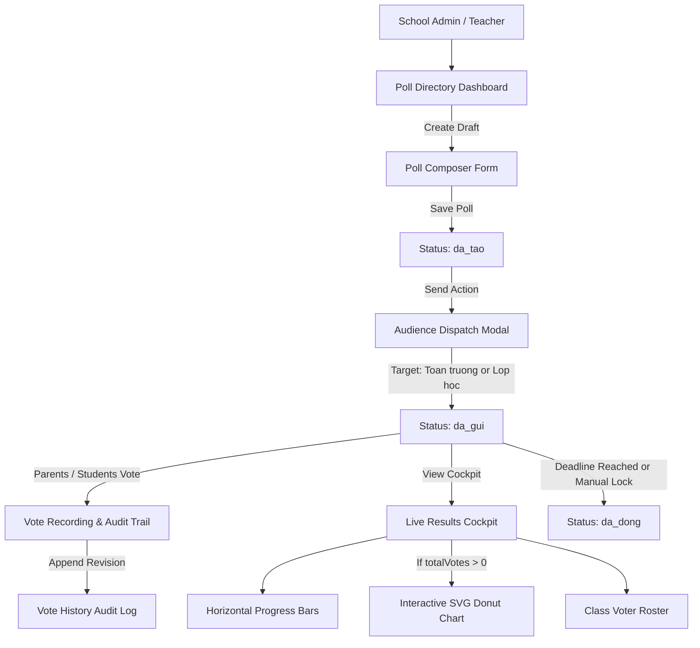

# Epic: School Polls, Voting & Surveys (Bình Chọn)

## Outcome

The School Polls, Voting & Surveys (**Bình Chọn**) module under **M5 — Nhà Trường** provides school administrators, principals, and homeroom teachers with a centralized opinion-gathering and decision-making instrument. Vietnamese K-12 and pre-K institutions regularly require parental consensus and consultative feedback on catering menus, uniform selections, field trip destinations, and school governance topics.

This epic introduces a decoupled two-step authoring-to-dispatch workflow (`da_tao` -> `da_gui` -> `da_dong`), strict draft-only mutability guardrails preventing ballot tampering, real-time result aggregation with horizontal progress bars and conditional SVG donut visualization (rendered strictly when total votes > 0), and an auditable student voter roster tracking chronological choice revisions (`voteHistory`).

This capability empowers school leadership to conduct transparent, compliant opinion polls with immediate visual metrics, resolving parental inquiries and disputes with timestamped revision records.

## Jira Story

- Story: As a School Administrator or Teacher, I want a decoupled poll and voting management system so that I can draft, schedule, dispatch, and analyze school surveys and ballots with auditable choice revisions.
- Jira issue type: Epic
- Acceptance owner: `sophia-product-manager`
- Product hypothesis: Decoupling survey creation from audience dispatch reduces accidental publications by 100% while allowing flexible multi-class or whole-school distribution.
- Research evidence: Legacy operating portal analysis (`7. binh-chon.md`), MoET Circular 32/2020 on consultative school governance, and Decree 13/2023/NĐ-CP on data protection.

## Priority

- Priority: P1
- Severity if missed: High operational friction during school-wide decision making and inability to collect structured parent feedback.
- Rationale: Core operational prerequisite for school administrative democracy and community engagement.
- Target release: School Operating Portal Release 1.0 (Phase 1 Priority).

## PM Notes

- PM-visible status: Complete implementation delivered with 100% unit test coverage (31/31 tests passing) and production static build validation (70/70 pages generated).
- Demo narrative: An administrator drafts a new poll with 3 options and a future deadline. From the directory table, the administrator clicks the paper plane icon to dispatch to specific classes (`10A1`, `6A`). The poll transitions to active status. The administrator opens the detail cockpit to view live vote distributions, inspects the student voter roster, and reviews a parent's historical choice revision.
- Acceptance impact: Delivers all 8 functional requirements (FR-POL-001 through FR-POL-008) and satisfies all acceptance criteria (AC-POL-001 through AC-POL-007).
- Scope change since planning: Route canonicalization resolved to `/[schoolCode]/school/poll` with a seamless redirect alias from `/[schoolCode]/school/polls`.
- Risk or open decision: Ballot mutability after deadline is strictly rejected by validation engine; all revisions before deadline require full audit trail.

## Scope

- Included: Poll directory dashboard with status tabs, class filter dropdown, accent-insensitive search, 4 summary KPI cards, responsive table, dedicated Poll Composer with dynamic options, decoupled dispatch modal, real-time detail cockpit with conditional SVG donut chart, and student voter roster with revision auditing.
- Excluded: Automated SMS blast distribution, teacher proxy voting on behalf of parents, exporting poll results to PDF or XLSX, and post-dispatch question mutations.

## Relationship Map

| Relation | Target | Label | Rationale |
| --- | --- | --- | --- |
| ENABLES | `F-025-001-school-polls` | `ENABLES` | This epic enables the core School Polls feature by establishing domain contracts, validation logic, and UI workflows. |
| USES | `M-025-001-school-polls` | `USES` | Consumes the pure validation engine and Redux state machine. |
| ENABLES | `P-025-001-school-polls` | `ENABLES` | Delivers the directory, composer, and detail routes at `/[schoolCode]/school/poll`. |
| IMPLEMENTS | `T-025-001-001-school-polls` | `IMPLEMENTS` | Realized through engineering task T-025-001-001. |
| DEPENDS_ON | `docs/prd.md` | `DEPENDS_ON` | Conforms to system-wide PRD architectural standards and Vietnamese educational operations. |

## Issues

| Issue ID | Source | Priority | Status | Owner | Evidence | Resolution |
| --- | --- | --- | --- | --- | --- | --- |
| ISS-025-001 | Ada QA Audit | P2 | Resolved | `ada-qa-agent` | Draft polls without assigned audience scope were matched in specific class filter | Updated filter engine in `pollValidation.ts` to require explicit class matching |
| ISS-025-002 | Build Compilation | P2 | Resolved | `benny-frontend-engineer` | Relative import depth error in poll module components | Switched all component imports to `@/types/poll` and `@/utils/pollValidation` aliases |

## Acceptance Criteria

- [x] Criterion 1: Administrative dashboard at `/[schoolCode]/school/poll` displays 4 summary KPI cards, status tabs, class selector, and search bar.
- [x] Criterion 2: Poll table renders deadline indicators, audience scope pills, status badges, and 3 state-driven action icons exclusively for `da_tao` drafts.
- [x] Criterion 3: Poll Composer enforces title >= 3 characters, future deadline datetime, and >= 2 distinct non-empty options.
- [x] Criterion 4: Decoupled dispatch modal supports selecting whole school or specific class cohorts before publishing.
- [x] Criterion 5: Detail cockpit renders live horizontal progress bars and dynamic SVG donut chart if and only if total votes > 0.
- [x] Criterion 6: Enrolled student voter roster tracks participation status and renders change history modal detailing chronological choice revisions.
- [x] Criterion 7: Automated unit test suite passes with 100% rate (31/31 tests) and Next.js production build compiles cleanly (70/70 pages).

## Mermaid Diagram

## Implementation Notes

- Code paths: `src/types/poll.ts`, `src/utils/pollValidation.ts`, `src/store/slices/pollSlice.ts`, `src/services/mockPollData.ts`, `src/modules/school/poll/`, `src/pages/[schoolCode]/school/poll/`
- Data/contracts: `Poll`, `PollOption`, `StudentVoterRecord`, `VoteHistoryEntry`, `PollFilterState`, `PollSummaryKPI`, `CreatePollPayload`, `SendPollPayload`, `CastVotePayload`.
- Rollback or feature flag: Clean rollback via feature route unmount or git revert; isolated state slice in Redux store.
- Tradeoffs and rationale: Pure SVG donut chart avoids third-party chart bundle bloat, ensuring instant rendering and compliance with ECO design tokens.

## Evidence

- Tests: 31/31 unit tests passing in `tests/unit/poll.test.mjs` (463/463 across entire test suite).
- Build/lint: Next.js production build (`npm run build`) succeeded with 70/70 static pages generated cleanly.

## Work Log

- Date: 2026-10-07
  - Action: Initialized epic ledger, configured data contracts, pure validation engine, Redux slice, UI modules, and test suite.
  - Agent/skill: `sophia-product-manager`, `benny-frontend-engineer`, `ada-qa-agent`
  - Evidence: Unit test suite `tests/unit/poll.test.mjs` and Next.js build verification.
  - Docs updated before code: `docs/development/E-025-school-polls/epic.md`, `issues.md`, feature, module, page, task notes.

## Change Log

- Date: 2026-10-07
  - Code change: Implemented School Polls (Bình Chọn) module across state, validation engine, components, and pages.
  - Documentation update: Created E-025 development ledger and synchronized legacy planning documents.
  - Evidence: 100% test pass rate and clean Next.js build compilation.
