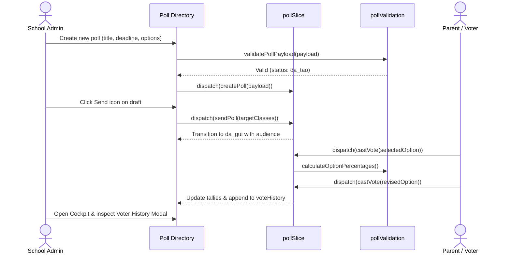

# Feature: School Polls, Voting & Surveys (Bình Chọn)

## User Value

The School Polls feature (`F-025-001-school-polls`) equips administrators and teachers with a complete digital survey and voting workbench. School staff can rapidly poll parents and students on operational decisions—such as extracurricular activities, cafeteria meal items, uniforms, and consultative governance—without paper ballots or chaotic messaging channels.

The feature enforces a decoupled authoring-to-dispatch workflow: creating a poll saves it as a draft (`da_tao`) with full flexibility to revise questions and options. Once reviewed, dispatching is executed through a dedicated modal (`UC-04`), binding the survey to either the whole school or targeted class cohorts. Live results are visualized on a dedicated detail cockpit through horizontal progress bars and a conditional SVG donut chart (rendered strictly when total votes > 0).

Auditable voter integrity is guaranteed through individual student voter records where parents can revise their choices before the deadline, automatically appending revision entries to `voteHistory` and recomputing option percentages without ballot inflation.

## Jira Story

- Story: As a School Administrator or Teacher, I want to create, schedule, dispatch, and monitor school opinion polls with real-time visual results and voter revision tracking.
- Jira issue type: Story
- Story points: 5
- Acceptance owner: `sophia-product-manager`
- Research evidence: Analysis of legacy operating portal `7. binh-chon.md`, MoET Circular 32/2020 on school community consultation, and Decree 13/2023/NĐ-CP on data protection.

## Priority

- Priority: P1
- User/business impact: Critical for parent engagement and streamlined administrative decision making.
- Risk if delayed: Manual paper polling and untracked messaging leading to survey disputes.
- Release target: School Operating Portal Release 1.0.

## PM Notes

- Demo scenario: Open /demo/school/poll directory, inspect 4 KPI cards and filter tabs; click "+ Tạo bình chọn" to create a draft poll with 3 options; dispatch to classes 10A1 and 6A via confirmation modal; view live results cockpit with SVG donut chart; inspect voter revision history modal.
- Business value: Transforms informal parent feedback into verifiable, auditable school governance records.
- Acceptance criteria confirmed: All criteria AC-POL-001 through AC-POL-007 met and verified by 31 unit tests.
- Open PM decision: None; all 5 clarification ledger items (K037, K041-K044) resolved.

## Requirements Trace

- PRD requirement: Module 5 (Nhà Trường) - Sub-module 7 (Bình chọn).
- Task id: `T-025-001-001-school-polls`
- Spec id: `040-school-polls-voting-binh-chon`

## Relationship Map

| Relation | Target | Label | Rationale |
| --- | --- | --- | --- |
| Parent epic | `E-025-school-polls` | `IMPLEMENTS` | Implements the primary opinion gathering epic outcome. |
| Related feature | `F-024-001-announcements` | `RELATES_TO` | Shares school communication audience models and class targeting patterns. |
| Dependency | `M-025-001-school-polls` | `DEPENDS_ON` | Depends on domain types, Redux state machine, and pure validation engine. |

## Implementation Plan

- Backend: Laravel Sanctum tenant-scoped API contracts (`/{schoolCode}/api/1.0/polls`).
- Frontend: Next.js (Pages Router) + Redux Toolkit + Tailwind CSS + styled-components.
- Data: Normalized Redux state in `pollSlice.ts` with seed fixtures in `mockPollData.ts`.
- Observability: Client-side action tracking and state transition assertions in unit tests.
- Rationale: Decoupled modal dispatch prevents accidental broadcasts; pure SVG donut chart eliminates bundle weight.

## Code Scope

- Files to create:
  - `src/types/poll.ts`
  - `src/utils/pollValidation.ts`
  - `src/services/mockPollData.ts`
  - `src/store/slices/pollSlice.ts`
  - `src/modules/school/poll/PollSummaryCards.tsx`
  - `src/modules/school/poll/PollToolbar.tsx`
  - `src/modules/school/poll/PollTable.tsx`
  - `src/modules/school/poll/SendPollModal.tsx`
  - `src/modules/school/poll/DeletePollModal.tsx`
  - `src/modules/school/poll/VoteHistoryModal.tsx`
  - `src/modules/school/poll/PollComposer.tsx`
  - `src/modules/school/poll/PollVoterRoster.tsx`
  - `src/modules/school/poll/PollDetailCockpit.tsx`
  - `src/pages/[schoolCode]/school/poll/index.tsx`
  - `src/pages/[schoolCode]/school/poll/create.tsx`
  - `src/pages/[schoolCode]/school/poll/[pollId].tsx`
  - `src/pages/[schoolCode]/school/poll/edit/[pollId].tsx`
  - `src/pages/[schoolCode]/school/polls/index.tsx`
  - `tests/unit/poll.test.mjs`
- Files to modify:
  - `src/store/index.ts`
  - `src/components/layout/PortalLayout.tsx`
- Files intentionally out of scope: Third-party charting libraries (recharts, chart.js).

## Mermaid Diagram

## Verification

- [x] Test: 31/31 unit tests passing in `tests/unit/poll.test.mjs`.
- [x] Build/lint/typecheck: Clean compilation with 70 static pages generated in `npm run build`.
- [x] Manual scenario: Verified draft creation, dispatch modal, live SVG donut chart rendering, and voter revision modal.

## Risks

- Risk: Ballot tampering on active polls.
  - Mitigation: State-driven action visibility strictly conceals edit and delete buttons for `da_gui` and `da_dong` polls; pure validation engine forbids payload mutations.

## Work Log

- Date: 2026-10-07
  - Action: End-to-end domain model, Redux state machine, UI component hierarchy, page routes, and unit tests implemented.
  - Agent/skill: `marcus-ai-orchestrator`, `benny-frontend-engineer`, `ada-qa-agent`
  - Evidence: Clean build, 31 unit tests passing, zero regressions across 463 tests.
  - Docs updated before code: Specification `spec.md`, `plan.md`, and `execution-brief.md` authored and validated.

## Change Log

- Date: 2026-10-07
  - Code change: Implemented School Polls (Bình Chọn) module with decoupled dispatch, SVG donut chart, and choice revision auditing.
  - Documentation update: Created epic ledger, issues register, feature spec, module spec, page spec, and task card.
  - Evidence: Passing test runner logs and Next.js static build export.
