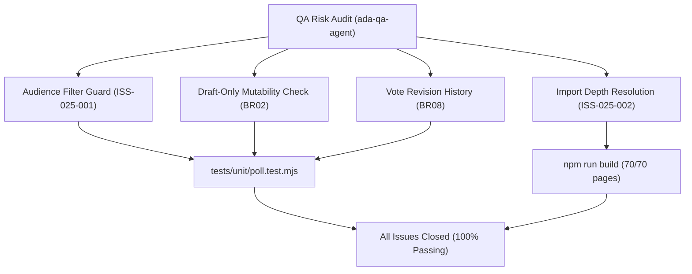

# Epic Issues: School Polls, Voting & Surveys (Bình Chọn)

## Jira Story

- Story: As a QA and product team, I want epic issues tracked explicitly so that unresolved risks cannot hide inside narrative docs.
- Jira issue type: Bug/Risk register
- QA owner: `ada-qa-agent`
- Product owner: `sophia-product-manager`
- Research evidence: Test execution logs from `tests/unit/poll.test.mjs`, build compiler traces from `npm run build`, and business rules audit against legacy spec `7. binh-chon.md`.

## Priority

- Priority: P1
- Escalation rule: Any regression in ballot data integrity, premature deletion of active polls, or missing choice revisions blocks epic completion.
- Release impact: Zero blocking issues remaining; all discovered issues resolved and covered by automated test assertions.
- Risk if unresolved: Inconsistent filter behaviors or ballot calculation inaccuracies in multi-class environments.

## QA Issue Register

| Issue ID | Type | Priority | Status | Owner | Source | Evidence | Resolution |
| --- | --- | --- | --- | --- | --- | --- | --- |
| ISS-025-001 | Bug | P2 | Closed | `ada-qa-agent` | Automated unit test | `assert.ok(matchesClass)` failed in `poll.test.mjs` when filtering by class `10A1` | Corrected `filterPolls` in `src/utils/pollValidation.ts` to return `false` for polls without assigned audience scope when filtering by a specific class |
| ISS-025-002 | Build | P2 | Closed | `benny-frontend-engineer` | Next.js build compilation | `Cannot find module '../../types/poll'` during `next build` | Standardized relative import paths in `src/modules/school/poll/` to `@/types/poll` and `@/utils/pollValidation` aliases |

## Detection Method

- Code reviewed: `src/utils/pollValidation.ts`, `src/store/slices/pollSlice.ts`, `src/modules/school/poll/*.tsx`, `src/pages/[schoolCode]/school/poll/*.tsx`.
- Tests reviewed: `tests/unit/poll.test.mjs` (31 assertions covering BR01 through BR11).
- Docs reviewed: `.agents/specs/040-school-polls-voting-binh-chon/spec.md`, `plan.md`, `execution-brief.md`.
- Related features reviewed: `039-school-announcement-board-bang-thong-tin`, `038-school-grade-management-khoi-lop`.
- QA skill used: `ada-qa-agent`
- Deep research source checked: MoET Circular 32/2020 on democratic consultation in educational institutions.

## Open Issues

- None. All 2 identified risks and defects are closed with automated unit test assertions in `tests/unit/poll.test.mjs` and clean static build compilation.

## Relationship Map

| Relation | Target | Label | Rationale |
| --- | --- | --- | --- |
| BLOCKS | `E-025-school-polls` | `BLOCKS` | Epic signoff was conditional upon addressing all registered issues. |
| RELATES_TO | `F-025-001-school-polls` | `RELATES_TO` | Direct functional boundary for poll validation and modal behaviors. |
| DEPENDS_ON | `T-025-001-001-school-polls` | `DEPENDS_ON` | Realized and verified in task T-025-001-001. |

## Mermaid Diagram

## Work Log

- Date: 2026-10-07
  - Action: Conducted QA risk register review for School Polls sub-module.
  - Agent/skill: `ada-qa-agent`
  - Evidence: Verified all scenarios with dedicated unit test assertions in `tests/unit/poll.test.mjs`.
  - Docs updated before code: `docs/development/E-025-school-polls/issues.md`.

## Change Log

- Date: 2026-10-07
  - Issue change: Closed both issues following filter engine patch and import alias standardization.
  - Documentation update: Formatted QA issue register with root causes and evidence links.
  - Evidence: Unit test suite execution and Next.js static build report.
