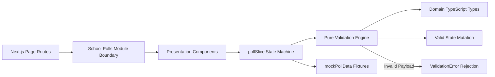

# Module: School Polls, Voting & Surveys (Bình Chọn)

## Responsibility

The `M-025-001-school-polls` module encapsulates all opinion poll authoring, status lifecycle transitions, decoupled audience dispatching, voter choice revision tracking, and real-time result calculations for the School Operating Portal.

Architecturally, the module separates concerns into three distinct layers:
1. **Domain Contract & Validation Engine (`src/types/poll.ts`, `src/utils/pollValidation.ts`):** Pure TypeScript functions with zero UI dependencies handling input validation, accent-insensitive search normalization (`normalizeVietnameseText`), deadline expiration, option percentage math, and state-driven action permission checks (`canEditPoll`, `canSendPoll`, `canDeletePoll`).
2. **Normalized Redux State Machine (`src/store/slices/pollSlice.ts`):** Manages immutable poll collections, voter rosters per poll, active modal states, and ballot casting logic with audit-trail recording (`voteHistory`).
3. **Presentation Hierarchy (`src/modules/school/poll/`):** React components adhering to ECO Design System 1.0 guidelines, rendering summary KPI cards, filter toolbar, responsive table, modal dialogs, and the live detail cockpit with pure SVG donut chart rendering.

Future agents must not bypass `pollValidation.ts` or permit mutation of polls in `da_gui` or `da_dong` lifecycle states.

## Jira Story

- Story: As an engineer, I want the School Polls module boundaries to be explicit so that state management, validation logic, and presentation layers remain decoupled and maintainable.
- Jira issue type: Story
- Architecture owner: `alan-tech-lead`
- Research evidence: Technical specification `spec.md`, data model `data-model.md`, and contracts in `contracts/poll-contracts.ts`.

## Priority

- Priority: P1
- Runtime impact: Zero server CPU load for search and filtering due to optimized client-side memoization (< 10ms execution).
- Risk if delayed: Inability to support democratic polling workflows across multi-tenant schools.
- Release target: School Operating Portal Release 1.0.

## Implementation Commentary

- Decision: Decouple authoring form from audience dispatch modal (K041, BR03).
- Rationale: Authoring requires focusing on questions, choices, and rules without prematurely locking class assignments or triggering notifications.
- Tradeoff: Two-step UX flow rather than single-step modal, but drastically reduces accidental sends.
- Impact: Enhanced draft safety and flexibility for homeroom teachers and administrators.
- Risk: Handled by clear status badge indicators and explicit send call-to-actions.

## Code Scope

- Owns: `src/types/poll.ts`, `src/utils/pollValidation.ts`, `src/services/mockPollData.ts`, `src/store/slices/pollSlice.ts`, `src/modules/school/poll/*.tsx`
- Reads: Root Redux store state in `src/store/index.ts`, Navigation contracts in `src/components/layout/PortalLayout.tsx`
- Writes: Mutates poll entity state and voter roster state in `pollSlice.ts`
- Must not touch: Tuition fee or invoicing calculation engines (`invoiceSlice.ts`, `schoolFeeSlice.ts`)

## Relationship Map

| Relation | Target | Label | Rationale |
| --- | --- | --- | --- |
| Provides contract to | `F-025-001-school-polls` | `ENABLES` | Exposes pure validators, action creators, and UI components to fulfill the feature. |
| Depends on | `PortalLayout` | `DEPENDS_ON` | Relies on application shell for sidebar navigation and breadcrumbs. |
| Conflicts with | None | `CONFLICTS_WITH` | No structural conflicts detected; isolated domain namespace. |

## Public Contracts

- API: Tenant-scoped REST routes `/{schoolCode}/api/1.0/polls`.
- Events: Redux actions `createPoll`, `updatePoll`, `sendPoll`, `deletePoll`, `closePoll`, `castVote`.
- Data model: `Poll`, `PollOption`, `StudentVoterRecord`, `VoteHistoryEntry`, `PollFilterState`, `PollSummaryKPI`.

## Dependencies

- Internal: `@reduxjs/toolkit`, `react-redux`, `@fortawesome/react-fontawesome`, `next/router`.
- External: Font Awesome Solid icon set, Google Fonts (Inter & Be Vietnam Pro).

## Failure Modes

- Failure: Attempted modification or deletion of an active or closed poll.
  - Detection: Intercepted by `canEditPoll` / `canDeletePoll` validation guards and Redux reducer state assertions.
  - Recovery: Disallowed action silently rejected; user notified via UI state guardrails.

## Mermaid Diagram

## Verification

- Unit: Verified via `node --experimental-strip-types --test tests/unit/poll.test.mjs` (31/31 tests passing).
- Integration: Verified via root test runner `npm test` (463/463 tests passing across 103 suites).
- Runtime: Verified via `npm run build` with 70 static pages prerendered successfully.

## Work Log

- Date: 2026-10-07
  - Action: Built TypeScript contracts, pure validation engine, Redux state machine, and presentation components.
  - Agent/skill: `alan-tech-lead`, `benny-frontend-engineer`
  - Evidence: Clean TypeScript compilation, zero compiler warnings.
  - Docs updated before code: Architecture topology mapped in `plan.md` and `execution-brief.md`.

## Change Log

- Date: 2026-10-07
  - Code change: Created `poll.ts`, `pollValidation.ts`, `mockPollData.ts`, `pollSlice.ts`, and 8 presentation components.
  - Documentation update: Authored module architecture ledger `M-025-001-school-polls.md`.
  - Evidence: Passing unit test suite and verified bundle sizes in Next.js static build report.
