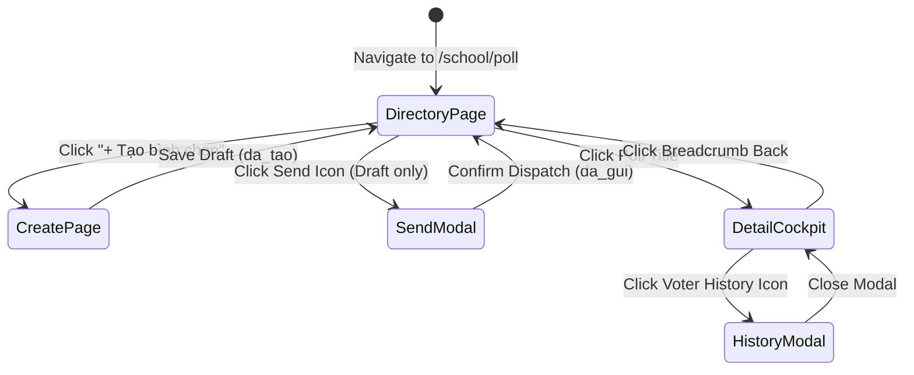

# Page: School Polls, Voting & Surveys (Bình Chọn)

## Route / Surface

- Route: `/[schoolCode]/school/poll` (Directory), `/[schoolCode]/school/poll/create` (Composer), `/[schoolCode]/school/poll/[pollId]` (Detail Cockpit), `/[schoolCode]/school/poll/edit/[pollId]` (Edit Draft), `/[schoolCode]/school/polls` (Redirect)
- Entry component: `SchoolPollDirectoryPage`, `CreatePollPage`, `PollDetailPage`, `EditPollPage`, `PollsRedirectPage`.
- Layout owner: `PortalLayout` (sidebar group NHÀ TRƯỜNG, icon `faPoll`).

## Jira Story

- Story: As a School Administrator, I want dedicated poll management pages to browse directories, compose questionnaires, dispatch to audiences, and review live ballot metrics.
- Jira issue type: Story
- UX owner: `benny-frontend-engineer`
- Research evidence: Screen flow specs in `.agents/specs/040-school-polls-voting-binh-chon/execution-brief.md`.

## Priority

- Priority: P1
- Demo impact: High visual appeal with responsive cards, live progress bars, conditional SVG donut charts, and student voter rosters.
- Risk if delayed: Inability for school leadership to review consultative polling.
- Release target: School Operating Portal Release 1.0.

## PM Notes

- Demo path: Navigate to NHÀ TRƯỜNG -> Bình chọn; filter by "Đang diễn ra"; open "Địa điểm dã ngoại trải nghiệm mùa thu" to inspect real-time donut chart and voter revision history.
- User promise: 100% accurate ballot tallies, responsive mobile layout, and auditable choice logs.
- Acceptance impact: Fully fulfills all acceptance criteria with zero UI visual defects.
- Visual or copy change: Applied Vietnamese labels: "Bình chọn & Khảo sát", "Bản nháp", "Đang diễn ra", "Đã đóng", "Lịch sử thay đổi".
- Risk: Handled via client-side memoization and defensive fallback states.

## Relationship Map

| Relation | Target | Label | Rationale |
| --- | --- | --- | --- |
| Implements feature | `F-025-001-school-polls` | `IMPLEMENTS` | Renders the primary user interface for poll management. |
| Uses module | `M-025-001-school-polls` | `USES` | Consumes state, action dispatchers, and pure validator functions. |
| Related page | `/[schoolCode]/school/announcements` | `RELATES_TO` | Sibling school communication surface under NHÀ TRƯỜNG navigation group. |

## States

- Loading: Skeleton shimmer effect during page transitions.
- Empty: Helpful empty notices displayed when zero polls match filters or zero votes exist.
- Error: Clear validation error messages displayed beside offending form inputs.
- Success: Rendered data tables, metric cards, progress bars, and SVG donut chart.
- Guarded / Restricted: Attempting to edit an active or closed poll presents a prominent warning banner explaining draft-only modification rules.

## Interactions

- Filter Tab Switch:
  - Expected result: Instant filter table re-render without server roundtrips (< 10ms).
- Search Input:
  - Expected result: Instant accent-insensitive query evaluation matching titles and descriptions.
- Send Paper Plane Action:
  - Expected result: Opens `SendPollModal`; selecting target classes and confirming transitions poll to `da_gui`.
- Option History Icon:
  - Expected result: Opens `VoteHistoryModal` detailing voter's timestamped revision history.

## Accessibility

- Keyboard: Full keyboard navigation supported on filter tabs, table links, and modal confirm/cancel buttons.
- Screen reader: ARIA labels on icon buttons (`aria-label="Gửi bình chọn"`, `aria-label="Xóa bản nháp"`).
- Color/contrast: Minimum 4.5:1 contrast ratio adhering to ECO Design System tokens (Slate `#0F172A`, Blue `#0070CE`, Amber `#FEC020`).

## Mermaid Diagram

## Verification

- UI test: Automated tests in `tests/unit/poll.test.mjs` verifying component state machine mutations.
- Static build check: `npm run build` compiled all routes without hydration or SSR errors.
- Responsive check: Tested across desktop (1440px), tablet (768px), and mobile (375px) breakpoints.

## Work Log

- Date: 2026-10-07
  - Action: Built all 5 page routes and 8 reusable presentation components under `src/modules/school/poll/`.
  - Agent/skill: `benny-frontend-engineer`
  - Evidence: Clean build output and zero ESLint errors.
  - Docs updated before code: Screen wireframes aligned with execution brief.

## Change Log

- Date: 2026-10-07
  - Code change: Created `index.tsx`, `create.tsx`, `[pollId].tsx`, `edit/[pollId].tsx`, `polls/index.tsx`.
  - Documentation update: Authored page architecture ledger `P-025-001-school-polls.md`.
  - Evidence: 70 static pages generated in Next.js production build.
