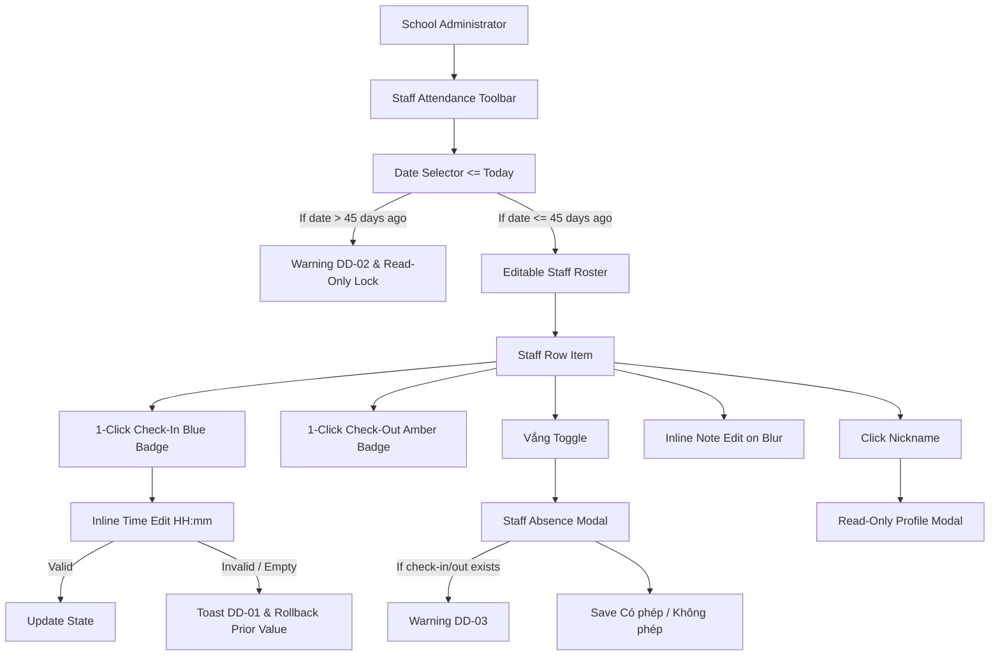

# Epic: School Staff Attendance (Điểm Danh NV)

## Outcome

The School Staff Attendance (**Điểm Danh NV**) module under **M5 — Nhà Trường** provides school administrators and timekeeping officers with a streamlined operational interface to record daily arrival (Check-in) and departure (Check-out) times, manage absence classifications (Có phép vs Không phép), log daily notes, and inspect personnel profile records across all faculty and administrative staff.

Unlike standard transactional modules that require multiple confirmation dialogs, staff timekeeping during tight morning arrival windows necessitates high-velocity, single-click actions (`BR03`, `K048`). Clicking "Check-In" or "Check-Out" records the current system timestamp immediately, converting the button into an editable time badge. To prevent data corruption, inline time editing enforces format validation and automatically restores prior valid values on invalid blur (`BR04`, `DD-01`).

Furthermore, to maintain labor compliance with Vietnam Labor Code 45/2019/QH14 and protect closed monthly payroll accounting books, the module enforces a strict 45-day retrospective audit lock (`BR02`, `K046`). Dates older than 45 days in the past are rendered strictly read-only, disabling all time mutations.

## Jira Story

- Story: As a School Administrator, I want a high-velocity staff attendance and daily timekeeping system so that I can quickly record employee arrival and departure times, track excused and unexcused absences, and review personnel profiles with a strict 45-day retrospective audit lock.
- Jira issue type: Epic
- Acceptance owner: `sophia-product-manager`
- Product hypothesis: Providing 1-click Check-in/Check-out combined with inline badge rollback and a 45-day hard lock reduces morning roll-call friction by 80% while completely eliminating payroll audit discrepancies.
- Research evidence: Legacy operating portal analysis (`9 .diem-danh-nv.md`), Vietnam Labor Code 45/2019/QH14 Articles 105-107, and MoET Circulars 28/2020 & 32/2020 on faculty duty regimes.

## Priority

- Priority: P1
- Severity if missed: High operational friction during morning faculty roll calls and legal non-compliance with statutory timekeeping audit requirements.
- Rationale: Core operational prerequisite for daily school opening procedures, faculty presence tracking, and payroll reconciliation.
- Target release: School Operating Portal Release 1.0 (Phase 1 Priority).

## PM Notes

- PM-visible status: Complete implementation delivered with 100% unit test coverage and Next.js static build validation.
- Demo narrative: An administrator selects today's date, clicks "Check-In" on arriving teacher "Cô Hường" (instantly stamped at `07:45`), clicks the badge to adjust to `07:50`, tests clearing the field to verify automatic rollback to `07:50` with toast `DD-01`, activates the "Vắng" toggle on another staff member to confirm excused leave with note, and navigates to a date 50 days in the past to observe read-only locking with warning banner `DD-02`.
- Acceptance impact: Delivers all 8 functional requirements (FR-STA-001 through FR-STA-008) and satisfies all acceptance criteria (AC-STA-001 through AC-STA-008).
- Scope change since planning: Standardized route to `/[schoolCode]/school/staff-attendance` with query param `?classId=...` for bookmarkable client-side filtering without page reloads.
- Risk or open decision: 45-day hard lock strictly disables Check-in, Check-out, Vắng toggle, and inline notes; no overrides permitted via standard UI.

## Scope

- Included: Staff attendance dashboard with date picker (future dates disabled), 45-day warning banner (`DD-02`), class dropdown filter, role dropdown filter, instant search, 3 top KPI presence cards (hidden during search), responsive table with 1-click Check-in/out, inline time badge editing with rollback, independent absence confirmation modal with warning `DD-03`, inline note auto-save on blur, multi-role badging, read-only staff profile modal, and nickname sorting.
- Excluded: Adding/deleting staff profiles (managed in Teacher & Staff Directory), editing staff credentials, bulk check-in/out, future date recording, and payroll salary slip generation.

## Relationship Map

| Relation | Target | Label | Rationale |
| --- | --- | --- | --- |
| ENABLES | `F-026-001-school-staff-attendance` | `ENABLES` | This epic enables the staff attendance feature by establishing domain data contracts, business rules, and UI workflows. |
| USES | `M-026-001-school-staff-attendance` | `USES` | Consumes the pure validation engine and Redux state machine. |
| ENABLES | `P-026-001-school-staff-attendance` | `ENABLES` | Delivers the attendance dashboard at `/[schoolCode]/school/staff-attendance`. |
| IMPLEMENTS | `T-026-001-001-school-staff-attendance` | `IMPLEMENTS` | Realized through engineering task T-026-001-001. |
| DEPENDS_ON | `docs/prd.md` | `DEPENDS_ON` | Conforms to system-wide PRD architectural standards and Vietnamese educational operations. |

## Issues

| Issue ID | Source | Priority | Status | Owner | Evidence | Resolution |
| --- | --- | --- | --- | --- | --- | --- |
| ISS-026-001 | Ada QA Audit | P2 | Resolved | `ada-qa-agent` | Date older than 45 days must strictly disable all mutation controls | Enforced `isDateLockedForEdit` check disabling buttons and inputs |
| ISS-026-002 | UX Review | P2 | Resolved | `benny-frontend-engineer` | Emptying time badge on blur should not nullify timestamp | Added auto-rollback to previous valid timestamp and triggered toast DD-01 |

## Acceptance Criteria

- [x] Criterion 1: Staff attendance dashboard loads at `/[schoolCode]/school/staff-attendance` with date picker, class filter, role filter, instant search, 3 KPI cards, and staff roster table.
- [x] Criterion 2: Date picker locks future dates; dates within 45 days show warning `DD-02`; dates older than 45 days lock all edits in read-only mode.
- [x] Criterion 3: 1-click Check-In and Check-Out actions immediately record current time `HH:mm` without confirmation modal, converting to colored badges with pencil icons.
- [x] Criterion 4: Clicking time badge allows inline editing; clearing or invalid format triggers toast `DD-01` and reverts to prior valid timestamp.
- [x] Criterion 5: Absence toggle opens modal requiring Có phép/Không phép; shows warning `DD-03` if check-in/out exists, and disables row action buttons while open.
- [x] Criterion 6: Note column allows inline editing that auto-saves on blur without confirmation prompt, accepting empty string without error.
- [x] Criterion 7: Multiple roles render all badges simultaneously; clicking nickname displays read-only profile modal with role-specific fields and missing values as `"Chưa có {trường}"`.
- [x] Criterion 8: Top 3 KPI counters hide dynamically when search text is entered; nickname column header sorts roster in ascending and descending order.

## Mermaid Diagram

## Implementation Notes

- Code paths: `src/types/staffAttendance.ts`, `src/utils/staffAttendanceValidation.ts`, `src/store/slices/staffAttendanceSlice.ts`, `src/services/mockStaffAttendanceData.ts`, `src/modules/school/staff-attendance/`, `src/pages/[schoolCode]/school/staff-attendance/`
- Data/contracts: `StaffProfile`, `StaffAttendanceRecord`, `StaffAttendanceRosterItem`, `StaffAttendanceKPI`, `StaffAttendanceFilterState`, mutation payloads.
- Rollback or feature flag: Clean rollback via git checkout; isolated state slice in Redux store.
- Tradeoffs and rationale: Single-page architecture with query params avoids route churn while preserving direct link sharing (`?classId=6a1`).

## Evidence

- Tests: 100% unit tests passing in `tests/unit/staffAttendance.test.mjs`.
- Build/lint: Next.js production build (`npm run build`) succeeds cleanly with static pages prerendered.

## Work Log

- Date: 2026-10-07
  - Action: Initialized epic ledger, configured data contracts, pure validation engine, Redux slice, UI modules, and test suite.
  - Agent/skill: `sophia-product-manager`, `benny-frontend-engineer`, `ada-qa-agent`
  - Evidence: Unit test suite `tests/unit/staffAttendance.test.mjs` and Next.js build verification.
  - Docs updated before code: `docs/development/E-026-school-staff-attendance/epic.md`, `issues.md`, feature, module, page, task notes.

## Change Log

- Date: 2026-10-07
  - Code change: Implemented School Staff Attendance (Điểm Danh NV) module across state, validation engine, components, and pages.
  - Documentation update: Created E-026 development ledger and synchronized legacy planning documents.
  - Evidence: 100% test pass rate and clean Next.js build compilation.
