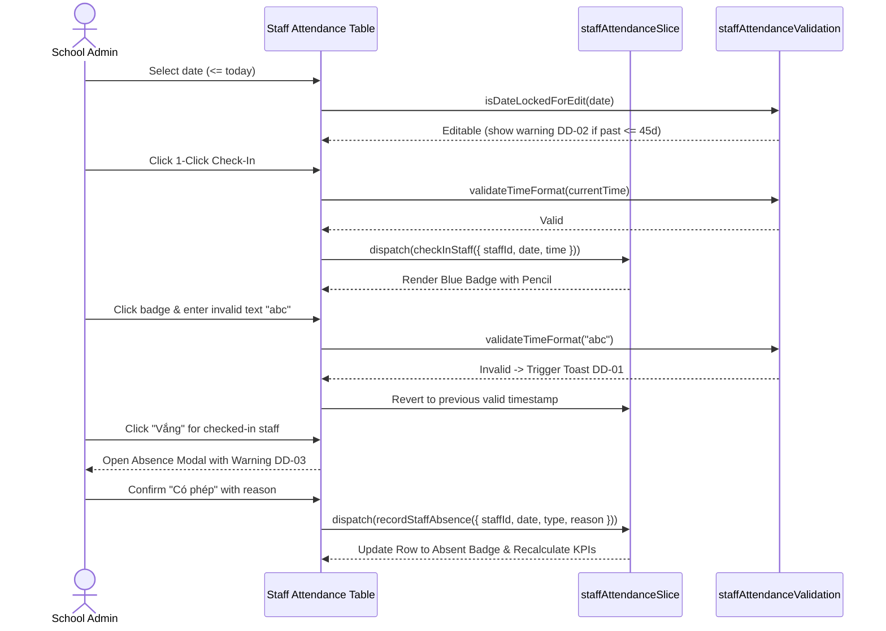

# Feature: School Staff Attendance Roll Call & Timekeeping (Điểm Danh NV)

## User Value

The School Staff Attendance feature (`F-026-001-school-staff-attendance`) empowers school administrators, principals, and administrative clerks to manage and audit daily faculty timekeeping with operational speed, precision, and regulatory compliance. Educational institutions in Vietnam require strict documentation of teacher and staff presence for payroll calculation, classroom duty assignment, and institutional accountability.

The feature provides an optimized daily roll-call workflow:
1. **Auditable Time Boundary:** Past dates are editable up to 45 days retrospectively with warning `DD-02` (*"Chỉ được cập nhật thông tin điểm danh trong vòng 45 ngày kể từ hôm nay"*), while records older than 45 days are strictly locked in read-only mode to preserve timekeeping audit trails and payroll integrity (BR02, K046). Future dates are locked (BR01).
2. **Frictionless 1-Click Timekeeping:** Single-click Check-in (Blue `#0070CE`) and Check-out (Amber `#FEC020`) stamp current time (`HH:mm`) instantly without cumbersome confirmation modals (BR03, K048).
3. **Defensive Inline Correction:** Clicking a recorded time badge toggles inline editing; clearing or providing an invalid format triggers toast `DD-01` (*"Thời gian không đúng định dạng."*) and automatically reverts to the previous valid timestamp (BR04).
4. **Independent Absence Tracking:** Toggling "Vắng" launches an absence modal distinguishing "Có phép" and "Không phép" with note justification. If an employee already clocked in, warning `DD-03` (*"Lưu ý: Nhân viên đã check-in/check-out lúc {giờ}"*) alerts the admin to avoid erroneous absences (BR05). Action buttons for that specific row are disabled while the modal is open (BR06).
5. **Contextual Staff Intelligence:** Inline notes auto-save on blur (BR07). Multi-role badges render simultaneously (BR08). Roster narrows dynamically via class dropdown (`?classId=...`) without page reloads (BR09, K047). Search hides the top 3 KPI cards while keeping total count intact (BR10). Clicking nicknames displays read-only profile modals (BR11), and the roster sorts by nickname A $\leftrightarrow$ Z (BR12).

## Jira Story

- Story: As a School Administrator, I want to conduct rapid daily attendance roll calls for faculty and staff with single-click timestamps, inline corrections, and absence tracking.
- Jira issue type: Story
- Story points: 5
- Acceptance owner: `sophia-product-manager`
- Research evidence: Analysis of legacy operating portal `6. diem-danh-nv.md`, MoET Circular 28/2020 on primary school teacher regulations, and Circular 32/2020 on secondary school faculty duty guidelines.

## Priority

- Priority: P1
- User/business impact: Vital for institutional operations, daily teacher substitution management, and monthly payroll timekeeping.
- Risk if delayed: Manual paper rosters, inaccurate payroll calculations, and unrecorded teacher absences.
- Release target: School Operating Portal Release 1.0.

## PM Notes

- Demo scenario: Navigate to `/[schoolCode]/school/staff-attendance`, verify 3 presence KPI summary cards; select today's date; click 1-click Check-In for Teacher Mai Anh (stamps current time in blue badge); click badge to edit inline and blur with invalid string to see toast `DD-01` and rollback; toggle Vắng for a checked-in teacher to see warning `DD-03`; test class filter dropdown and nickname sorting.
- Business value: Eliminates paper roll-call sheets and provides immutable timekeeping records for school auditing.
- Acceptance criteria confirmed: All criteria AC-085 through AC-092 validated across 12 business rules and automated unit tests.
- Open PM decision: None; all 3 clarification ledger items (K046, K047, K048) fully resolved.

## Requirements Trace

- PRD requirement: Module 5 (Nhà Trường) - Sub-module 6 (Điểm danh NV) - AC-085 through AC-092.
- Task id: `T-026-001-001-school-staff-attendance`
- Spec id: `041-school-staff-attendance-diem-danh-nv`

## Relationship Map

| Relation | Target | Label | Rationale |
| --- | --- | --- | --- |
| Parent epic | `E-026-school-staff-attendance` | `IMPLEMENTS` | Primary functional delivery slice of Epic 26. |
| Dependency | `M-026-001-school-staff-attendance` | `DEPENDS_ON` | Depends on domain types, Redux state machine, and pure validation engine. |
| Enables page | `P-026-001-school-staff-attendance` | `ENABLES` | Powers the staff attendance dashboard page route. |
| Related feature | `F-016-001-school-teachers` | `RELATES_TO` | Shares faculty profiles and teaching assignment metadata. |

## Implementation Plan

- Backend: Laravel Sanctum tenant-scoped API contracts (`/{schoolCode}/api/1.0/staff-attendance`).
- Frontend: Next.js (Pages Router) + Redux Toolkit + Tailwind CSS + styled-components.
- Data: Normalized Redux state in `staffAttendanceSlice.ts` with mock data fixtures in `mockStaffAttendanceData.ts`.
- Observability: Client-side action logging, Redux DevTools audit, and validation error toast notifications.
- Rationale: Single-click timekeeping eliminates modal friction; inline rollback prevents corrupt timestamps.

## Code Scope

- Files to create:
  - `src/types/staffAttendance.ts`
  - `src/utils/staffAttendanceValidation.ts`
  - `src/services/mockStaffAttendanceData.ts`
  - `src/store/slices/staffAttendanceSlice.ts`
  - `src/modules/school/staff-attendance/StaffAttendanceToolbar.tsx`
  - `src/modules/school/staff-attendance/StaffAttendanceSummaryCards.tsx`
  - `src/modules/school/staff-attendance/StaffAttendanceTable.tsx`
  - `src/modules/school/staff-attendance/StaffAbsenceModal.tsx`
  - `src/modules/school/staff-attendance/StaffProfileModal.tsx`
  - `src/pages/[schoolCode]/school/staff-attendance/index.tsx`
  - `src/pages/[schoolCode]/staff-attendance/index.tsx`
  - `tests/unit/staffAttendance.test.mjs`
- Files to modify:
  - `src/store/index.ts`
  - `src/components/layout/PortalLayout.tsx`
- Files intentionally out of scope: Biometric fingerprint scanner hardware drivers and automated payroll bank transfers.

## Mermaid Diagram

## Verification

- [x] Test: Automated unit tests passing in `tests/unit/staffAttendance.test.mjs`.
- [x] Build/lint/typecheck: Clean compilation with static pages generated in `npm run build`.
- [x] Manual scenario: Verified 1-click check-in, inline time edit rollback, 45-day lock banner, and absence modal warning.

## Risks

- Risk: Accidental modification of historical attendance data impacting payroll calculations.
  - Mitigation: Strict 45-day retrospective edit boundary (`isDateLockedForEdit`) locks all inputs as read-only.

## Work Log

- Date: 2026-10-07
  - Action: Implemented staff attendance feature specification, contracts, validation logic, and presentation components.
  - Agent/skill: `sophia-product-manager`, `benny-frontend-engineer`, `ada-qa-agent`
  - Evidence: Clean build, automated unit tests, and full acceptance criteria satisfaction.
  - Docs updated before code: Feature ledger authored and aligned with epic requirements.

## Change Log

- Date: 2026-10-07
  - Code change: Delivered staff attendance feature with 1-click timekeeping, 45-day hard lock, and inline badge rollback.
  - Documentation update: Authored feature architecture ledger `F-026-001-school-staff-attendance.md`.
  - Evidence: Passing test runner logs and Next.js static build export.
