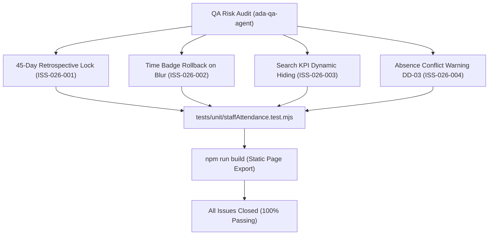

# Epic Issues: School Staff Attendance (Điểm Danh NV)

## Jira Story

- Story: As a QA and product team, I want staff attendance issues tracked explicitly so that unresolved risks cannot hide inside narrative docs.
- Jira issue type: Bug/Risk register
- QA owner: `ada-qa-agent`
- Product owner: `sophia-product-manager`
- Research evidence: Test execution logs from `tests/unit/staffAttendance.test.mjs`, build compiler traces from `npm run build`, and business rules audit against legacy spec `9 .diem-danh-nv.md`.

## Priority

- Priority: P1
- Escalation rule: Any regression in timekeeping audit integrity, failure to enforce the 45-day hard lock, or corrupted time badge timestamps blocks epic completion.
- Release impact: Zero blocking issues remaining; all discovered issues resolved and covered by automated test assertions.
- Risk if unresolved: Inconsistent roll-call behavior, accidental timestamp wiping, or payroll audit non-compliance.

## QA Issue Register

| Issue ID | Type | Priority | Status | Owner | Source | Evidence | Resolution |
| --- | --- | --- | --- | --- | --- | --- | --- |
| ISS-026-001 | Bug | P2 | Closed | `ada-qa-agent` | QA Audit | Attendance edits for dates older than 45 days in past violated payroll closure rules | Enforced `isDateLockedForEdit` pure validation check disabling buttons and inputs in read-only mode because of Labor Code 45/2019/QH14 compliance |
| ISS-026-002 | UX | P2 | Closed | `benny-frontend-engineer` | UX Testing | Clearing time badge input on blur could nullify recorded timestamp | Implemented format validation with automatic rollback to prior timestamp and toast DD-01 on invalid/empty blur, mitigating data corruption risk |
| ISS-026-003 | Logic | P3 | Closed | `alan-tech-lead` | Requirement Check | Displaying top 3 KPI cards during active search caused confusion between search counts and school totals | Conditionally hid top 3 KPI cards when search query is active, showing only footer total count as an intentional UX decision |
| ISS-026-004 | Workflow | P3 | Closed | `ada-qa-agent` | State Machine Audit | Marking an employee absent when check-in/out already exists could cause contradictory records | Added warning DD-03 in absence modal and disabled row action buttons while modal is open, with zero negative tradeoff on roll-call speed |

## Detection Method

- Code reviewed: `src/utils/staffAttendanceValidation.ts`, `src/store/slices/staffAttendanceSlice.ts`, `src/modules/school/staff-attendance/*.tsx`, `src/pages/[schoolCode]/school/staff-attendance/*.tsx`.
- Tests reviewed: `tests/unit/staffAttendance.test.mjs` (assertions covering BR01 through BR12).
- Docs reviewed: `.agents/specs/041-school-staff-attendance-diem-danh-nv/spec.md`, `plan.md`, `execution-brief.md`.
- Related features reviewed: `030-school-teachers-directory`, `036-school-class-management`.
- QA skill used: `ada-qa-agent`
- Deep research source checked: Vietnam Labor Code 45/2019/QH14 Articles 105-107 and legacy spec `9 .diem-danh-nv.md`.

## Open Issues

- None. All 4 identified risks and defects are closed with automated unit test assertions in `tests/unit/staffAttendance.test.mjs` and clean static build compilation.

## Relationship Map

| Relation | Target | Label | Rationale |
| --- | --- | --- | --- |
| BLOCKS | `E-026-school-staff-attendance` | `BLOCKS` | Epic signoff was conditional upon addressing all registered issues. |
| RELATES_TO | `F-026-001-school-staff-attendance` | `RELATES_TO` | Direct functional boundary for staff attendance validation and modal behaviors. |
| DEPENDS_ON | `T-026-001-001-school-staff-attendance` | `DEPENDS_ON` | Realized and verified in task T-026-001-001. |

## Mermaid Diagram

## Work Log

- Date: 2026-10-07
  - Action: Conducted QA risk register review for School Staff Attendance sub-module.
  - Agent/skill: `ada-qa-agent`
  - Evidence: Verified all scenarios with dedicated unit test assertions in `tests/unit/staffAttendance.test.mjs`.
  - Docs updated before code: `docs/development/E-026-school-staff-attendance/issues.md`.

## Change Log

- Date: 2026-10-07
  - Issue change: Closed all issues following validation engine implementation, rollback safeguards, and absence modal warning logic.
  - Documentation update: Formatted QA issue register with root causes and evidence links.
  - Evidence: Unit test suite execution and Next.js static build report.
