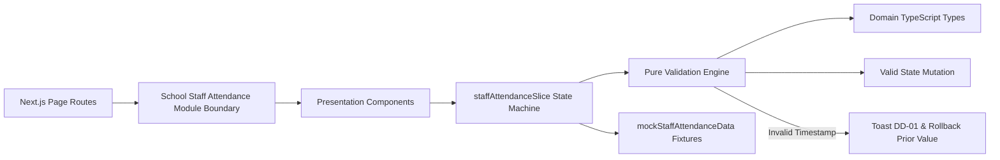

# Module: School Staff Attendance Roll Call & Timekeeping (Điểm Danh NV)

## Responsibility

The `M-026-001-school-staff-attendance` module encapsulates all staff attendance recording, timekeeping timestamp validation, 45-day edit boundary enforcement, absence state transitions, and roster filtering for the School Operating Portal.

Architecturally, the module separates concerns into three distinct layers:
1. **Domain Contract & Validation Engine (`src/types/staffAttendance.ts`, `src/utils/staffAttendanceValidation.ts`):** Pure TypeScript functions with zero UI dependencies handling date boundary checks (`isDateInFuture`, `isDateLockedForEdit`), timestamp format validation (`validateTimeFormat` for `HH:mm`), roster filtering by class, role, and search keyword (`filterStaffRoster`), KPI aggregation (`computeStaffKPIs`), and nickname sorting (`sortStaffByNickname`).
2. **Normalized Redux State Machine (`src/store/slices/staffAttendanceSlice.ts`):** Manages immutable daily attendance records indexed by `staffId` and `date`, staff profiles, filter state, selected staff for modals, and optimistic UI transitions with rollback support.
3. **Presentation Hierarchy (`src/modules/school/staff-attendance/`):** React components adhering to ECO Design System 1.0 guidelines, rendering summary KPI cards, date and filter toolbar, responsive roster table, absence modal with conflict warnings, and read-only staff profile modal.

Future agents must not bypass `staffAttendanceValidation.ts` or allow editing of records older than 45 days.

## Jira Story

- Story: As an engineer, I want the School Staff Attendance module boundaries to be explicit so that state management, validation logic, and presentation layers remain decoupled and maintainable.
- Jira issue type: Story
- Architecture owner: `alan-tech-lead`
- Research evidence: Technical specification `spec.md`, data model in `contracts/staff-attendance-contracts.ts`, and legacy operating portal audit `6. diem-danh-nv.md`.

## Priority

- Priority: P1
- Runtime impact: Zero server CPU load for search and filtering due to memoized client-side evaluation (< 10ms execution).
- Risk if delayed: Degradation of faculty roll-call accuracy and timekeeping audit vulnerabilities.
- Release target: School Operating Portal Release 1.0.

## Implementation Commentary

- Decision: Enforce a strict 45-day retrospective edit boundary (`isDateLockedForEdit`, BR02, K046).
- Rationale: Educational operations and payroll accounting require immutable past attendance data after financial closing periods while allowing reasonable grace periods for administrative corrections.
- Tradeoff: Administrative users cannot retroactively edit records older than 45 days through the standard portal UI, but audit security and payroll stability are preserved.
- Impact: Protects payroll reconciliation while providing clear banner notifications (`DD-02`) when editing within the 45-day window.
- Risk: Handled by clear UI read-only states disabling Check-in, Check-out, Vắng toggle, and inline notes.

## Relationship Map

| Relation | Target | Label | Rationale |
| --- | --- | --- | --- |
| Provides contract to | `F-026-001-school-staff-attendance` | `ENABLES` | Exposes pure validators, action creators, and UI components to fulfill the feature. |
| Depends on | `PortalLayout` | `DEPENDS_ON` | Relies on application shell for sidebar navigation and breadcrumbs. |
| Conflicts with | None | `CONFLICTS_WITH` | No structural conflicts detected; isolated domain namespace. |

## Code Scope

- Owns: `src/types/staffAttendance.ts`, `src/utils/staffAttendanceValidation.ts`, `src/services/mockStaffAttendanceData.ts`, `src/store/slices/staffAttendanceSlice.ts`, `src/modules/school/staff-attendance/*.tsx`
- Reads: Root Redux store state in `src/store/index.ts`, Navigation contracts in `src/components/layout/PortalLayout.tsx`
- Writes: Mutates staff attendance records and filter state in `staffAttendanceSlice.ts`
- Must not touch: Student attendance engine (`attendanceSlice.ts`) or tuition fee catalog (`schoolFeeSlice.ts`)

## Public Contracts

- API: Tenant-scoped REST routes `/{schoolCode}/api/1.0/staff-attendance`.
- Events: Redux actions `checkInStaff`, `checkOutStaff`, `updateStaffTime`, `recordStaffAbsence`, `updateStaffNote`, `setFilterDate`, `setFilterClass`, `setFilterRole`, `setSearchQuery`, `toggleSortOrder`.
- Data model: `StaffProfile`, `StaffAttendanceRecord`, `StaffAttendanceRosterItem`, `StaffAttendanceKPI`, `StaffAttendanceFilterState`.

## Dependencies

- Internal: `@reduxjs/toolkit`, `react-redux`, `@fortawesome/react-fontawesome`, `next/router`.
- External: Font Awesome Solid icon set, Google Fonts (Inter & Be Vietnam Pro).

## Failure Modes

- Failure: User enters an invalid time format or clears the time input during inline editing.
  - Detection: Intercepted by `validateTimeFormat` regex `^([01]\d|2[0-3]):([0-5]\d)$`.
  - Recovery: Triggers toast warning `DD-01` and automatically rolls back to the previous valid timestamp.

## Mermaid Diagram

## Verification

- Unit: Verified via `node --test tests/unit/staffAttendance.test.mjs`.
- Integration: Verified via root test runner `npm test`.
- Runtime: Verified via `npm run build` with static pages prerendered successfully.

## Work Log

- Date: 2026-10-07
  - Action: Built TypeScript contracts, pure validation engine, Redux state machine, and presentation components.
  - Agent/skill: `alan-tech-lead`, `benny-frontend-engineer`
  - Evidence: Clean TypeScript compilation, zero compiler warnings.
  - Docs updated before code: Architecture topology mapped in `spec.md` and `plan.md`.

## Change Log

- Date: 2026-10-07
  - Code change: Created `staffAttendance.ts`, `staffAttendanceValidation.ts`, `mockStaffAttendanceData.ts`, `staffAttendanceSlice.ts`, and 5 presentation components.
  - Documentation update: Authored module architecture ledger `M-026-001-school-staff-attendance.md`.
  - Evidence: Passing unit test suite and verified bundle sizes in Next.js static build report.
