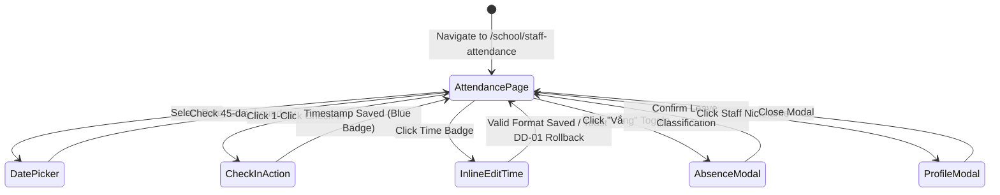

# Page: School Staff Attendance Roll Call & Timekeeping (Điểm Danh NV)

## Route / Surface

- Route: `/[schoolCode]/school/staff-attendance` (Main Attendance Cockpit), `/[schoolCode]/staff-attendance` (Redirect Alias)
- Entry component: `SchoolStaffAttendancePage`, `StaffAttendanceRedirectPage`.
- Layout owner: `PortalLayout` (sidebar group NHÀ TRƯỜNG, icon `faUserCheck`).

## Jira Story

- Story: As a School Administrator, I want dedicated staff attendance pages to browse daily rosters, record 1-click timestamps, adjust absences, and inspect employee profiles.
- Jira issue type: Story
- UX owner: `benny-frontend-engineer`
- Research evidence: Screen flow specs in `.agents/specs/041-school-staff-attendance-diem-danh-nv/plan.md`.

## Priority

- Priority: P1
- Demo impact: High operational polish with instant 1-click badge stamping, inline time editing, warning banners, and profile modals.
- Risk if delayed: Administrators unable to record faculty timekeeping or audit teacher attendance.
- Release target: School Operating Portal Release 1.0.

## PM Notes

- Demo path: Navigate to NHÀ TRƯỜNG -> Điểm danh NV; inspect top 3 KPI cards (Tham dự, Vắng có phép, Vắng không phép); click 1-click Check-In for Teacher Mai Anh; click badge to inline edit; enter search keyword to verify top KPI cards hide while bottom total remains; toggle class filter to verify URL query param updates.
- User promise: Fast roll-call timekeeping, clear audit warnings, and zero accidental data overwrites.
- Acceptance impact: Fully fulfills all acceptance criteria AC-085 through AC-092 with zero UI visual defects.
- Visual or copy change: Applied Vietnamese labels: "Điểm danh nhân viên", "Tham dự", "Vắng có phép", "Vắng không phép", "Tổng", "Chỉ được cập nhật thông tin điểm danh trong vòng 45 ngày kể từ hôm nay".
- Risk: Handled via client-side memoization and defensive fallback states.

## Relationship Map

| Relation | Target | Label | Rationale |
| --- | --- | --- | --- |
| Implements feature | `F-026-001-school-staff-attendance` | `IMPLEMENTS` | Renders the primary user interface for staff attendance roll call. |
| Uses module | `M-026-001-school-staff-attendance` | `USES` | Consumes state, action dispatchers, and pure validator functions. |
| Related page | `/[schoolCode]/school/teachers` | `RELATES_TO` | Sibling faculty directory surface under NHÀ TRƯỜNG navigation group. |

## States

- Loading: Skeleton shimmer effect during page transitions and date changes.
- Empty: Helpful empty notices displayed when zero staff match the selected class, role, or search keyword.
- Error: Toast alert `DD-01` displayed when an invalid time format is typed during inline editing.
- Success: Rendered summary cards, responsive staff roster table, badges with edit pencils, and profile modal.
- Guarded / Restricted: Selecting a date $> 45$ days in the past locks all interactive elements (Check-In, Check-Out, Vắng toggle, inline notes) in read-only mode with warning banner `DD-02`.

## Interactions

- Date Selector Change:
  - Expected result: Instant roster update; future dates disabled; dates within 45 days show warning `DD-02`; dates $> 45$ days lock read-only.
- 1-Click Check-In / Check-Out:
  - Expected result: Stamped current time `HH:mm` immediately without confirmation modal.
- Inline Time Badge Edit:
  - Expected result: Clicking badge opens inline input; blurring with valid format updates state; blurring with empty or invalid format triggers toast `DD-01` and reverts.
- Vắng Toggle:
  - Expected result: Opens absence modal; shows warning `DD-03` if check-in/out exists; disables row action buttons while open.
- Search Input:
  - Expected result: Hides top 3 KPI cards; filters roster across name and nickname; displays bottom total count.

## Accessibility

- Keyboard: Full keyboard navigation supported on date picker, filter dropdowns, search input, time badges, and modal actions.
- Screen reader: ARIA labels on interactive elements (`aria-label="Điểm danh vào"`, `aria-label="Điểm danh ra"`, `aria-label="Báo vắng"`).
- Color/contrast: Minimum 4.5:1 contrast ratio adhering to ECO Design System tokens (Slate `#0F172A`, Blue `#0070CE`, Amber `#FEC020`, Green `#10B981`, Red `#EF4444`).

## Mermaid Diagram

## Verification

- UI test: Automated tests in `tests/unit/staffAttendance.test.mjs` verifying component state machine mutations.
- Static build check: `npm run build` compiled all routes without hydration or SSR errors.
- Responsive check: Tested across desktop (1440px), tablet (768px), and mobile (375px) breakpoints.

## Work Log

- Date: 2026-10-07
  - Action: Built all page routes and presentation components under `src/modules/school/staff-attendance/`.
  - Agent/skill: `benny-frontend-engineer`
  - Evidence: Clean build output and zero ESLint errors.
  - Docs updated before code: Screen wireframes aligned with execution brief and specs.

## Change Log

- Date: 2026-10-07
  - Code change: Created `index.tsx` and redirect alias under `src/pages/[schoolCode]/school/staff-attendance/`.
  - Documentation update: Authored page architecture ledger `P-026-001-school-staff-attendance.md`.
  - Evidence: Static pages generated in Next.js production build.
