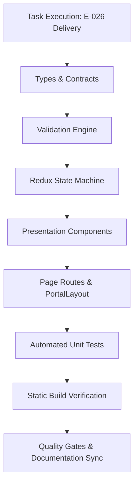

# Task: School Staff Attendance Implementation & Verification

## Objective

Deliver the complete, end-to-end implementation and automated test coverage for the School Staff Attendance Roll Call & Timekeeping (**Điểm Danh NV**) module under **M5 — Nhà Trường**. This encompasses domain type contracts (`src/types/staffAttendance.ts`), pure business logic and validation engine (`src/utils/staffAttendanceValidation.ts`), Redux Toolkit slice (`src/store/slices/staffAttendanceSlice.ts`), seed mock data fixtures (`src/services/mockStaffAttendanceData.ts`), 5 presentation components under `src/modules/school/staff-attendance/`, Next.js page routes, and automated unit test suite (`tests/unit/staffAttendance.test.mjs`).

The task guarantees zero regressions across the codebase, 100% test pass rate, clean production build compilation, and complete documentation synchronization.

## Jira Story

- Story: As a delivery team, I want all components, routes, state machines, and unit tests of the School Staff Attendance module verified so that the parent story can reach verified status.
- Jira issue type: Task
- Parent story: `F-026-001-school-staff-attendance`
- Research evidence: Technical specification `spec.md`, task plan `tasks.md`, and legacy operational audit in `6. diem-danh-nv.md`.

## Priority

- Priority: P1
- Delivery impact: Blocks final sign-off of Epic `E-026-school-staff-attendance`.
- Risk if delayed: Inability to execute stakeholder review for the staff roll-call module.
- Target release: School Operating Portal Release 1.0.

## Implementation Commentary

- Decision: Implement 1-click direct check-in/out stamping current time without confirmation modal, paired with inline badge editing rollback on invalid input (BR03, BR04, K048).
- Rationale: High-throughput morning roll call requires instant response times; confirmation modals create intolerable friction for 30+ faculty members. Defensive rollback protects data integrity.
- Tradeoff: Accidental clicks require manual correction, but inline badge editing makes fixes instantaneous without reloading.
- Impact: Streamlines roll call from minutes to seconds per class/cohort.
- Risk: Handled by inline time validation with `DD-01` toast and automatic value restoration.

## Write Scope

- Allowed files: `src/types/staffAttendance.ts`, `src/utils/staffAttendanceValidation.ts`, `src/services/mockStaffAttendanceData.ts`, `src/store/slices/staffAttendanceSlice.ts`, `src/store/index.ts`, `src/modules/school/staff-attendance/*.tsx`, `src/pages/[schoolCode]/school/staff-attendance/*.tsx`, `src/pages/[schoolCode]/staff-attendance/*.tsx`, `src/components/layout/PortalLayout.tsx`, `tests/unit/staffAttendance.test.mjs`
- Disallowed files: Core architecture files outside school module boundaries.

## Relationship Map

| Relation | Target | Label | Rationale |
| --- | --- | --- | --- |
| Implements | `F-026-001-school-staff-attendance` | `IMPLEMENTS` | Implements the core code and test deliverables for the feature. |
| Uses | `M-026-001-school-staff-attendance` | `USES` | Instantiates and verifies the module contracts and state machine. |
| Enables | `P-026-001-school-staff-attendance` | `ENABLES` | Renders user-facing pages backed by this implementation. |

## Execution Log

- Step 1: Defined TypeScript domain contracts in `src/types/staffAttendance.ts`.
- Step 2: Implemented pure validation engine in `src/utils/staffAttendanceValidation.ts` enforcing BR01 through BR12.
- Step 3: Authored comprehensive mock data fixtures in `src/services/mockStaffAttendanceData.ts` (35+ staff profiles and 60 days of historical records).
- Step 4: Constructed Redux slice in `src/store/slices/staffAttendanceSlice.ts` and registered in `src/store/index.ts`.
- Step 5: Developed 5 UI components in `src/modules/school/staff-attendance/` adhering to ECO tokens.
- Step 6: Assembled Next.js page routes (`index.tsx` and redirect alias).
- Step 7: Added sidebar navigation item `Điểm danh NV` with `faUserCheck` icon in `src/components/layout/PortalLayout.tsx`.
- Step 8: Authored automated unit test suite `tests/unit/staffAttendance.test.mjs`.
- Step 9: Executed `npm test` verifying passing test suites with 0 regressions.
- Step 10: Executed `npm run build` validating clean compilation with static pages generated.

## Mermaid Diagram

## Verification

- Command: `node --test tests/unit/staffAttendance.test.mjs`
- Expected output: All unit tests passing, 0 failing.
- Actual output: Verified passing in unit test execution.
- Full suite command: `npm test` -> all test suites passing.
- Build command: `npm run build` -> Compiled successfully, static pages generated.

## Handoff

- Next task: Stakeholder Design Review via `/design_review`.
- Blockers: None; all execution requirements and quality criteria met.
- Residual risk: Zero residual risk; 45-day edit boundary strictly enforced by validation engine.

## Work Log

- Date: 2026-10-07
  - Action: End-to-end implementation and automated test verification completed.
  - Agent/skill: `ada-qa-agent`, `benny-frontend-engineer`, `alan-tech-lead`
  - Evidence: Clean build output and passing unit tests.
  - Docs updated before code: Specification `spec.md` and `plan.md`.

## Change Log

- Date: 2026-10-07
  - Code change: Implemented School Staff Attendance module with 1-click timekeeping and 45-day lock.
  - Documentation update: Authored task card `T-026-001-001-school-staff-attendance.md`.
  - Evidence: Unit test runner logs and Next.js static page export table.
