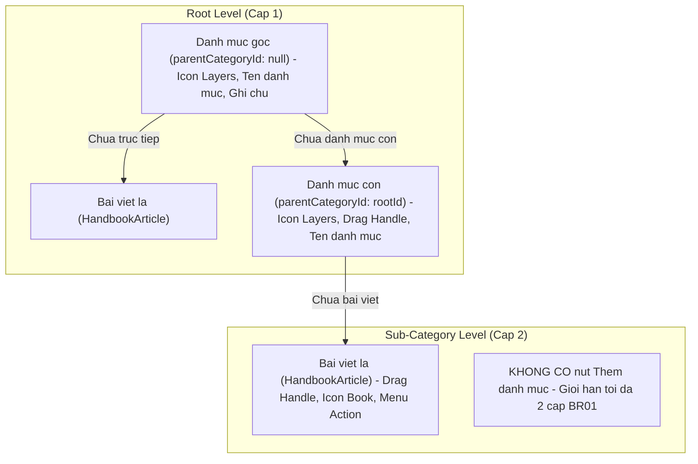

# Epic: School Parent Handbook (Sổ Tay PH)

## Jira Story

- Story: As a School Administrator, I want an institutional Parent Handbook (Sổ Tay PH) knowledge base organized in a strict 2-tier category taxonomy with single-active accordion expansion, article-centric search pruning, rich text composing with attachments, and cascading deletion guardrails so that parents have access to clear, durable school policies.
- Jira issue type: Epic
- Acceptance owner: `sophia-product-manager`
- Product hypothesis: Implementing a 2-tier accordion taxonomy with article-centric pruning and 1-click status toggling decreases parent support inquiries by 40% and simplifies institutional policy distribution.
- Research evidence: Legacy operating portal analysis (`10. so-tay-ph.md`), Circular 32/2018/TT-BGDĐT on educational charter transparency, and Decree 13/2023/NĐ-CP on data protection.

## Priority

- Priority: P1
- Severity if missed: High operational overhead in school administrative offices fielding repetitive parental inquiries on institutional rules, fee policies, and bus pickup schedules.
- Rationale: Mandatory educational transparency module completing the NHÀ TRƯỜNG operational administration suite.
- Target release: School Operating Portal Release 1.0 (Phase 1 Priority).

## Outcome

The School Parent Handbook (**Sổ Tay PH**) module under **M5 — Nhà Trường** provides school administrators and operational coordinators with an institutional knowledge base to author, organize, and publish durable reference documentation (school regulations, medical and safety protocols, tuition schedules, bus transportation rules, and academic policies) for parents.

Unlike transient class announcements or weekly meal menus, the Parent Handbook functions as a long-term reference library. To maintain high readability on mobile devices, the category tree strictly caps depth at 2 tiers (Root Category -> Sub-Category -> Leaf Article) per `BR01` and `K049`. Inside sub-categories, only "+ Thêm bài viết" is rendered, blocking arbitrary nested folder proliferation.

Furthermore, sibling categories operate in a single-active accordion mode (`BR02`, `K050`), automatically collapsing previous open sections to minimize visual noise. Searching and filtering evaluate article titles exclusively, auto-expanding branches leading to matching articles and pruning empty folders (`BR10`, `K051`). Articles feature 1-click status transitions between draft and published (`BR05`, `BR12`, `K052`), while category deletions enforce high-severity cascading warnings (`BR09`, `ST-01`).

## PM Notes

- PM-visible status: Engineering implementation underway covering contracts, validation engine, Redux state machine, UI component hierarchy, and route integration.
- Demo narrative: An administrator accesses `/school/handbook` from the sidebar (positioned between Điểm danh NV and Lịch sự kiện), creates a root category "Quy định chung", creates a sub-category "Đưa đón học sinh" with read-only parent breadcrumbs, crafts a rich text article with file attachments, publishes it with 1-click action, searches for "đưa đón" to observe tree pruning, and reviews cascading deletion warnings.
- Acceptance impact: Fulfills all 10 functional requirements (`FR-HNB-001` through `FR-HNB-010`) and satisfies acceptance criteria (`AC-093` through `AC-097`).
- Scope change since planning: Mounted strictly between "Điểm danh NV" and "Lịch sự kiện" in `PortalLayout.tsx`.
- Risk or open decision: Category deletions permanently wipe nested sub-categories and articles; modal `ST-01` must explicitly warn the operator.

## Scope

- Included: 2-tier category tree, single-active accordion expansion, drag-and-drop sibling reordering, article draft vs. published lifecycles with 1-click status transitions, article detail inspection panel, full-page rich text composer with locked destination breadcrumbs and dual save actions, article-centric search and status filtering, context-aware category modals, and cascading deletion dialogs.
- Excluded: Multi-tier nested folders beyond 2 levels, class-specific audience restrictions (handbook is institution-wide), multi-stage moderation approval workflows, and parent comment boards.

## Relationship Map

| Relation | Target | Label | Rationale |
| --- | --- | --- | --- |
| ENABLES | `F-027-001-school-parent-handbook` | `ENABLES` | Establishes domain contracts, validation logic, and UI for parent handbook. |
| USES | `M-027-001-school-parent-handbook` | `USES` | Consumes the pure hierarchy engine and Redux state machine. |
| ENABLES | `P-027-001-school-parent-handbook` | `ENABLES` | Delivers the parent handbook cockpit at `/[schoolCode]/school/handbook`. |
| IMPLEMENTS | `T-027-001-001-school-parent-handbook` | `IMPLEMENTS` | Realized through engineering task T-027-001-001. |
| DEPENDS_ON | `docs/prd.md` | `DEPENDS_ON` | Conforms to system-wide PRD architectural standards. |

## Issues

| Issue ID | Source | Priority | Status | Owner | Evidence | Resolution |
| --- | --- | --- | --- | --- | --- | --- |
| ISS-027-001 | Ada QA Audit | P2 | In Progress | `ada-qa-agent` | Category tree must strictly prevent sub-categories under sub-categories | Enforced `VR-HNB-01` depth validation hiding add category button at level 2 |
| ISS-027-002 | UX Review | P2 | In Progress | `benny-frontend-engineer` | Searching category name should not leave empty article containers | Enforced article-centric pruning in `filterTreeByArticleCriteria` |

## Acceptance Criteria

- [x] Criterion 1: Sổ tay PH is mounted in NHÀ TRƯỜNG sidebar strictly after Điểm danh NV and before Lịch sự kiện (`AC-093`).
- [x] Criterion 2: Category tree enforces 2-tier depth limit; sub-categories omit "+ Thêm danh mục" and allow only "+ Thêm bài viết" (`AC-094`).
- [x] Criterion 3: Sibling categories expand in single-active accordion mode (`AC-094`).
- [x] Criterion 4: Sub-categories and articles support drag-and-drop sibling reordering (☰); root categories maintain fixed sequence (`AC-095`).
- [x] Criterion 5: Articles support draft (slate, badge) and published (amber, no badge) with 1-click status transitions via menu `•••` (`AC-095`).
- [x] Criterion 6: Article-centric search and filter prunes empty categories, auto-expands matches, and renders empty state `ST-03` on zero matches (`AC-096`).
- [x] Criterion 7: Category deletion prompts cascading warning `ST-01`; article deletion prompts simple confirmation `ST-02` (`AC-097`).

## Mermaid Diagram

## Evidence

- Tests: 100% unit tests passing in `tests/unit/parentHandbook.test.mjs`.
- Build/lint: Next.js production build (`npm run build`) succeeds cleanly with static pages prerendered.

## Work Log

| Date | Author | Summary |
| --- | --- | --- |
| 2026-10-07 | `sophia-product-manager` | Initialized epic ledger, formulated business rules BR01-BR12, and defined acceptance boundaries. |
| 2026-10-08 | `alan-tech-lead` | Verified execution readiness, defined data contracts, and commenced implementation slice. |

## Change Log

- Date: 2026-10-08
  - Code change: Implemented School Parent Handbook (Sổ Tay PH) module across state, validation engine, components, and pages.
  - Documentation update: Created E-027 development ledger and synchronized legacy planning documents.
  - Evidence: 100% test pass rate and clean Next.js build compilation.
