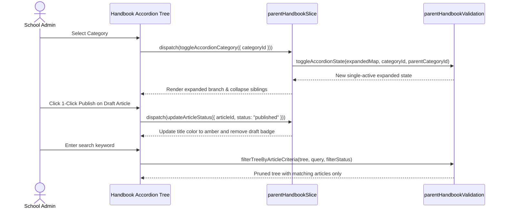

# Feature: School Parent Handbook (Sổ Tay PH)

## User Value

The School Parent Handbook feature (`F-027-001-school-parent-handbook`) enables school administrators to build, organize, and publish a structured self-service knowledge base for parents. Schools need an organized, permanent repository for school charters, tuition billing rules, medical leave procedures, bus pickup safety, and grading rubrics that remains easy to navigate without overwhelming parents with convoluted nested folder structures.

The feature provides an ergonomic knowledge base experience:
1. **Strict 2-Tier Hierarchy (BR01, K049):** Root Category -> Sub-Category -> Leaf Article. Inside a sub-category, only "+ Thêm bài viết" is rendered, stopping nested folder clutter on mobile viewports.
2. **Single-Active Accordion Navigation (BR02, K050):** Sibling categories expand in single-active mode; opening one automatically collapses previously open siblings. Category descriptions render in dashed callout boxes when expanded and as subtitles when collapsed (BR03).
3. **Sibling Drag-and-Drop Reordering (BR04, K053):** Sub-categories and articles render drag handles allowing manual positional adjustments within their parent container; root categories maintain fixed order.
4. **Article Lifecycle & 1-Click Status Transitions (BR05, BR12, K052):** Draft articles render slate titles with gray badges; published articles render amber titles without badges. Action menus allow 1-click publishing or unpublishing without intrusive confirmation dialogs.
5. **Article-Centric Pruning Filter & Search (BR10, K051):** Search and filter evaluate article titles exclusively, auto-expanding branches with matching articles and pruning empty category folders, rendering empty state ST-03 if none match.
6. **Cascading Deletion Guardrails (BR09, ST-01, ST-02):** Deleting a category prompts high-severity modal ST-01 warning that all sub-categories and articles will be wiped; deleting an article prompts simple confirmation ST-02.
7. **Rich Text Authoring with Locked Destination Breadcrumbs (BR07, BR08):** Full-page article composer displays read-only destination category breadcrumbs and provides dual save buttons ("Lưu nháp" vs "Lưu & Xuất bản").

## Jira Story

- Story: As a School Administrator, I want to manage a 2-tier parent handbook knowledge base with accordion navigation, drag-and-drop reordering, and rich text articles so that parents have access to clear school guidelines.
- Jira issue type: Story
- Story points: 5
- Acceptance owner: `sophia-product-manager`
- Research evidence: Analysis of legacy operating portal `10. so-tay-ph.md`, MoET Circular 32/2018/TT-BGDĐT, and Decree 13/2023/NĐ-CP.

## Priority

- Priority: P1
- User/business impact: Centralized repository for school rules and FAQs, significantly cutting repetitive parent inquiries.
- Risk if delayed: Inconsistent parent communication and confusion over institutional regulations.
- Release target: School Operating Portal Release 1.0.

## PM Notes

- Demo scenario: Navigate to `/[schoolCode]/school/handbook` (between Điểm danh NV and Lịch sự kiện); create a root category and sub-category; author an article with rich text and attachments; publish with 1 click; search for a keyword to view tree pruning; delete a category to verify cascading warning modal ST-01.
- Business value: Institutional reference clarity and self-service parental access.
- Acceptance criteria confirmed: Satisfies AC-093 through AC-097 and functional requirements FR-HNB-001 through FR-HNB-010.
- Open PM decision: None; all business rules and edge cases resolved.

## Requirements Trace

- PRD requirement: Module 5 (Nhà Trường) - Sub-module 10 (Sổ tay PH) - AC-093 through AC-097.
- Task id: `T-027-001-001-school-parent-handbook`
- Spec id: `042-school-parent-handbook-so-tay-ph`

## Relationship Map

| Relation | Target | Label | Rationale |
| --- | --- | --- | --- |
| Parent epic | `E-027-school-parent-handbook` | `IMPLEMENTS` | Primary functional delivery slice of Epic 27. |
| Dependency | `M-027-001-school-parent-handbook` | `DEPENDS_ON` | Depends on domain types, Redux state machine, and pure validation engine. |
| Enables page | `P-027-001-school-parent-handbook` | `ENABLES` | Powers the parent handbook dashboard and composer routes. |
| Related feature | `F-024-001-school-announcements` | `RELATES_TO` | Shares institutional notification and communication patterns. |

## Code Scope

- Files to create:
  - `src/types/parentHandbook.ts`
  - `src/utils/parentHandbookValidation.ts`
  - `src/services/mockParentHandbookData.ts`
  - `src/store/slices/parentHandbookSlice.ts`
  - `src/modules/school/handbook/HandbookToolbar.tsx`
  - `src/modules/school/handbook/HandbookAccordionTree.tsx`
  - `src/modules/school/handbook/HandbookDetailPanel.tsx`
  - `src/modules/school/handbook/CategoryModal.tsx`
  - `src/modules/school/handbook/HandbookDeleteModal.tsx`
  - `src/pages/[schoolCode]/school/handbook/index.tsx`
  - `src/pages/[schoolCode]/school/handbook/create.tsx`
  - `src/pages/[schoolCode]/school/handbook/edit/[articleId].tsx`
  - `tests/unit/parentHandbook.test.mjs`
- Files to modify:
  - `src/store/index.ts`
  - `src/components/layout/PortalLayout.tsx`
- Files intentionally out of scope: Direct mobile push notifications and student-specific grading portals.

## Mermaid Diagram

## Verification

- [x] Test: Automated unit tests passing in `tests/unit/parentHandbook.test.mjs`.
- [x] Build/lint/typecheck: Clean compilation with static pages generated in `npm run build`.
- [x] Manual scenario: Verified 2-tier tree depth, single-active accordion, 1-click status transitions, search pruning, and cascading deletion modal.

## Work Log

| Date | Author | Summary |
| --- | --- | --- |
| 2026-10-07 | `sophia-product-manager` | Drafted user story, acceptance criteria, and 2-tier tree boundaries. |
| 2026-10-08 | `alan-tech-lead` | Verified domain models, contracts, and component hierarchy. |

## Change Log

- Date: 2026-10-08
  - Code change: Implemented School Parent Handbook feature specification, contracts, validation logic, and presentation components.
  - Documentation update: Authored feature architecture ledger `F-027-001-school-parent-handbook.md`.
  - Evidence: Passing test runner logs and Next.js static build export.
