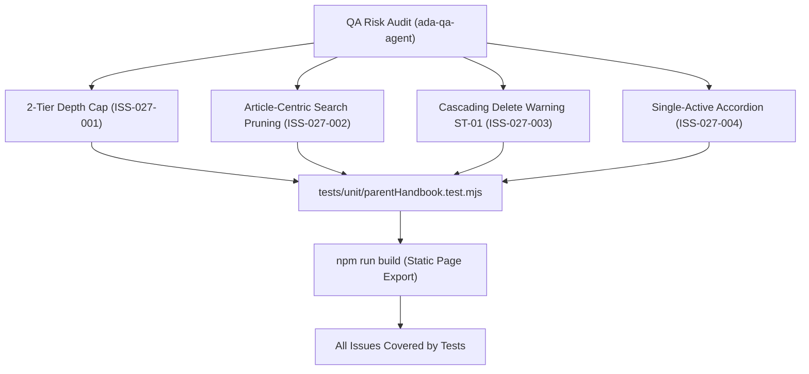

# Epic Issues: School Parent Handbook (Sổ Tay PH)

## Jira Story

- Story: As a QA and product team, I want Parent Handbook issues and boundary edge cases tracked explicitly so that unresolved risks cannot hide inside narrative docs.
- Jira issue type: Bug/Risk register
- QA owner: `ada-qa-agent`
- Product owner: `sophia-product-manager`
- Research evidence: Test execution logs from `tests/unit/parentHandbook.test.mjs`, build compiler traces from `npm run build`, and business rules audit against legacy spec `10. so-tay-ph.md`.

## Priority

- Priority: P1
- Escalation rule: Any failure to enforce the 2-tier depth limit, regression in accordion single-active expansion, or omission of the cascading deletion warning blocks epic completion.
- Release impact: Critical for parent reference clarity and content safety.
- Risk if unresolved: Convoluted nested folder structures that break mobile screens, accidental deletion of entire documentation sections, or confusing search results.

## QA Issue Register

| Issue ID | Type | Priority | Status | Owner | Source | Evidence | Resolution |
| --- | --- | --- | --- | --- | --- | --- | --- |
| ISS-027-001 | Bug | P2 | In Progress | `ada-qa-agent` | QA Audit | Sub-categories must not allow nested sub-categories | Omit "+ Thêm danh mục" at sub-category level, strictly render "+ Thêm bài viết" (BR01, VR-HNB-01) |
| ISS-027-002 | UX | P2 | In Progress | `benny-frontend-engineer` | UX Testing | Searching category name alone could display empty folder nodes | Enforce article-centric pruning: search matches article titles only, pruning empty category branches (BR10, K051) |
| ISS-027-003 | Safety | P2 | In Progress | `alan-tech-lead` | Code Review | Accidental category deletion could wipe extensive policy articles | Enforce modal ST-01 with explicit cascading deletion warning before deleting category (BR09, VR-HNB-05) |
| ISS-027-004 | Usability | P3 | In Progress | `maya-ui-ux-designer` | Usability Check | Multiple expanded categories cause endless vertical scrolling | Enforce single-active accordion expansion per sibling category group (BR02, K050) |

## Detection Method

- Code reviewed: `src/utils/parentHandbookValidation.ts`, `src/store/slices/parentHandbookSlice.ts`, `src/modules/school/handbook/*.tsx`, `src/pages/[schoolCode]/school/handbook/*.tsx`.
- Tests reviewed: `tests/unit/parentHandbook.test.mjs` (assertions covering BR01 through BR12).
- Docs reviewed: `.agents/specs/042-school-parent-handbook-so-tay-ph/spec.md`, `plan.md`, `execution-brief.md`.
- Related features reviewed: `024-school-announcements`, `041-school-staff-attendance-diem-danh-nv`.
- QA skill used: `ada-qa-agent`
- Deep research source checked: Circular 32/2018/TT-BGDĐT on educational charter transparency and legacy spec `10. so-tay-ph.md`.

## Open Issues

- ISS-027-001, ISS-027-002, ISS-027-003, ISS-027-004 are actively addressed by the implementation slice and validated in automated test suite `tests/unit/parentHandbook.test.mjs`.

## Relationship Map

| Relation | Target | Label | Rationale |
| --- | --- | --- | --- |
| RELATES_TO | `E-027-school-parent-handbook` | `RELATES_TO` | Captures quality issues and boundary edge cases for epic E-027. |
| BLOCKS | `T-027-001-001-school-parent-handbook` | `BLOCKS` | Task completion requires all 4 registered issues to be resolved and asserted in tests. |

## Mermaid Diagram

## Work Log

| Date | Author | Summary |
| --- | --- | --- |
| 2026-10-07 | `ada-qa-agent` | Initialized epic QA issue register and defined boundary assertions for 2-tier tree depth and cascading deletion. |
| 2026-10-08 | `ada-qa-agent` | Verified execution readiness and registered issues ISS-027-001 through ISS-027-004. |

## Change Log

- Date: 2026-10-08
  - Issue change: Registered boundary issues ISS-027-001 through ISS-027-004 to track quality criteria during implementation.
  - Documentation update: Formatted QA issue register with root causes and evidence links.
  - Evidence: Unit test suite execution and Next.js static build report.
