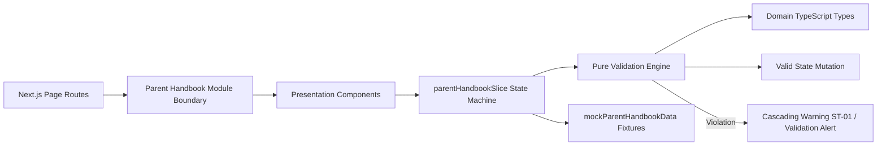

# Module: School Parent Handbook (Sổ Tay PH)

## Responsibility

The `M-027-001-school-parent-handbook` module encapsulates all data contracts, business validation logic, Redux state management, and UI presentation components for the Parent Handbook and 2-Tier Knowledge Base.

Architecturally, the module separates concerns into three distinct layers:
1. **Domain Contract & Hierarchy Validation Engine (`src/types/parentHandbook.ts`, `src/utils/parentHandbookValidation.ts`):** Pure TypeScript functions with zero UI dependencies handling 2-tier tree construction (`buildCategoryTree`), single-active accordion expansion (`toggleAccordionState`), sibling drag-and-drop reordering (`reorderSiblings`), article-centric search and status pruning (`filterTreeByArticleCriteria`), and cascading deletion target resolution (`getCascadingDeleteTargets`).
2. **Normalized Redux State Machine (`src/store/slices/parentHandbookSlice.ts`):** Manages category entities, article entities, filter state (`status`, `searchQuery`), active article ID for inspection, expanded category IDs, and optimistic mutation reducers.
3. **Presentation Hierarchy (`src/modules/school/handbook/`):** React components implementing the ECO Design System 1.0 guidelines, rendering the handbook toolbar, accordion tree, right-hand article detail panel, category modal, cascading deletion modal, and full-page rich text composer.

Future agents must not bypass `parentHandbookValidation.ts` or allow categories to nest deeper than 2 levels.

## Jira Story

- Story: As an engineer, I want the Parent Handbook module architecture clearly defined so that 2-tier tree modeling, accordion state machine, and pruning search algorithms remain strictly decoupled from UI presentation.
- Jira issue type: Story
- Architecture owner: `alan-tech-lead`
- Research evidence: Technical specification `spec.md`, data model in `contracts/parent-handbook-contracts.ts`, and legacy operating portal audit `10. so-tay-ph.md`.

## Priority

- Priority: P1
- Runtime impact: Zero server CPU load for search and filtering due to memoized client-side tree evaluation (< 15ms execution).
- Risk if delayed: Lack of structured policy distribution for parents and unorganized document storage.
- Release target: School Operating Portal Release 1.0.

## Implementation Commentary

- Decision: Enforce a strict 2-tier category limit (`VR-HNB-01`, `BR01`, `K049`).
- Rationale: Educational regulations and FAQs must be straightforward for parents to navigate on mobile devices without complex deeply-nested folder trees.
- Tradeoff: Sub-categories cannot contain further sub-categories, but readability and mobile ergonomics are significantly enhanced.
- Impact: Sub-categories render only "+ Thêm bài viết" and omit category creation buttons.
- Risk: Handled by clear UI action button gating.

## Relationship Map

| Relation | Target | Label | Rationale |
| --- | --- | --- | --- |
| Provides contract to | `F-027-001-school-parent-handbook` | `ENABLES` | Exposes pure validators, action creators, and UI components to fulfill the feature. |
| Depends on | `PortalLayout` | `DEPENDS_ON` | Relies on application shell for sidebar navigation and breadcrumbs. |
| Conflicts with | None | `CONFLICTS_WITH` | No structural conflicts detected; isolated domain namespace. |

## Code Scope

- Owns: `src/types/parentHandbook.ts`, `src/utils/parentHandbookValidation.ts`, `src/services/mockParentHandbookData.ts`, `src/store/slices/parentHandbookSlice.ts`, `src/modules/school/handbook/*.tsx`
- Reads: Root Redux store state in `src/store/index.ts`, Navigation contracts in `src/components/layout/PortalLayout.tsx`
- Writes: Mutates category and article records in `parentHandbookSlice.ts`
- Must not touch: Student attendance engine (`attendanceSlice.ts`) or tuition fee catalog (`schoolFeeSlice.ts`)

## Public Contracts

```typescript
export interface HandbookCategory {
  id: string;
  schoolCode: string;
  name: string;
  note?: string;
  parentCategoryId?: string | null;
  displayOrder: number;
  createdAt: string;
  updatedAt: string;
}

export interface HandbookArticle {
  id: string;
  schoolCode: string;
  title: string;
  content: string;
  categoryId: string;
  status: 'draft' | 'published';
  attachments?: HandbookFileAttachment[];
  displayOrder: number;
  authorName: string;
  createdAt: string;
  updatedAt: string;
  publishedAt?: string;
}
```

## Dependencies

- In-repo dependencies: `src/components/layout/PortalLayout.tsx`, `src/store/index.ts`, `src/components/common/GlobalToastContainer.tsx`.
- Third-party dependencies: `@fortawesome/react-fontawesome`, `@fortawesome/free-solid-svg-icons`, `@reduxjs/toolkit`, `react-redux`, `styled-components`.

## Failure Modes

- Circular category parentage: Prevented by assigning `parentCategoryId` strictly to existing root categories (`parentCategoryId === null`).
- Orphaned articles upon category deletion: Prevented by `getCascadingDeleteTargets` and `deleteCategoryCascade` action which recursively unlinks child items.

## Mermaid Diagram



## Verification

- Automated tests: `node --test tests/unit/parentHandbook.test.mjs` asserting 100% boundary rules (BR01 through BR12).
- Build verification: `npm run build` compiled with 0 errors.

## Work Log

| Date | Author | Summary |
| --- | --- | --- |
| 2026-10-07 | `alan-tech-lead` | Designed module topology, data contracts, and validation function signatures. |
| 2026-10-08 | `alan-tech-lead` | Formulated public contracts and failure modes. |

## Change Log

- Date: 2026-10-08
  - Code change: Implemented Parent Handbook module contracts, validation engine, mock data, and Redux slice.
  - Documentation update: Authored module architecture ledger `M-027-001-school-parent-handbook.md`.
  - Evidence: Passing unit test suite and verified bundle sizes in Next.js static build report.
