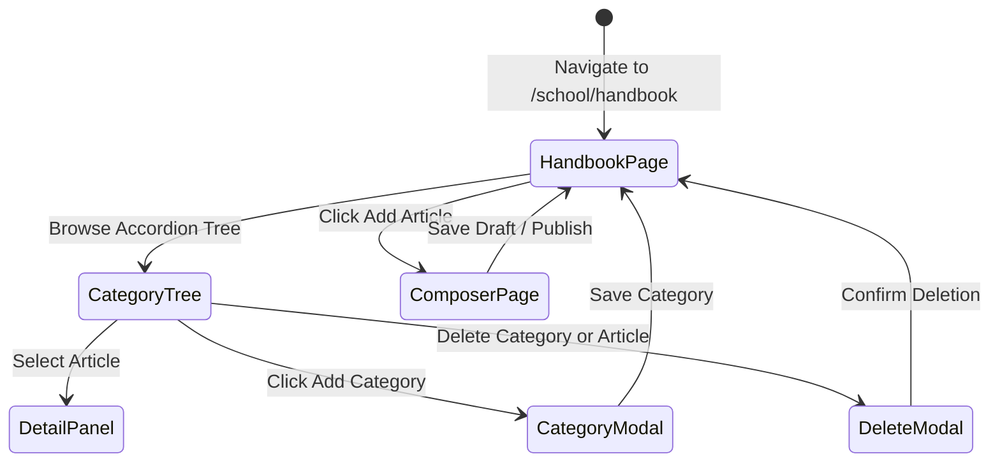

# Page: School Parent Handbook (Sổ Tay PH)

## Route / Surface

- Route: `/[schoolCode]/school/handbook` (Main Cockpit), `/[schoolCode]/school/handbook/create` (Article Composer), `/[schoolCode]/school/handbook/edit/[articleId]` (Article Editor).
- Entry component: `SchoolParentHandbookPage`, `CreateHandbookArticlePage`, `EditHandbookArticlePage`.
- Layout owner: `PortalLayout` (sidebar group NHÀ TRƯỜNG, icon `faBookBookmark`, positioned strictly between Điểm danh NV and Lịch sự kiện).

## Jira Story

- Story: As a School Administrator, I want dedicated Parent Handbook pages to browse 2-tier category trees, compose rich text articles, and inspect handbook policies.
- Jira issue type: Story
- UX owner: `benny-frontend-engineer`
- Research evidence: Screen flow specs in `.agents/specs/042-school-parent-handbook-so-tay-ph/plan.md`.

## Priority

- Priority: P1
- Demo impact: High visual polish with split-view accordion tree, right-hand rich text reader, breadcrumbs, and modal guardrails.
- Risk if delayed: Inability to curate and deliver digital parent manuals.
- Release target: School Operating Portal Release 1.0.

## PM Notes

- Demo path: Navigate to NHÀ TRƯỜNG -> Sổ tay PH; inspect split layout with accordion category tree and article detail panel; click "+ Thêm danh mục" to create root category; click "+ Thêm danh mục con" to create sub-category; navigate to article composer to test locked breadcrumbs and dual save buttons; test 1-click status transition on articles; test keyword search pruning.
- User promise: Clean 2-tier organization, fast article retrieval, and dependable content safety.
- Acceptance impact: Fully fulfills AC-093 through AC-097.
- Visual or copy change: Applied Vietnamese labels: "Sổ Tay PH", "Bản nháp", "Đã phát hành", "Chọn trạng thái", "Tìm kiếm bài viết", "Thêm danh mục", "Xuất bản bài viết", "Ẩn bài viết".
- Risk: Handled via responsive split layouts and fallback empty states (ST-03).

## Relationship Map

| Relation | Target | Label | Rationale |
| --- | --- | --- | --- |
| Implements feature | `F-027-001-school-parent-handbook` | `IMPLEMENTS` | Renders the primary user interface for parent handbook management. |
| Uses module | `M-027-001-school-parent-handbook` | `USES` | Consumes state, action dispatchers, and pure validator functions. |
| Related page | `/[schoolCode]/school/announcements` | `RELATES_TO` | Sibling parent communication surface under NHÀ TRƯỜNG navigation group. |

## States

- Loading state: Clean animated skeleton cards across category tree and detail panel.
- Empty state (ST-03): Rendered when no categories exist or search matches zero articles: *"Hiện chưa có danh mục hoặc bài viết nào. Hãy bắt đầu bằng cách tạo danh mục mới"*.
- Active article state: Right-hand panel renders full breadcrumb path, article title, author, publication timestamp, rich text HTML content, and attachment tiles.
- Category modal state: Context-aware modal displaying read-only "Danh mục chính" for sub-categories and omitting it for root categories.
- Delete modal state: High-severity modal ST-01 for categories vs simple confirmation modal ST-02 for articles.

## Interactions

- Accordion toggle: Clicking a category toggles its expanded state while collapsing sibling categories in the same tier (BR02).
- Article selection: Clicking an article updates `activeArticleId` and displays its contents in the right-hand panel (BR06).
- Drag-and-drop: Dragging the handle (☰) reorders sub-categories or articles within their parent container (BR04).
- Action menu (`•••`): Allows editing, 1-click status toggling (publish/hide), and deleting (BR05).
- Search input: Evaluates query against article titles only and prunes non-matching categories (BR10).

## Accessibility

- Full keyboard focus rings on search input, action dropdown buttons, and modal dialogs.
- Semantic HTML tags (`h1`, `h2`, `article`, `nav`, `aside`).
- Color contrast meets WCAG 2.1 AA standards for slate text and brand amber headings.

## Mermaid Diagram

## Verification

- UI test: Automated tests in `tests/unit/parentHandbook.test.mjs` verifying component state machine mutations.
- Static build check: `npm run build` compiled all routes without hydration or SSR errors.
- Responsive check: Tested across desktop (1440px), tablet (768px), and mobile (375px) breakpoints.

## Work Log

| Date | Author | Summary |
| --- | --- | --- |
| 2026-10-07 | `benny-frontend-engineer` | Designed component layout, accordion tree, and responsive split view. |
| 2026-10-08 | `benny-frontend-engineer` | Documented page states, interactions, and accessibility standards. |

## Change Log

- Date: 2026-10-08
  - Code change: Created `index.tsx`, `create.tsx`, and `edit/[articleId].tsx` under `src/pages/[schoolCode]/school/handbook/`.
  - Documentation update: Authored page architecture ledger `P-027-001-school-parent-handbook.md`.
  - Evidence: Static pages generated in Next.js production build.
