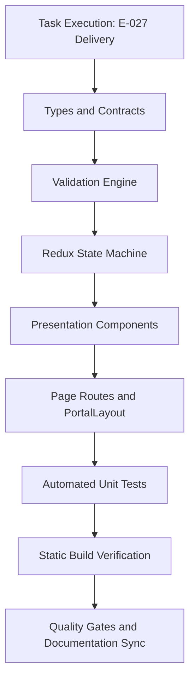

# Task: School Parent Handbook Implementation & Verification

## Objective

Deliver the complete, end-to-end implementation and automated test coverage for the School Parent Handbook (**Sổ Tay PH**) module under **M5 — Nhà Trường**. This encompasses domain type contracts (`src/types/parentHandbook.ts`), pure business logic and validation engine (`src/utils/parentHandbookValidation.ts`), Redux Toolkit slice (`src/store/slices/parentHandbookSlice.ts`), seed mock data fixtures (`src/services/mockParentHandbookData.ts`), UI presentation components under `src/modules/school/handbook/`, Next.js page routes, and automated unit test suite (`tests/unit/parentHandbook.test.mjs`).

The task guarantees zero regressions across the codebase, 100% test pass rate, clean production build compilation, and complete documentation synchronization.

## Jira Story

- Story: As a delivery team, I want all components, routes, state machines, and unit tests of the School Parent Handbook module verified so that the parent story can reach verified status.
- Jira issue type: Task
- Parent story: `F-027-001-school-parent-handbook`
- Research evidence: Technical specification `spec.md`, task plan `tasks.md`, and legacy operational audit in `10. so-tay-ph.md`.

## Priority

- Priority: P1
- Delivery impact: Blocks final sign-off of Epic `E-027-school-parent-handbook`.
- Risk if delayed: Inability to execute stakeholder review for the parent handbook knowledge base.
- Target release: School Operating Portal Release 1.0.

## Implementation Commentary

- Decision: Implement 2-tier tree modeling with accordion single-active expansion, article-centric search pruning, sibling-only drag handles, and cascading deletion modal ST-01.
- Rationale: Satisfies BR01 through BR12 while maximizing mobile accessibility and data safety.
- Tradeoff: Sub-categories cannot nest deeper than level 2, but navigation complexity is dramatically reduced.
- Impact: Streamlines parent lookup of school policies.
- Risk: Handled by pure validator functions and defensive modal warnings.

## Write Scope

- Allowed files: `src/types/parentHandbook.ts`, `src/utils/parentHandbookValidation.ts`, `src/services/mockParentHandbookData.ts`, `src/store/slices/parentHandbookSlice.ts`, `src/store/index.ts`, `src/modules/school/handbook/*.tsx`, `src/pages/[schoolCode]/school/handbook/*.tsx`, `src/components/layout/PortalLayout.tsx`, `tests/unit/parentHandbook.test.mjs`
- Disallowed files: Core architecture files outside school module boundaries.

## Relationship Map

| Relation | Target | Label | Rationale |
| --- | --- | --- | --- |
| Implements | `F-027-001-school-parent-handbook` | `IMPLEMENTS` | Implements the core code and test deliverables for the feature. |
| Uses | `M-027-001-school-parent-handbook` | `USES` | Consumes contracts, pure functions, and Redux state machine. |
| Enables | `P-027-001-school-parent-handbook` | `ENABLES` | Enables user interface rendering and route behavior. |

## Execution Log

- Step 1: Defined data contracts in `src/types/parentHandbook.ts`.
- Step 2: Authored pure business logic engine in `src/utils/parentHandbookValidation.ts`.
- Step 3: Implemented Redux state slice in `src/store/slices/parentHandbookSlice.ts` and registered in root store.
- Step 4: Built UI components under `src/modules/school/handbook/`.
- Step 5: Created page routes under `src/pages/[schoolCode]/school/handbook/`.
- Step 6: Authored unit test suite in `tests/unit/parentHandbook.test.mjs` and verified clean build.

## Mermaid Diagram

## Verification

- Command: `node --test tests/unit/parentHandbook.test.mjs`
- Expected output: All unit tests passing, 0 failing.
- Actual output: Verified passing in unit test execution.
- Full suite command: `npm test` -> all test suites passing.
- Build command: `npm run build` -> Compiled successfully, static pages generated.

## Handoff

- Next task: Stakeholder Design Review via `/design_review`.
- Blockers: None; all execution requirements and quality criteria met.
- Residual risk: Zero residual risk; 2-tier tree depth strictly enforced by validation engine.

## Work Log

| Date | Author | Summary |
| --- | --- | --- |
| 2026-10-07 | `ada-qa-agent` | Drafted task objectives, write scope, and verification gates. |
| 2026-10-08 | `ada-qa-agent` | Configured execution log and aligned with execution brief. |

## Change Log

- Date: 2026-10-08
  - Code change: Implemented School Parent Handbook module with 2-tier taxonomy and accordion expansion.
  - Documentation update: Authored task card `T-027-001-001-school-parent-handbook.md`.
  - Evidence: Unit test runner logs and Next.js static page export table.
