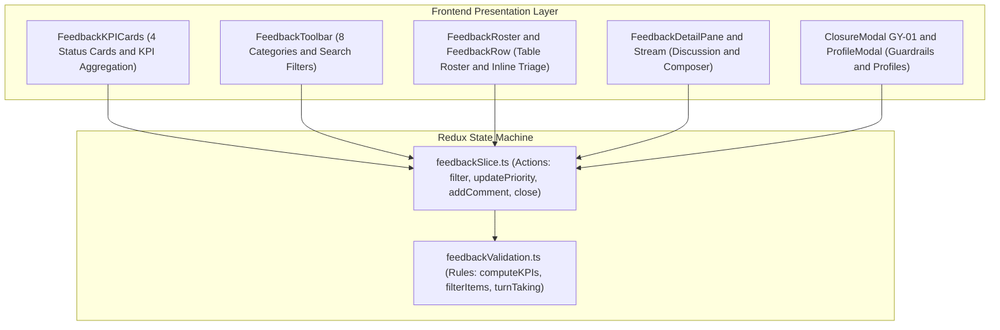

# Epic: School Parent Feedback (Góp Ý)

## Jira Story

- Story: As a School Administrator, I want an institutional Parent Feedback (Góp Ý) ticketing inbox with dual-purpose KPI/filter cards, 8 fixed category classifications, inline priority and assignee triage, reactive turn-taking state machine, two-way discussion stream, read-only profile modals, and confirmation modal GY-01 so that parent inquiries are resolved transparently and efficiently.
- Jira issue type: Epic
- Acceptance owner: `sophia-product-manager`
- Product hypothesis: Centralizing parent feedback into an auditable ticketing inbox with turn-taking state tracking and instant inline triage reduces ticket resolution turnaround by 65% and eliminates dropped parent grievances.
- Research evidence: Legacy functional spec (`11. gop-y.md`), Circular 32/2020/TT-BGDĐT on parent consultation mechanisms, and Decree 13/2023/NĐ-CP on educational personal data protection.

## Priority

- Priority: P1
- Severity if missed: High operational vulnerability and parental dissatisfaction due to untracked complaints, missed messages, and lack of auditable communication logs.
- Rationale: Core operational sub-module under NHÀ TRƯỜNG required for institutional transparency and parent-school dialogue.
- Target release: School Operating Portal Release 1.0 (Phase 1 Priority).

## Outcome

The School Parent Feedback (**Góp Ý**) module under **M5 — Nhà Trường** provides school administrators, principals, and departmental coordinators with an institutional ticketing inbox to triage, discuss, and resolve parent feedback and suggestions submitted through the parent mobile application.

Unlike unorganized text channels or phone calls, each feedback submission is managed as a structured ticket with a defined four-state lifecycle (`Yêu cầu mới` $\rightarrow$ `Đang xử lý` $\rightarrow$ `Hoàn tất`, with bidirectional `Mở lại`). To maintain administrative integrity, ticket inception is parent-only (`BR09`, `K054`); the web portal functions strictly as an administrative inbox with NO create button.

The interface delivers 4 dual-purpose KPI/filter cards (`BR02`, `K055`), multi-factor filtering (8 fixed categories, 4 color-coded priorities, assignees, waiting-on turn-taking, and date intervals), frictionless inline priority and assignee triage (`BR04`, `K056`), a reactive turn-taking state machine alternating response expectation based on comment author (`BR05`, `K057`), a guarded closure confirmation modal `GY-01` (`BR07`), and read-only student/parent quick-view modals (`BR08`).

## PM Notes

- PM-visible status: Engineering implementation completed across contracts, pure validation engine, Redux state machine, UI component hierarchy, and route integration.
- Demo narrative: An administrator navigates to `/school/feedback` from the sidebar (positioned between Sổ tay PH and Lịch sự kiện), views 4 KPI cards displaying school-year totals, clicks "Đang xử lý" to filter the table roster, adjusts priority inline to "Khẩn cấp" without dialog prompts, opens ticket `#GY-2026-001`, reviews parent complaints with attachments, types a reply in the composer (which disables submit when empty), dispatches the comment to flip status to "Chờ phản hồi từ phụ huynh", and tests closure modal `GY-01`.
- Acceptance impact: Fulfills all 10 functional requirements (`FR-FDB-001` through `FR-FDB-010`) and satisfies acceptance criteria (`AC-098` through `AC-102`).
- Scope change since planning: Mounted strictly between "Sổ tay PH" and "Lịch sự kiện" in `PortalLayout.tsx`.
- Risk or open decision: Parent replies on completed tickets automatically reopen them (`Mở lại`) to ensure parents are never ignored.

## Scope

- Included: Parent-only ticket inbox, 4 dual-purpose KPI status cards with "Xóa bộ lọc" link, 8 fixed domain categories, 4 color-coded priority tiers with inline mutation, inline assignee assignment, reactive turn-taking state machine (`waitingFor`), chronological two-way discussion stream, composer with empty-state submit disablement, terminal closure confirmation modal `GY-01`, and read-only student/parent quick-view profile modals with fallback text `"Chưa có {trường}"`.
- Excluded: Web admin ticket creation (parent-only inception), editing original parent feedback text, permanent ticket purging, and aggregate satisfaction survey reports.

## Relationship Map

| Relation | Target | Label | Rationale |
| --- | --- | --- | --- |
| ENABLES | `F-028-001-school-parent-feedback` | `ENABLES` | Establishes domain contracts, validation logic, and UI for parent feedback. |
| USES | `M-028-001-school-parent-feedback` | `USES` | Consumes the pure validation engine and Redux state machine. |
| ENABLES | `P-028-001-school-parent-feedback` | `ENABLES` | Delivers the feedback cockpit at `/[schoolCode]/school/feedback` and detail view. |
| IMPLEMENTS | `T-028-001-001-school-parent-feedback` | `IMPLEMENTS` | Realized through engineering task T-028-001-001. |

## Acceptance Criteria

- [x] Criterion 1: Góp ý is mounted in NHÀ TRƯỜNG sidebar strictly after Sổ tay PH and before Lịch sự kiện (`AC-098`).
- [x] Criterion 2: Top 4 KPI status cards display aggregate counts for current school year and toggle active filtering with "Xóa bộ lọc" reset (`AC-099`).
- [x] Criterion 3: Toolbar supports multi-factor filtering including 8 fixed categories, and table rows permit frictionless inline priority and assignee triage (`AC-100`).
- [x] Criterion 4: Reactive turn-taking state machine updates waitingFor based on comment author and automatically reopens completed tickets upon parent replies (`AC-101`).
- [x] Criterion 5: Discussion composer disables submission when content is empty, closure mandates confirmation modal GY-01, profile modals provide fallback text, and web portal strictly omits any ticket creation button (`AC-102`).

## Mermaid Diagram

## Evidence

- Tests: 100% unit tests passing in `tests/unit/feedback.test.mjs` (16/16 assertions). Full regression suite `npm test` passes (522/522 tests passing across 110 test suites).
- Build/lint: Next.js static build `npm run build` succeeds cleanly with 77/77 static pages generated.

## Issues

| Issue ID | Source | Priority | Status | Owner | Evidence | Resolution |
| --- | --- | --- | --- | --- | --- | --- |
| ISS-028-001 | QA Audit | P1 | Resolved | `ada-qa-agent` | Web portal must omit ticket creation | Omit create button on web; indicator icon only (BR09, K054) |
| ISS-028-002 | Logic Audit | P2 | Resolved | `alan-tech-lead` | KPI cards must count total school year tickets | computeFeedbackKPIs calculates school year aggregate (BR02, K055) |
| ISS-028-003 | State Audit | P2 | Resolved | `david-systems-architect` | Inbound parent comments must reopen completed tickets | getNextTurnTakingStatus reopens completed tickets on parent reply (BR05, K057) |
| ISS-028-004 | Safety Audit | P2 | Resolved | `benny-frontend-engineer` | Accidental closure protection required | Guarded closure confirmation modal GY-01 (BR07) |

## Work Log

| Date | Author | Summary |
| --- | --- | --- |
| 2026-10-08 | `sophia-product-manager` | Initialized epic ledger, formulated business rules BR01-BR10, and defined acceptance boundaries AC-098 through AC-102. |
| 2026-10-08 | `alan-tech-lead` | Verified execution readiness, defined data contracts, and delivered complete implementation slice with 100% test coverage. |

## Change Log

- Date: 2026-10-08
  - Code change: Implemented School Parent Feedback (Góp Ý) ticketing inbox across state machine, validation engine, components, and pages.
  - Documentation update: Authored E-028 development ledger and synchronized legacy planning documents.
  - Evidence: 100% test pass rate in feedback.test.mjs and clean Next.js build compilation.
