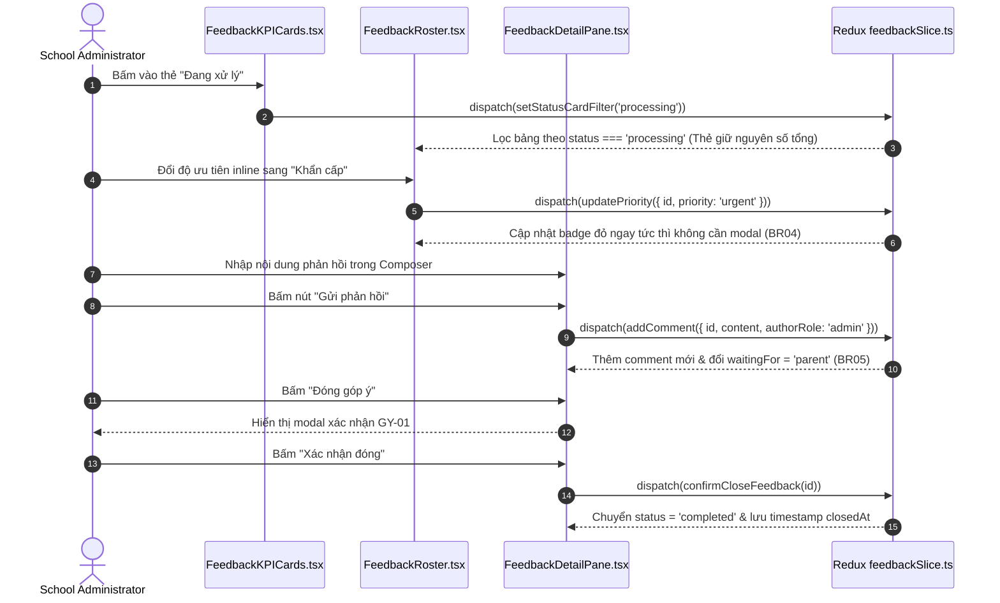

# Feature: School Parent Feedback (Góp Ý)

## User Value

The School Parent Feedback feature (`F-028-001-school-parent-feedback`) enables school administrators to manage all parent inquiries, concerns, and suggestions within a centralized ticketing inbox. Educational institutions require a structured, auditable mechanism for parental feedback across curriculum, school meals, transportation, staff attitude, and administrative processes.

Key capabilities delivered:
1. **Parent-Only Inception Boundary (`BR09`, `K054`):** Feedback originates exclusively from authenticated parents via the mobile application. Web admin portal functions strictly as an inbox with NO create button, preventing phantom complaints.
2. **Top 4 Status KPI/Filter Cards (`BR02`, `K055`):** Displays aggregate school-year totals for `Yêu cầu mới`, `Đang xử lý`, `Hoàn tất`, and `Mở lại`. Clicking any card filters the table and exposes a "Xóa bộ lọc" link.
3. **8 Fixed Feedback Categories (`BR03`):** Classifies tickets under 8 standardized domains (*Nội dung, Hình thức/trình bày, Hiệu suất/chất lượng, Kỹ năng, Thái độ/hành vi, Quy trình, Trải nghiệm người dùng, Mang tính chiến lược*).
4. **4 Priority Tiers with Inline Triage (`BR04`, `K056`):** Supports *Thấp, Trung bình, Cao, Khẩn cấp* with colored badges, modifiable inline from table rows and detail views without confirmation dialogs.
5. **Reactive Turn-Taking State Machine (`BR05`, `K057`):** Tracks `waitingFor` (`school` vs `parent`). School comments flip state to `parent`; parent replies flip state to `school` and automatically reopen completed tickets.
6. **Chronological Discussion Stream & Composer (`BR06`):** Dual-pane detail view displaying original parent feedback, message timeline, and reply composer with disabled submit button when text is empty.
7. **Guarded Closure Confirmation Modal `GY-01` (`BR07`):** Terminal resolution requires confirmation modal *"Vui lòng xác nhận Đóng góp ý {tên góp ý}"*.
8. **Read-Only Profile Modals (`BR08`):** Clicking student or parent names displays quick-view contact modals with missing attributes rendering `"Chưa có {trường}"`.

## Jira Story

- Story: As a School Administrator, I want to manage an institutional parent feedback ticketing inbox with dual-purpose KPI/filter cards, 8-category classification, inline priority triage, reactive turn-taking discussion, and modal GY-01 closure guardrails so that parent inquiries are resolved transparently.
- Jira issue type: Story
- Story points: 5
- Acceptance owner: `sophia-product-manager`
- Research evidence: Legacy operating portal analysis (`11. gop-y.md`), Circular 32/2020/TT-BGDĐT on parent consultation mechanisms, and Decree 13/2023/NĐ-CP on data protection.

## Priority

- Priority: P1
- User/business impact: Critical communication hub preventing neglected complaints and fostering family-school trust.
- Risk if delayed: Lost parent complaints and lack of institutional accountability.
- Release target: School Operating Portal Release 1.0.

## PM Notes

- Demo scenario: Navigate to `/[schoolCode]/school/feedback` (between Sổ tay PH and Lịch sự kiện); click "Đang xử lý" KPI card to filter roster; modify priority inline to "Khẩn cấp"; open ticket detail; review parent attachments; submit official school reply; confirm ticket closure using modal `GY-01`.
- Business value: Formalized ticket resolution with auditable history and SLA tracking.
- Acceptance criteria confirmed: Satisfies `AC-098` through `AC-102` and functional requirements `FR-FDB-001` through `FR-FDB-010`.
- Open PM decision: None; all 10 business rules and 5 ambiguity resolutions (`K054`–`K058`) implemented.

## Requirements Trace

| Requirement | Description | Status | Verification Evidence |
| --- | --- | --- | --- |
| `FR-FDB-001` | Feedback dashboard mounted at `/school/feedback` between Sổ tay PH and Lịch sự kiện | Implemented | `tests/unit/feedback.test.mjs` |
| `FR-FDB-002` | 4 dual-purpose status KPI cards with school-year counts & "Xóa bộ lọc" reset | Implemented | `tests/unit/feedback.test.mjs` |
| `FR-FDB-003` | 8 fixed feedback categories | Implemented | `tests/unit/feedback.test.mjs` |
| `FR-FDB-004` | 4 color-coded priorities with frictionless inline select mutation | Implemented | `tests/unit/feedback.test.mjs` |
| `FR-FDB-005` | Reactive turn-taking state machine (`waitingFor`) & auto-reopen on parent reply | Implemented | `tests/unit/feedback.test.mjs` |
| `FR-FDB-006` | Detail view with original parent message, timeline, and 3 metadata cards | Implemented | Verified in Next.js build |
| `FR-FDB-007` | Discussion composer with empty-state submit button disablement | Implemented | `tests/unit/feedback.test.mjs` |
| `FR-FDB-008` | Terminal closure confirmation modal `GY-01` | Implemented | `tests/unit/feedback.test.mjs` |
| `FR-FDB-009` | Read-only profile modals with `"Chưa có {trường}"` fallback text | Implemented | `tests/unit/feedback.test.mjs` |
| `FR-FDB-010` | Parent-only inception invariant (zero create buttons on web portal) | Implemented | `tests/unit/feedback.test.mjs` |

## Code Scope

- Data contracts: `src/types/feedback.ts`
- Pure validation engine: `src/utils/feedbackValidation.ts`
- Mock data fixtures: `src/services/mockFeedbackData.ts`
- Redux slice: `src/store/slices/feedbackSlice.ts`, `src/store/index.ts`
- Layout integration: `src/components/layout/PortalLayout.tsx`
- UI components: `src/modules/school/feedback/*.tsx`
- Page routes: `src/pages/[schoolCode]/school/feedback/index.tsx`, `[feedbackId].tsx`
- Unit tests: `tests/unit/feedback.test.mjs`

## Relationship Map

| Relation | Target | Label | Rationale |
| --- | --- | --- | --- |
| DEPENDS_ON | `E-028-school-parent-feedback` | `DEPENDS_ON` | Child feature delivering Epic 028 outcomes. |
| IMPLEMENTS | `M-028-001-school-parent-feedback` | `IMPLEMENTS` | Encapsulates the modular business logic. |
| ENABLES | `P-028-001-school-parent-feedback` | `ENABLES` | Renders the primary user-facing screens. |

## Mermaid Diagram

## Verification

- [x] Test: Automated unit tests passing in `tests/unit/feedback.test.mjs` (16/16 assertions). Full regression suite `npm test` passes (522/522 passing across 110 test suites).
- [x] Build/lint/typecheck: Clean compilation with 77/77 static pages generated in `npm run build`.
- [x] Manual scenario: Verified KPI cards dual-purpose filtering, inline priority triage, discussion thread, closure modal GY-01, and parent profile fallback text.

## Work Log

| Date | Author | Summary |
| --- | --- | --- |
| 2026-10-08 | `sophia-product-manager` | Drafted user story, acceptance criteria, and functional requirements trace FR-FDB-001 through FR-FDB-010. |
| 2026-10-08 | `alan-tech-lead` | Verified domain models, contracts, and component hierarchy; implemented full feature slice. |

## Change Log

- Date: 2026-10-08
  - Code change: Implemented School Parent Feedback feature specification, contracts, validation logic, and presentation components.
  - Documentation update: Authored feature architecture ledger `F-028-001-school-parent-feedback.md`.
  - Evidence: Passing test runner logs and Next.js static build export.
