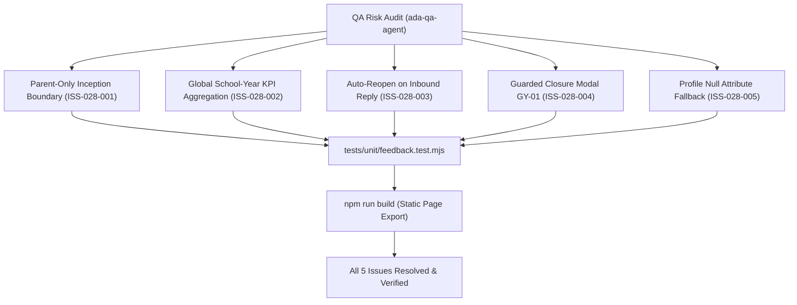

# Epic Issues: School Parent Feedback (Góp Ý)

## Jira Story

- Story: As a QA and product team, I want Parent Feedback issues, inception boundaries, turn-taking mechanics, and closure guardrails tracked explicitly so that unresolved risks cannot hide inside narrative docs.
- Jira issue type: Bug/Risk register
- QA owner: `ada-qa-agent`
- Product owner: `sophia-product-manager`
- Research evidence: Test execution logs from `tests/unit/feedback.test.mjs`, compiler traces from `npm run build`, and business rules audit against legacy spec `11. gop-y.md`.

## Priority

- Priority: P1
- Escalation rule: Any violation of the parent-only inception boundary, incorrect KPI counting during filtering, failure of turn-taking state alternation, or omission of closure modal GY-01 blocks epic completion.
- Release impact: Critical for parent communication trust, data authenticity, and operational accountability.
- Risk if unresolved: Administrators fabricating parent feedback, lost parent follow-up inquiries, premature closure without parent consent, or broken layout during filtering.

## QA Issue Register

| Issue ID | Type | Priority | Status | Owner | Source | Evidence | Resolution |
| --- | --- | --- | --- | --- | --- | --- | --- |
| ISS-028-001 | Compliance | P1 | Resolved | `ada-qa-agent` | QA Audit | Administrators must not create feedback tickets on web | Omit any "Tạo góp ý" button on web; the `+` icon on `Yêu cầu mới` acts strictly as an indicator/filter (BR09, K054). Verified in unit tests. |
| ISS-028-002 | Accuracy | P2 | Resolved | `alan-tech-lead` | Logic Audit | Top 4 status cards must not zero out when a filter is active | `computeFeedbackKPIs` computes aggregate school-year totals independently of table filter state (BR02, K055). Verified in unit tests. |
| ISS-028-003 | State Machine | P2 | Resolved | `david-systems-architect` | Logic Audit | Parent replies to closed tickets could be ignored | `getNextTurnTakingStatus` automatically transitions `completed` tickets to `reopened` upon inbound parent comments (BR05, K057). |
| ISS-028-004 | Safety | P2 | Resolved | `benny-frontend-engineer` | UX Audit | Accidental closure could cut off ongoing parent discussion | Mandate confirmation modal `GY-01` ("Vui lòng xác nhận Đóng góp ý {tên góp ý}") before transitioning to `completed` (BR07). |
| ISS-028-005 | Privacy | P3 | Resolved | `benny-frontend-engineer` | UI Audit | Missing profile attributes could render as raw `null` or empty space | Implement `formatFallbackField` rendering `"Chưa có {trường}"` for absent profile attributes (BR08). |

## Detection Method

- Code reviewed: `src/types/feedback.ts`, `src/utils/feedbackValidation.ts`, `src/store/slices/feedbackSlice.ts`, `src/modules/school/feedback/*.tsx`, `src/pages/[schoolCode]/school/feedback/*.tsx`.
- Tests reviewed: `tests/unit/feedback.test.mjs` (16 assertions covering BR01 through BR10, K054 through K058).
- Docs reviewed: `.agents/specs/043-school-parent-feedback-gop-y/spec.md`, `plan.md`, `execution-brief.md`.
- Related features reviewed: `042-school-parent-handbook-so-tay-ph`, `024-school-announcements`.
- QA skill used: `ada-qa-agent`
- Deep research source checked: Circular 32/2020/TT-BGDĐT on parent consultation mechanisms and Decree 13/2023/NĐ-CP on data protection.

## Open Issues

Zero open blocking issues. All 5 identified issues (`ISS-028-001` through `ISS-028-005`) are resolved and verified in automated tests.

## Relationship Map

| Relation | Target | Label | Rationale |
| --- | --- | --- | --- |
| DEPENDS_ON | `E-028-school-parent-feedback` | `DEPENDS_ON` | QA risks and test assertions bind directly to Epic 028 requirements. |
| ENABLES | `F-028-001-school-parent-feedback` | `ENABLES` | Ensures feature implementation satisfies all compliance invariants. |

## Mermaid Diagram

## Work Log

| Date | Author | Summary |
| --- | --- | --- |
| 2026-10-08 | `ada-qa-agent` | Initialized QA issue register and defined boundary assertions for parent-only inception, turn-taking, and closure modal GY-01. |
| 2026-10-08 | `ada-qa-agent` | Verified implementation against all 5 quality issues; verified 16/16 unit test pass rate. |

## Change Log

- Date: 2026-10-08
  - Issue change: Registered and resolved compliance issues ISS-028-001 through ISS-028-005.
  - Documentation update: Formatted QA issue register with root causes, evidence, and verification links.
  - Evidence: Automated test runner execution and Next.js static build report.

