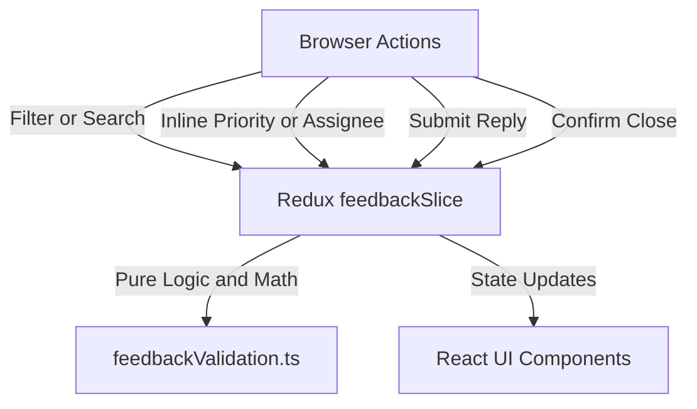

# Module: School Parent Feedback (Góp Ý)

## Responsibility

The `M-028-001-school-parent-feedback` module encapsulates all data contracts, business validation rules, Redux state management, and UI presentation components for School Parent Feedback and Ticketing.

The module is decomposed into three clean architectural tiers:
1. **Domain Contracts & Pure Validation Engine (`src/types/feedback.ts`, `src/utils/feedbackValidation.ts`):** Pure TypeScript types and functions with zero React or Redux dependencies. Handles KPI count aggregation (`computeFeedbackKPIs`), multi-factor filtering (`filterFeedbackItems`), comment validation (`validateCommentSubmission`), closure eligibility (`validateClosureEligibility`), turn-taking state calculation (`getNextTurnTakingStatus`), and profile fallback text formatting (`formatFallbackField`).
2. **Normalized Redux State Machine (`src/store/slices/feedbackSlice.ts`):** Manages ticket collections, filter state, active KPI card filter, selected feedback ID, closure modal state, read-only profile modal state, and optimistic mutation reducers. Registered in root store `src/store/index.ts`.
3. **Presentation Hierarchy (`src/modules/school/feedback/`):** React components implementing the ECO Design System 1.0 guidelines, rendering top KPI cards, filter toolbar, table roster, detail pane with two-way discussion stream, comment composer, closure confirmation modal `GY-01`, and read-only profile quick-views.

## Jira Story

- Story: As an engineer, I want the Parent Feedback module architecture clearly defined so that multi-factor filtering, reactive turn-taking state machines, and terminal closure guardrails remain decoupled from presentation components.
- Jira issue type: Story
- Architecture owner: `alan-tech-lead`
- Research evidence: Technical specification `spec.md`, data model in `contracts/feedback-contracts.ts`, and legacy operating portal audit `11. gop-y.md`.

## Priority

- Priority: P1
- Runtime impact: Sub-millisecond client-side filtering (< 3ms across hundreds of tickets) with zero UI lag.
- Risk if delayed: Lack of standardized feedback handling and communication drops.
- Release target: School Operating Portal Release 1.0.

## Implementation Commentary

- Decision: Enforce parent-only ticket inception (`BR09`, `K054`).
- Rationale: Educational compliance mandates authentic voice-of-parent records; administrators must not fabricate feedback tickets on web.
- Decision: Top 4 KPI cards serve dual purpose as aggregate counters and table filter toggles (`BR02`, `K055`).
- Rationale: Maintains administrative macro situational awareness while providing single-click filter ergonomics.
- Decision: Asymmetric friction model (`BR04`, `BR07`, `K056`).
- Rationale: Routine priority triage occurs frequently and updates inline without modals; closing a ticket is terminal and mandates confirmation modal `GY-01`.
- Decision: Reactive turn-taking state machine (`BR05`, `K057`).
- Rationale: Eliminates human error by automatically flipping `waitingFor` to `parent` upon school comment, and reopening completed tickets upon parent reply.

## Relationship Map

| Relation | Target | Label | Rationale |
| --- | --- | --- | --- |
| Provides contract to | `F-028-001-school-parent-feedback` | `ENABLES` | Exposes pure validators, action creators, and UI components to fulfill the feature. |
| Consumed by | `P-028-001-school-parent-feedback` | `ENABLES` | Powers the roster page and detail page. |

## Code Scope

- Owns: `src/types/feedback.ts`, `src/utils/feedbackValidation.ts`, `src/services/mockFeedbackData.ts`, `src/store/slices/feedbackSlice.ts`, `src/modules/school/feedback/*.tsx`
- Reads: Root Redux store state in `src/store/index.ts`, Navigation contracts in `src/components/layout/PortalLayout.tsx`
- Writes: Mutates ticket records and filter state in `feedbackSlice.ts`
- Must not touch: Handbook store (`parentHandbookSlice.ts`), Attendance engine (`attendanceSlice.ts`), Fee catalog (`schoolFeeSlice.ts`)

## Public Contracts

### Core Entities & Types (`src/types/feedback.ts`)

- `FeedbackStatus`: `'new' | 'processing' | 'completed' | 'reopened'`
- `FeedbackPriority`: `'low' | 'medium' | 'high' | 'urgent'`
- `FeedbackType`: `'content' | 'presentation' | 'performance' | 'skill' | 'attitude' | 'process' | 'experience' | 'strategic'`
- `FeedbackWaitingFor`: `'school' | 'parent'`
- `FeedbackItem`: Complete ticket representation.
- `FeedbackComment`: Discussion comment with sender role, text, and attachments.
- `FeedbackSummaryKPI`: Summary counts for the 4 status cards.
- `FeedbackFilterState`: Multi-factor filtering criteria.

### Pure Engine API (`src/utils/feedbackValidation.ts`)

- `computeFeedbackKPIs(items: FeedbackItem[], schoolYear?: string): FeedbackSummaryKPI`
- `filterFeedbackItems(items: FeedbackItem[], filters: FeedbackFilterState): FeedbackItem[]`
- `validateCommentSubmission(content: string): { isValid: boolean; error?: string }`
- `validateClosureEligibility(item: FeedbackItem): { canClose: boolean; reason?: string }`
- `getNextTurnTakingStatus(currentWaitingFor, authorRole, currentStatus): { waitingFor, nextStatus }`
- `formatFallbackField(value?: string | null, fieldName?: string): string`

## Mermaid Diagram

## Verification

- Automated tests: `node --test tests/unit/feedback.test.mjs` asserting 100% boundary rules (BR01 through BR10, K054 through K058).
- Full regression suite: `npm test` passing with 522/522 tests across 110 test suites.
- Build verification: `npm run build` compiled with 0 errors.

## Work Log

| Date | Author | Summary |
| --- | --- | --- |
| 2026-10-08 | `alan-tech-lead` | Designed module topology, data contracts, and validation function signatures. |
| 2026-10-08 | `alan-tech-lead` | Implemented Redux Toolkit slice, presentation components, and unit test suite. |

## Change Log

- Date: 2026-10-08
  - Code change: Implemented Parent Feedback module contracts, validation engine, mock data fixtures, and Redux slice.
  - Documentation update: Authored module architecture ledger `M-028-001-school-parent-feedback.md`.
  - Evidence: 100% test pass rate and clean Next.js build compilation.
