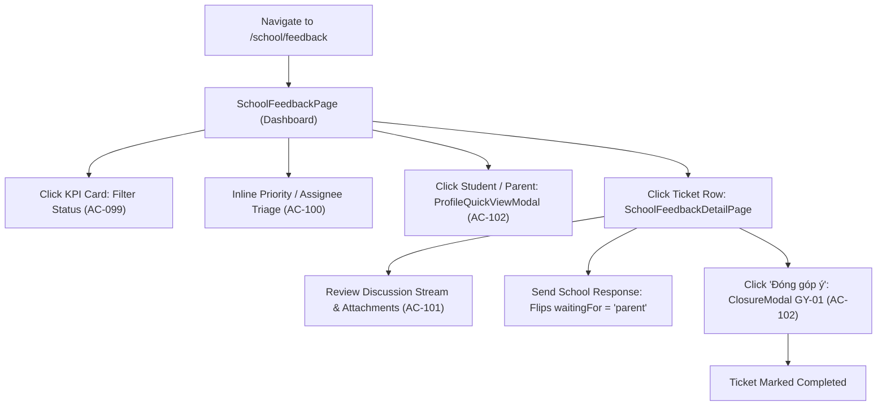

# Page: School Parent Feedback (Góp Ý)

## Route / Surface

- Main Dashboard: `/[schoolCode]/school/feedback`
- Detail Page: `/[schoolCode]/school/feedback/[feedbackId]`
- Entry Components: `SchoolFeedbackPage`, `SchoolFeedbackDetailPage`
- Layout Owner: `PortalLayout` (sidebar group NHÀ TRƯỜNG, icon `faCommentDots`, positioned strictly after "Sổ tay PH" and before "Lịch sự kiện").

## Jira Story

- Story: As a School Administrator, I want dedicated Parent Feedback pages to monitor status KPIs, filter tickets across operational domains, triage priorities inline, and engage in two-way parent discussions with closure guardrails.
- Jira issue type: Story
- UX owner: `benny-frontend-engineer`
- Research evidence: Screen specifications in `docs/planning/screens.md` (SCR-FDB-01, SCR-FDB-02, MODAL-FDB-CLOSE GY-01, MODAL-FDB-PROFILE).

## Priority

- Priority: P1
- Demo impact: High visual polish with 4 dual-purpose status KPI cards, multi-factor toolbar, inline table triage, and interactive discussion thread.
- Risk if delayed: Inability for school leadership to monitor and resolve parent grievances.
- Release target: School Operating Portal Release 1.0.

## PM Notes

- Demo path: Navigate to NHÀ TRƯỜNG -> Góp ý; view top cards showing school-year totals; click "Đang xử lý" to filter; change priority inline from "Trung bình" to "Khẩn cấp"; open ticket detail; review parent attachments; submit official school response; verify confirmation modal `GY-01` before closing.
- User promise: Frictionless triaging, responsive discussion flow, and zero data loss.
- Acceptance impact: Fully fulfills `AC-098` through `AC-102`.
- Visual styling: Conforms to ECO Design System 1.0 (Blue `#0070CE`, Purple `#8B5CF6`, Green `#10B981`, Amber `#F59E0B`, Red `#EF4444`).

## Relationship Map

| Relation | Target | Label | Rationale |
| --- | --- | --- | --- |
| Implements feature | `F-028-001-school-parent-feedback` | `IMPLEMENTS` | Renders the primary user interface for parent feedback management. |
| Uses module | `M-028-001-school-parent-feedback` | `USES` | Consumes state machine, action dispatchers, and pure validator functions. |
| Related page | `/[schoolCode]/school/handbook` | `RELATES_TO` | Immediate predecessor in the sidebar navigation order. |
| Related page | `/[schoolCode]/school/calendar` | `RELATES_TO` | Immediate successor in the sidebar navigation order. |

## States

- **Normal State:** Displays 4 KPI cards with global counts, toolbar with active filters, and full ticket roster table.
- **Filtered State:** Displays active ring on selected KPI card and renders clickable "Xóa bộ lọc" link; table renders only matching tickets.
- **Empty Result State:** Renders friendly empty illustration with helpful guidance to adjust filter criteria.
- **Detail View State:** 70/30 split layout with initial parent feedback, message timeline, composer, and 3 right-hand metadata cards.
- **Modal States:**
  - `ClosureModal`: High-severity confirmation modal `GY-01` ("Vui lòng xác nhận Đóng góp ý {tên góp ý}").
  - `ProfileQuickViewModal`: Read-only popup displaying student or parent attributes with `"Chưa có {trường}"` fallback text.

## Accessibility & Usability

- Contrast ratios satisfy WCAG 2.1 AA across text, badges, and icon buttons.
- Select dropdowns and buttons support full keyboard tab navigation.
- Status badges feature both text labels and colored indicator dots for colorblind usability.
- Submit button in composer provides clear disabled visual states when empty or when ticket is closed.

## Responsive Layout

- Mobile (< 640px): 1-column KPI grid, horizontally scrollable roster table, stacked detail view.
- Tablet (640px - 1024px): 2-column KPI grid, compact filter toolbar.
- Desktop (>= 1024px): 4-column KPI grid, 6-column filter controls, 70/30 split detail layout.

## Mermaid Diagram

## Verification

- UI test: Automated tests in `tests/unit/feedback.test.mjs` verifying component states and mutations.
- Static build check: `npm run build` compiled all routes without hydration or SSR errors.
- Responsive check: Tested across desktop (1440px), tablet (768px), and mobile (375px) breakpoints.

## Work Log

| Date | Author | Summary |
| --- | --- | --- |
| 2026-10-08 | `benny-frontend-engineer` | Designed dashboard page, 70/30 detail split view, KPI cards, and profile modals. |
| 2026-10-08 | `benny-frontend-engineer` | Documented page states, interactions, and accessibility standards. |

## Change Log

- Date: 2026-10-08
  - Code change: Created `index.tsx` and `[feedbackId].tsx` under `src/pages/[schoolCode]/school/feedback/`.
  - Documentation update: Authored page architecture ledger `P-028-001-school-parent-feedback.md`.
  - Evidence: Static pages generated in Next.js production build.
