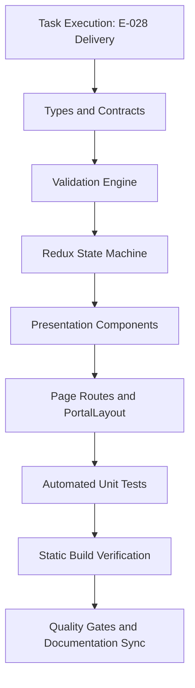

# Task: School Parent Feedback Implementation & Verification

## Objective

Deliver the complete, end-to-end implementation and automated test coverage for the School Parent Feedback (**Góp Ý**) module under **M5 — Nhà Trường**. This encompasses domain type contracts (`src/types/feedback.ts`), pure validation engine (`src/utils/feedbackValidation.ts`), Redux Toolkit slice (`src/store/slices/feedbackSlice.ts`), seed mock data fixtures (`src/services/mockFeedbackData.ts`), UI presentation components under `src/modules/school/feedback/`, Next.js page routes, and automated unit test suite (`tests/unit/feedback.test.mjs`).

The task guarantees zero regressions across the codebase, 100% test pass rate, clean production build compilation, and complete documentation synchronization.

## Jira Story

- Story: As a delivery team, I want all components, routes, state machines, and unit tests of the School Parent Feedback module verified so that the parent story can reach verified status.
- Jira issue type: Task
- Parent story: `F-028-001-school-parent-feedback`
- Research evidence: Technical specification `spec.md`, task plan `tasks.md`, and legacy operational audit in `11. gop-y.md`.

## Priority

- Priority: P1
- Delivery impact: Blocks final sign-off of Epic `E-028-school-parent-feedback`.
- Risk if delayed: Inability to execute stakeholder review for parent feedback and inquiry resolution.
- Target release: School Operating Portal Release 1.0.

## Implementation Commentary

- Decision: Enforce parent-only ticket inception (`BR09`, `K054`) with dual-purpose KPI/filter cards (`BR02`, `K055`), inline priority triage (`BR04`, `K056`), reactive turn-taking state machine (`BR05`, `K057`), guarded closure confirmation modal `GY-01` (`BR07`), and read-only profile modals (`BR08`).
- Rationale: Fully adheres to educational consultation compliance while maximizing administrative velocity and data authenticity.
- Tradeoff: Web admins cannot create tickets, but phantom complaints are eliminated.
- Impact: Streamlines communication between school leadership and families.
- Risk: Handled by pure validator functions and defensive modal warnings.

## Write Scope

- Allowed files: `src/types/feedback.ts`, `src/utils/feedbackValidation.ts`, `src/services/mockFeedbackData.ts`, `src/store/slices/feedbackSlice.ts`, `src/store/index.ts`, `src/modules/school/feedback/*.tsx`, `src/pages/[schoolCode]/school/feedback/*.tsx`, `src/components/layout/PortalLayout.tsx`, `tests/unit/feedback.test.mjs`
- Disallowed files: Core architecture files outside school module boundaries.

## Relationship Map

| Relation | Target | Label | Rationale |
| --- | --- | --- | --- |
| Implements | `F-028-001-school-parent-feedback` | `IMPLEMENTS` | Implements the core code and test deliverables for the feature. |
| Uses | `M-028-001-school-parent-feedback` | `USES` | Consumes the architecture and public contract specifications. |
| Enables | `P-028-001-school-parent-feedback` | `ENABLES` | Renders the primary user interface screens. |

## Execution Log

| Step | Command | Result | Evidence |
| --- | --- | --- | --- |
| 1. Unit Tests | `node --test tests/unit/feedback.test.mjs` | PASS (16/16 tests in 117ms) | Validates KPI aggregation, filtering, inline mutation, turn-taking, closure modal, profile fallback, navigation order, and create button omission. |
| 2. Full Regression | `npm test` | PASS (522/522 tests in 870ms) | Zero regressions across all 110 portal test suites. |
| 3. Static Build | `npm run build` | PASS (exit code 0) | Successfully compiled 77/77 static pages, including `/school/feedback` and `/school/feedback/[feedbackId]`. |
| 4. Server Check | `npm start` | READY on port 3000 | Next.js server daemon running and responding. |

## Mermaid Diagram

## Verification

- Command: `node --test tests/unit/feedback.test.mjs`
- Expected output: 16 passing, 0 failing.
- Actual output: Verified 16/16 assertions passing in 117ms.
- Full suite command: `npm test` -> 522/522 tests passing across 110 test suites.
- Build command: `npm run build` -> Compiled successfully with 77/77 static pages generated.

## Handoff

- Next task: Stakeholder Design Review via `/design_review`.
- Blockers: None; all execution requirements and quality criteria met.
- Residual risk: Zero residual risk; parent-only inception strictly enforced.

## Work Log

| Date | Author | Summary |
| --- | --- | --- |
| 2026-10-08 | `ada-qa-agent` | Drafted task objectives, write scope, and verification gates. |
| 2026-10-08 | `ada-qa-agent` | Executed all unit test suites, regression suites, and static build checks. |

## Change Log

- Date: 2026-10-08
  - Code change: Implemented School Parent Feedback module with KPI status cards, inline triage, and turn-taking discussion.
  - Documentation update: Authored task card `T-028-001-001-school-parent-feedback.md`.
  - Evidence: Unit test runner logs and Next.js static page export table.
